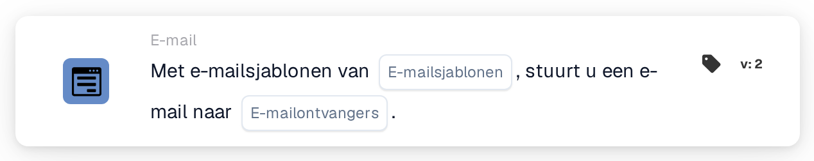

# E-mail verzenden

<figure><figcaption>
Versie 2
</figcaption></figure>

## Doel:

Deze workflowkaart verstuurt een e-mail op basis van een of meer e-mailsjablonen. De ontvangers worden niet als vaste adressen ingevoerd, maar gekozen op basis van hun rol in de workflow, bijvoorbeeld de gebruiker of groep aan wie het document is toegewezen, of de gebruikers en groepen die door een beslissingstabel worden geretourneerd. Zo blijft de workflow geldig wanneer de mensen achter deze rollen wisselen.

Om in plaats daarvan een e-mail naar geselecteerde gebruikersgroepen te versturen, kan de kaart **Send Email to Groups** worden gebruikt, zie [Send Email to Groups](send-email-groups-guide.md).

## Onderdelen van de kaart:

1. **E-mailsjablonen**
   * **Beschrijving:** De e-mailsjablonen die voor de e-mail worden gebruikt.
   * **Detail:** Er kunnen een of meer e-mailsjablonen van de organisatie worden geselecteerd. Elk geselecteerd sjabloon wordt naar elke ontvanger verzonden. Wanneer de workflow voor een document wordt uitgevoerd, wordt een sjabloon dat voor een bepaald documenttype is ingericht alleen verzonden als het document dat documenttype heeft.
2. **E-mailontvangers**
   * **Beschrijving:** Wie de e-mail ontvangt.
   * **Opties:** Een of meer van de volgende opties kunnen worden geselecteerd:
     * **Toegewezen gebruiker/groep van document:** De gebruiker of groep aan wie het document op dat moment is toegewezen.
     * **Gebruiker/groep van beslissingstabel geretourneerd:** De gebruikers en groepen die zijn geretourneerd door een beslissingstabel die eerder in dezelfde workflow is geëvalueerd, bijvoorbeeld met de kaart **Decision Table has Returns**.
     * **Gebruiker toegewezen aan leverancier:** De toegewezen gebruiker van de leverancier, in workflows die worden gestart door een wijziging van de status van een leverancier.
     * **Verwijzer van leverancier:** De verwijzer van de leverancier, in workflows die worden gestart door een wijziging van de status van een leverancier.

## Functionaliteit:

* **Ontvangers verzamelen:** De kaart verzamelt de ontvangers van alle geselecteerde opties. Een ontvanger die uit meer dan één optie voortkomt, ontvangt de e-mail maar één keer.
* **Actie-uitvoering:** De e-mail wordt met de geselecteerde sjablonen verzonden. Wanneer de workflow voor een document wordt uitgevoerd, kunnen de sjablonen de veldwaarden van het document gebruiken. Het resultaat wordt samen met de namen van de ontvangers in het workflowlogboek vastgelegd.
* **Zonder document:** De kaart kan ook worden uitgevoerd in workflows die niet voor een document worden gestart, bijvoorbeeld workflows die door een wijziging van de status van een leverancier worden gestart. In zo'n workflow voegt de optie **Toegewezen gebruiker/groep van document** geen ontvanger toe.
* **Ontbrekende gegevens:**
  * Is er op de kaart geen e-mailsjabloon of geen ontvangeroptie geselecteerd, dan wordt de kaart niet uitgevoerd en meldt ze de ontbrekende gegevens in het workflowlogboek.
  * Leidt een geselecteerde optie naar niemand, bijvoorbeeld omdat het document niet is toegewezen of de beslissingstabel niemand heeft geretourneerd, dan voegt die optie geen ontvanger toe.
* **Fouten:** Wijst de e-mailservice het verzoek af of antwoordt deze niet op tijd, dan eindigt de kaart met een fout.

## Opzet en configuratie:

* De e-mailsjablonen horen in de organisatie te zijn ingericht voordat ze op de kaart kunnen worden geselecteerd.
* De kaart kan worden toegevoegd vanuit de categorie **E-mail**. Daarna worden een of meer sjablonen geselecteerd in **E-mailsjablonen** en een of meer opties in **E-mailontvangers**.
* Voor de optie **Gebruiker/groep van beslissingstabel geretourneerd** hoort er eerder in dezelfde workflow een beslissingstabel te worden geëvalueerd.

## Conclusie:

De workflowkaart "Send Email" informeert de betrokkenen bij een document- of leveranciersproces automatisch met behulp van voorbereide sjablonen. Omdat de ontvangers op basis van hun rol worden gekozen, bereikt dezelfde workflow ook na gewijzigde toewijzingen de juiste mensen.
