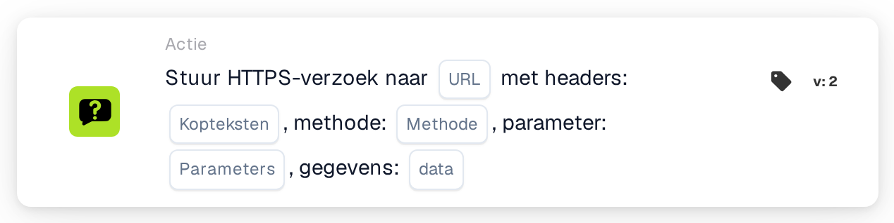

# Stuur een HTTPS-verzoek naar

<figure><figcaption>
Versie 2
</figcaption></figure>

## Doel:

Met de workflow-kaart **"Send HTTPS Request"** kunnen gebruikers HTTPS-verzoeken naar een opgegeven URL verzenden met aanpasbare headers, parameters en gegevens-payload. Deze kaart is ideaal voor het rechtstreeks integreren van externe API's of webdiensten in de workflow.

## Onderdelen van de kaart:

1. **URL**
   * **Beschrijving:** Geeft het eindpunt op waar het HTTPS-verzoek naartoe wordt verzonden.
   * **Details:** Voer de volledige URL in van de API of webdienst waarmee u verbinding wilt maken.
2. **Koppen**
   * **Beschrijving:** Definieert de headers die in het HTTPS-verzoek worden opgenomen.
   * **Details:** Geef sleutel-waardeparen op in een geldig JSON-formaat, bijvoorbeeld voor authenticatietokens of contenttypen. Voorbeeld: {"Authorization": "Bearer example\_value"}
3. **Methode**
   * **Beschrijving:** Geeft de HTTP-methode op die voor het verzoek wordt gebruikt.
   * **Opties:**
     * **GET:** Haalt gegevens op van het eindpunt.
     * **POST:** Verzendt gegevens naar het eindpunt om resources te maken of bij te werken.
     * **PUT:** Werkt bestaande resources op het eindpunt bij.
     * **DELETE:** Verwijdert resources van het eindpunt.
4. **Parameters**
   * **Beschrijving:** Sleutel-waardeparen die als queryparameters in de URL worden opgenomen.
   * **Details:** Gebruik een geldig JSON-formaat om filters of aanvullende gegevens voor het eindpunt op te geven. Zie het voorbeeld bij Headers.
5. **Gegevens**
   * **Beschrijving:** De body van het HTTPS-verzoek.
   * **Details:** Geef de payload op in een geldig JSON-formaat. Zie het voorbeeld bij Headers.

## Functionaliteit:

* **Voorwaarde-evaluatie:** De kaart verzendt het HTTPS-verzoek alleen als de **"Wanneer"**- en **"En"**-secties als true worden geëvalueerd.
  * Als een van beide voorwaarden false is, wordt het verzoek niet verzonden.
* **Verzoekuitvoering:**
  * Wanneer aan de voorwaarden wordt voldaan, verzendt het systeem het HTTPS-verzoek met de opgegeven configuraties.

## Opzet en configuratie:

1. **URL definiëren:** Voer het eindpunt in waar het HTTPS-verzoek naartoe moet worden verzonden.
2. **Headers instellen:** Geef de vereiste headers op als sleutel-waardeparen.
3. **HTTP-methode selecteren:** Kies de juiste methode (**GET**, **POST**, **PUT** of **DELETE**) op basis van de uit te voeren actie.
4. **Parameters toevoegen:** Geef eventuele queryparameters op die het eindpunt vereist.
5. **Gegevens-payload opgeven:** Voer indien nodig de verzoekbody in het vereiste formaat in (bijv. JSON).
6. **Voorwaarden configureren:** Definieer de **"Wanneer"**- en **"En"**-secties om ervoor te zorgen dat het verzoek alleen wordt verzonden wanneer aan specifieke voorwaarden wordt voldaan.

## Conclusie:

De workflow-kaart **"Send HTTPS Request"** vereenvoudigt API-integratie doordat gebruikers aangepaste verzoeken naar externe diensten kunnen doen, rechtstreeks vanuit hun workflows. Door het proces van het verzenden van HTTPS-verzoeken en het beheren van responses te automatiseren, verbetert deze kaart de flexibiliteit en functionaliteit van de workflow.
