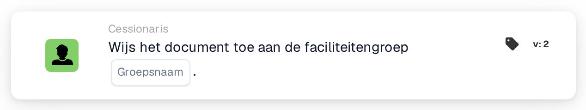

# Document toewijzen aan faciliteitsgroep

<figure><figcaption>
Versie 2
</figcaption></figure>

## Doel:

Deze workflowkaart wijst een document toe aan de groep die verantwoordelijk is voor de faciliteit van de bijbehorende inkooporder. De faciliteit wordt niet op de kaart geselecteerd, maar overgenomen uit de inkooporders waarmee het document is gematcht. De kaart zoekt vervolgens een gebruikersgroep waarvan de naam zowel de op de kaart ingevoerde groepsnaam als de faciliteitscode bevat, en wijst het document aan die groep toe.

Dit is nuttig wanneer hetzelfde soort team per faciliteit één keer bestaat, bijvoorbeeld één goedkeuringsgroep per fabriek of magazijn, en elk document naar het team van de faciliteit hoort te gaan waarvoor het is besteld.

Voor een toewijzing die aan een reeks goedkeurders wordt toegevoegd in plaats van direct te worden uitgevoerd, kan de kaart **Assign Sequentially to Facility Group** worden gebruikt.

## Onderdelen van de kaart:

1. **Groepsnaam**
   * **Beschrijving:** Het deel van de naam dat de faciliteitengroepen gemeenschappelijk hebben.
   * **Detail:** Een tekst die wordt vergeleken met de namen van de gebruikersgroepen van de organisatie. Een groep komt overeen als haar naam deze tekst en de faciliteitscode van de inkooporder bevat. Bij de vergelijking wordt geen onderscheid gemaakt tussen hoofd- en kleine letters. Met de groepsnaam **Approver** en een inkooporder voor faciliteit **1000** zou bijvoorbeeld een groep met de naam **Approver 1000** overeenkomen.

## Functionaliteit:

* **Faciliteit bepalen:** De kaart leest de inkooporders waarmee het document is gematcht en verzamelt van elk daarvan de faciliteitscode (de locatie van de inkooporder).
* **Groep bepalen:** Voor elke faciliteitscode zoekt de kaart gebruikersgroepen waarvan de naam zowel de **Groepsnaam** van de kaart als de faciliteitscode bevat. Faciliteitscodes waarvoor geen groep wordt gevonden, worden in het workflowlogboek vermeld.
* **Actie-uitvoering:** Het document wordt toegewezen aan de overeenkomende groep. Komen meerdere groepen overeen, bijvoorbeeld omdat het document is gematcht met inkooporders van verschillende faciliteiten, dan wordt het document aan slechts één ervan toegewezen; welke dat is, wordt niet door de kaart bepaald.
* **Ontbrekende gegevens:**
  * Is er op de kaart geen groepsnaam ingevoerd, dan wordt de kaart niet uitgevoerd en meldt ze de ontbrekende gegevens in het workflowlogboek.
  * Is het document niet met een inkooporder gematcht, dan meldt de kaart de ontbrekende gegevens in plaats van het document toe te wijzen.
  * Komt geen enkele groep overeen met een van de faciliteitscodes, dan wordt het document niet toegewezen en vermeldt het workflowlogboek dat er geen overeenkomende groep is gevonden.

## Opzet en configuratie:

* De gebruikersgroepen horen zo te worden benoemd dat elke naam het gemeenschappelijke naamdeel en de faciliteitscode bevat, bijvoorbeeld **Approver 1000**, **Approver 2000**.
* De kaart kan worden toegevoegd vanuit de categorie **Cessionaris**. Daarna wordt het gemeenschappelijke naamdeel van de groepen in het veld **Groepsnaam** ingevoerd.
* Omdat de faciliteit uit de gematchte inkooporders komt, wordt de kaart het best gebruikt in workflows voor documenten die al met een inkooporder zijn gematcht.

## Conclusie:

De workflowkaart "Assign Document to Facility Group" stuurt documenten naar het team van de faciliteit waarvoor ze zijn besteld. Eén kaart dekt alle faciliteiten af, zolang de gebruikersgroepen een consistent naamgevingsschema met de faciliteitscode in hun naam volgen.
