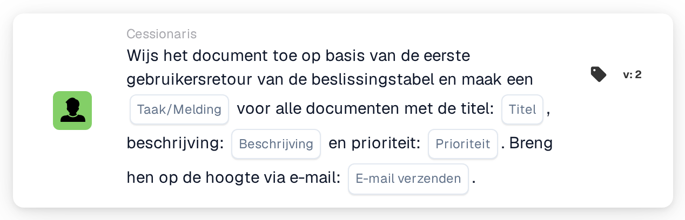

# Document toewijzen aan eerste gebruiker uit beslissingstabel en taken maken

<figure><figcaption>
Versie 2
</figcaption></figure>

## Doel:

Deze workflowkaart gebruikt de door een beslissingstabel geretourneerde gebruikers op twee manieren: het document wordt toegewezen aan de eerste geretourneerde gebruiker, en elke geretourneerde gebruiker, inclusief de eerste, ontvangt een taak of melding over het document. Zo wordt één persoon verantwoordelijk voor het document, terwijl de anderen worden geïnformeerd of eveneens om actie worden gevraagd.

De gebruikers komen uit een beslissingstabel die eerder in dezelfde workflow wordt geëvalueerd, bijvoorbeeld met de kaart **Decision Table has Returns**, ingesteld om de geretourneerde gegevens in volgende kaarten te gebruiken.

## Onderdelen van de kaart:

1. **Taak/Melding**
   * **Beschrijving:** Bepaalt of er voor de geretourneerde gebruikers een taak of een melding wordt aangemaakt.
   * **Opties:**
     * **Taak:** Voor elke gebruiker wordt een taak aangemaakt.
     * **Kennisgeving:** Voor elke gebruiker wordt een melding aangemaakt.
2. **Titel**
   * **Beschrijving:** De titel van de taak of melding.
   * **Detail:** Een korte tekst waaraan de taak of melding te herkennen is.
3. **Beschrijving**
   * **Beschrijving:** Verdere details over de taak of melding.
   * **Detail:** Een tekst die beschrijft wat er gedaan kan worden of waarom de gebruikers worden geïnformeerd.
4. **Prioriteit**
   * **Beschrijving:** De urgentie van de taak of melding.
   * **Opties:**
     * **hoog gewicht:** De taak of melding wordt met hoge prioriteit aangemaakt.
     * **gemiddeld gewicht:** De taak of melding wordt met gemiddelde prioriteit aangemaakt.
     * **laag gewicht:** De taak of melding wordt met lage prioriteit aangemaakt.
5. **E-mail verzenden**
   * **Beschrijving:** Bepaalt of de gebruikers ook per e-mail over de taak of melding worden geïnformeerd.
   * **Opties:**
     * **True:** Er wordt een e-mailmelding verzonden.
     * **False:** Er wordt geen e-mailmelding verzonden.

## Functionaliteit:

* **Beslissingstabel lezen:** De kaart leest de gebruikers die eerder in de workflow door de beslissingstabel zijn geretourneerd. Alleen geretourneerde gebruikers worden meegenomen, geen groepen.
* **Documenttoewijzing:** Het document wordt toegewezen aan de eerste geretourneerde gebruiker.
* **Taken aanmaken:** Voor elke geretourneerde gebruiker wordt een taak of melding aangemaakt met de titel, beschrijving en prioriteit van de kaart. Elke gebruiker ontvangt een eigen taak. De taken worden ook aangemaakt als de toewijzing van het document niet is gelukt; het workflowlogboek toont het resultaat van de toewijzing en van elke taak.
* **Standaardwaarden:** Is er geen prioriteit ingesteld, dan wordt **gemiddeld gewicht** gebruikt. Is **E-mail verzenden** niet ingesteld, dan wordt er geen e-mail verzonden. Is **Taak/Melding** niet ingesteld, dan wordt er een taak aangemaakt en vermeldt het workflowlogboek de ontbrekende instelling.
* **Ontbrekende gegevens:**
  * Heeft de beslissingstabel geen gebruiker geretourneerd, dan wordt er niets toegewezen en meldt de kaart de ontbrekende gegevens in het workflowlogboek.
  * Is de titel of de beschrijving leeg, dan wordt het document niet toegewezen, wordt er geen taak aangemaakt en meldt de kaart de ontbrekende gegevens.

## Opzet en configuratie:

* Een beslissingstabel die gebruikers retourneert, hoort eerder in de workflow te worden geëvalueerd, bijvoorbeeld met de kaart **Decision Table has Returns**. De volgorde van de geretourneerde gebruikers is van belang, omdat de eerste het document ontvangt.
* De kaart kan worden toegevoegd vanuit de categorie **Cessionaris**. Daarna kunnen het type (**Taak** of **Kennisgeving**), de titel, de beschrijving, de prioriteit en de e-mailinstelling worden geconfigureerd.

## Conclusie:

De workflowkaart "Assign Document to First Decision Table User and Create Tasks" combineert een duidelijke verantwoordelijkheid voor het document met informatie voor iedereen die de beslissingstabel noemt. De kaart is nuttig wanneer één persoon eigenaar van het document hoort te zijn, terwijl anderen erbij betrokken of op de hoogte gehouden horen te worden.
