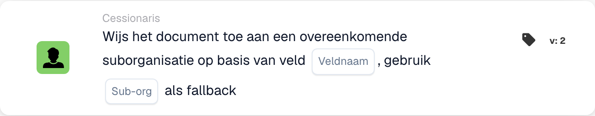

# Wijs het document toe aan de overeenkomende suborganisatie

<figure><figcaption>
Kaartvelden in de getoonde versie. De velden zijn nog niet ingevuld. Sommige labels van deze versie zijn in de interface nog niet of onjuist vertaald. De uitleg op deze pagina gebruikt de juiste termen; de afbeelding toont de werkelijke interface.
</figcaption></figure>

## **Doel:**

De workflow-kaart **"Document toewijzen aan overeenkomende suborganisatie op basis van veld"** wijst een document dynamisch toe aan een suborganisatie, op basis van een opgegeven veld in het document. Als er geen overeenkomende suborganisatie wordt gevonden, gebruikt de kaart een vooraf gedefinieerde terugval-suborganisatie.

## **Onderdelen van de kaart:**

1. **Veldnaam**
   * **Beschrijving:** Geeft het documentveld op dat wordt gebruikt om de overeenkomende suborganisatie te bepalen.
   * **Details:** De kaart zoekt naar een waarde in het opgegeven veld om deze te matchen met een beschikbare suborganisatie.
2. **Suborganisatie (Fallback)**
   * **Beschrijving:** Definieert de terugval-suborganisatie die wordt gebruikt als er geen match in het opgegeven veld wordt gevonden.
   * **Details:** Als de veldwaarde met geen enkele suborganisatie overeenkomt, wordt het document toegewezen aan de geselecteerde terugval-suborganisatie.

## **Functionaliteit:**

* **Voorwaarde-evaluatie:**\
  De kaart voert de actie alleen uit als zowel de **"Wanneer"**- als de **"En"**-secties als true worden geëvalueerd.
* **Dynamische toewijzing:**\
  De kaart controleert de waarde van het opgegeven veld en wijst het document toe aan de suborganisatie die met deze waarde overeenkomt.
* **Terugvalmechanisme:**\
  Als er geen overeenkomende suborganisatie wordt gevonden, wordt het document toegewezen aan de terugval-suborganisatie.

## **Opzet en configuratie:**

* **Field Name selecteren:**\
  Kies het veld uit het document dat de waarde bevat om te matchen met een suborganisatie.
* **Terugval-suborganisatie selecteren:**\
  Kies de suborganisatie die wordt gebruikt als er geen match in het documentveld wordt gevonden.

## **Conclusie:**

De workflow-kaart **"Document toewijzen aan overeenkomende suborganisatie op basis van veld"** biedt flexibiliteit door documenten dynamisch naar de juiste suborganisatie te routeren, met een toegevoegde terugvaloptie om ervoor te zorgen dat geen enkel document niet-toegewezen blijft.

<!-- workflow-card-practical-example-20261021 -->

## Praktisch voorbeeld

**Wanneer gebruiken:** Kies een bedrijfseenheid uit een geëxtraheerd routeringsveld.

**Configuratie:** Stel het routeringsveld `business_unit` in op de geconfigureerde suborganisatienaam `Demo North` en kies `Demo Default` als fallback.

**Verwacht resultaat en tegenvoorbeeld:** Een overeenkomende veldwaarde selecteert `Demo North`. Een onbekende naam gebruikt `Demo Default`; test de fallback voordat u de workflow inschakelt.

Dit is een illustratieve configuratie en een verwacht resultaat. Gebruik velden, gebruikers en groepen die in uw testorganisatie zijn geconfigureerd; het is geen bewering dat dit voorbeeld is uitgevoerd.
