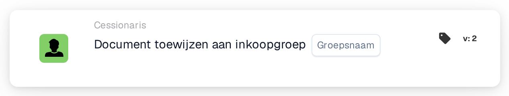

# Document toewijzen aan inkoopgroep

<figure><figcaption>
Versie 2
</figcaption></figure>

## **Doel:**

De workflow-kaart **"Assign to Procurement Group"** wordt gebruikt om een document toe te wijzen aan een opgegeven inkoopgroep binnen het systeem. Dit helpt het documentbeheer te stroomlijnen door ervoor te zorgen dat het juiste team het document afhandelt op basis van de toegewezen inkoopgroep.

## **Onderdelen van de kaart:**

1. **Inkoopgroep**
   * **Beschrijving:** Geeft de inkoopgroep op waaraan het document wordt toegewezen.
   * **Details:** De geselecteerde inkoopgroep is verantwoordelijk voor het verwerken en beheren van het document.

## **Functionaliteit:**

* **Voorwaarde-evaluatie:**\
  De kaart voert de actie alleen uit als zowel de **"Wanneer"**- als de **"En"**-secties als true worden geëvalueerd.
* **Actie-uitvoering:**\
  Als beide voorwaarden true zijn, wordt het document toegewezen aan de opgegeven inkoopgroep. Als een van beide voorwaarden false is, worden er geen acties ondernomen en blijft het document niet-toegewezen.

## **Opzet en configuratie:**

* **Inkoopgroep selecteren:** Kies de inkoopgroep waaraan het document wordt toegewezen uit de dropdownlijst.

## **Conclusie:**

De workflow-kaart **"Assign to Procurement Group"** biedt een eenvoudige maar effectieve manier om ervoor te zorgen dat documenten automatisch aan het juiste inkoopteam worden toegewezen voor verdere verwerking.

<!-- workflow-card-practical-example-20261021 -->

## Praktisch voorbeeld

**Wanneer gebruiken:** Stuur een inkoopuitzondering naar de inkoopgroep.

**Configuratie:** Selecteer de geconfigureerde groep `Demo Procurement`.

**Verwacht resultaat en tegenvoorbeeld:** Het document is toegewezen aan die inkoopgroep. Er mag niet worden aangenomen dat een gelijknamige gewone groep hetzelfde geconfigureerde doel is.

Dit is een illustratieve configuratie en een verwacht resultaat. Gebruik velden, gebruikers en groepen die in uw testorganisatie zijn geconfigureerd; het is geen bewering dat dit voorbeeld is uitgevoerd.
