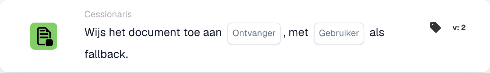

# Document toewijzen aan ontvanger

<figure><figcaption>
Kaartvelden in de getoonde versie. De velden zijn nog niet ingevuld. Sommige labels van deze versie zijn in de interface nog niet of onjuist vertaald. De uitleg op deze pagina gebruikt de juiste termen; de afbeelding toont de werkelijke interface.
</figcaption></figure>

## **Doel:**

De workflow-kaart **"Document toewijzen aan disponent/koper"** wijst een document toe aan een **Disponent** of **Koper**. Als er geen geldige gebruiker wordt gevonden, wordt een terugvalgebruiker geselecteerd om ervoor te zorgen dat het document altijd aan iemand wordt toegewezen.

## **Onderdelen van de kaart:**

1. **Disponent / Koper**
   * **Beschrijving:** Geeft op of het document aan een Disponent of Purchaser wordt toegewezen.
   * **Opties:**
     * **Disponent:** Wijs het document toe aan de Disponent.
     * **Koper:** Wijs het document toe aan de Purchaser.
2. **Fallback-gebruiker**
   * **Beschrijving:** Geeft een terugvalgebruiker op voor het geval het document niet aan de geselecteerde Disponent of Purchaser kan worden toegewezen.
   * **Details:** Met de dropdownlijst van beschikbare gebruikers kunt u een terugvalgebruiker kiezen om ervoor te zorgen dat het document wordt toegewezen, zelfs als de primaire gebruiker niet kan worden bepaald.

## **Functionaliteit:**

* **Voorwaarde-evaluatie:**\
  De kaart voert de actie alleen uit als zowel de **"Wanneer"**- als de **"En"**-secties als true worden geëvalueerd.
* **Documenttoewijzing:**\
  De kaart wijst het document toe aan de **Disponent** of **Koper** zoals geselecteerd. Als de geselecteerde persoon niet beschikbaar of niet geldig is, wordt het document aan de terugvalgebruiker toegewezen.

## **Opzet en configuratie:**

* **Disponent / Koper selecteren:**\
  Kies of het document aan de **Disponent** of **Koper** wordt toegewezen.
* **Terugvalgebruiker selecteren:**\
  Kies een terugvalgebruiker uit de dropdownlijst die het document ontvangt als de primaire toewijzing niet mogelijk is.

## **Conclusie:**

De workflow-kaart **"Document toewijzen aan disponent/koper"** zorgt ervoor dat het document altijd wordt toegewezen, ofwel aan de geselecteerde Disponent/Purchaser, ofwel, indien nodig, aan de terugvalgebruiker. Dit minimaliseert verstoringen in de workflow en zorgt ervoor dat de documentverwerking soepel doorgaat.

<!-- workflow-card-practical-example-20261021 -->

## Praktisch voorbeeld

**Wanneer gebruiken:** Wijs een document toe aan de opgeloste ontvanger, met een veilige terugval.

**Configuratie:** Selecteer de ontvangerbron en reservegebruiker `Demo Reviewer A`.

**Verwacht resultaat en tegenvoorbeeld:** Een oplosbare ontvanger ontvangt de opdracht. Als de ontvanger niet kan worden opgelost, wordt de geconfigureerde fallback gebruikt. Controleer beide paden.

Dit is een illustratieve configuratie en een verwacht resultaat. Gebruik velden, gebruikers en groepen die in uw testorganisatie zijn geconfigureerd; het is geen bewering dat dit voorbeeld is uitgevoerd.
