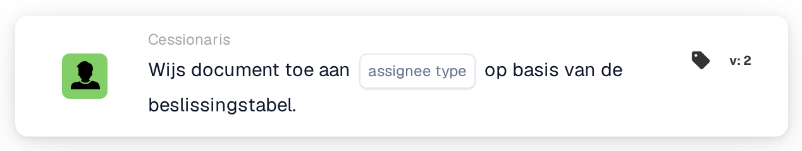

# Document toewijzen aan

<figure><figcaption>
Versie 2
</figcaption></figure>

## Doel:

De workflow-kaart **"Document toewijzen aan \[Gebruiker/groep] op basis van beslissingstabel"** wijst documenten dynamisch toe aan gebruikers of groepen op basis van de uitkomst van een **beslissingstabel**. Deze functie zorgt ervoor dat documenttoewijzing efficiënt en consistent wordt afgehandeld op basis van vooraf gedefinieerde voorwaarden.

## Onderdelen van de kaart:

1. **Gebruiker/Groep**
   * **Beschrijving:** Geeft de **gebruiker** of **groep** op aan wie het document wordt toegewezen.
   * **Details:** Wordt geselecteerd op basis van de uitkomst van de **beslissingstabel**.
2. **Beslissingstabel**
   * **Beschrijving:** Een **beslissingstabel** wordt gebruikt om de juiste **gebruiker** of **groep** voor documenttoewijzing te bepalen.
   * **Details:** Gebruikt de decision table die in de **"en"**-sectie is gedefinieerd.

## Functionaliteit:

* **Voorwaarde-evaluatie:** De kaart voert de actie alleen uit als zowel de **"Wanneer"**- als de **"En"**-secties als true worden geëvalueerd.
* **Dynamische documenttoewijzing:** Het document wordt toegewezen aan de **gebruiker** of **groep** die door de **beslissingstabel** wordt bepaald.

## Opzet en configuratie:

* **Decision Table definiëren:** Stel de **beslissingstabel** in zodat deze de voorwaarden bevat voor het bepalen van de doel-**gebruiker** of -**groep**.
* **Document toewijzen aan gebruiker/groep:** Het document wordt dynamisch toegewezen op basis van de uitkomst van de decision table.

## Conclusie:

De workflow-kaart **"Document toewijzen aan \[Gebruiker/groep] op basis van beslissingstabel"** biedt dynamische documenttoewijzingsmogelijkheden op basis van beslislogica. Dit zorgt voor nauwkeurige en efficiënte verwerking door documenten automatisch naar de juiste **gebruiker** of **groep** te leiden, wat de workflow-automatisering verbetert.

<!-- workflow-card-practical-example-20261021 -->

## Praktisch voorbeeld

**Wanneer gebruiken:** Kies een documentontvanger uit een beslissingstabel.

**Configuratie:** Selecteer een demobeslissingstabel waarvan de overeenkomende regel de geconfigureerde revisor retourneert, en kies het type toegewezen persoon dat door deze kaartversie wordt aangeboden.

**Verwacht resultaat en tegenvoorbeeld:** De geretourneerde gebruiker of groep wordt de documentontvanger. Een leeg beslissingstabelresultaat moet afzonderlijk worden gediagnosticeerd.

Dit is een illustratieve configuratie en een verwacht resultaat. Gebruik velden, gebruikers en groepen die in uw testorganisatie zijn geconfigureerd; het is geen bewering dat dit voorbeeld is uitgevoerd.
