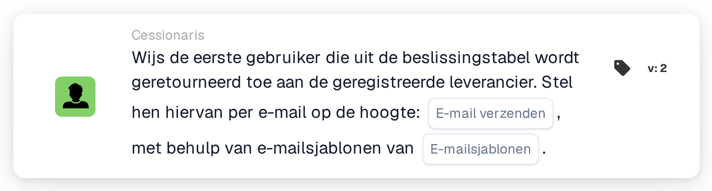

# Eerste gebruiker uit beslissingstabel toewijzen aan leverancier

<figure><figcaption>
Versie 2
</figcaption></figure>

## Doel:

Deze workflowkaart stelt de toegewezen gebruiker van een geregistreerde leverancier in op basis van een beslissingstabel. De eerste door de beslissingstabel geretourneerde gebruiker wordt de toegewezen gebruiker van de leverancier, de interne contactpersoon die verantwoordelijk is voor de leverancier. De geretourneerde gebruikers kunnen ook per e-mail worden geïnformeerd.

Net als **Assign User to Supplier** werkt de kaart niet op een document: ze is bedoeld voor workflows die worden gestart door een wijziging van de status van een leverancier, bijvoorbeeld met de When-kaart **Supplier status changed**. De gebruiker wordt bepaald door een beslissingstabel die eerder in dezelfde workflow wordt geëvalueerd, bijvoorbeeld met de kaart **Decision Table has Returns**, in plaats van op de kaart te worden geselecteerd.

## Onderdelen van de kaart:

1. **E-mail verzenden**
   * **Beschrijving:** De e-mailinstelling van de kaart.
   * **Opties:** **True** of **False**.
   * **Detail:** Met **True** worden de e-mails met de geselecteerde e-mailsjablonen verzonden. Met **False** wordt er geen e-mail verzonden. Is **E-mail verzenden** niet ingesteld, dan wordt er evenmin een e-mail verzonden.
2. **E-mailsjablonen**
   * **Beschrijving:** De e-mailsjablonen die voor de e-mail worden gebruikt.
   * **Detail:** Er kunnen een of meer e-mailsjablonen van de organisatie worden geselecteerd. De sjablonen worden gebruikt wanneer **E-mail verzenden** op **True** staat.

## Functionaliteit:

* **Beslissingstabel lezen:** De kaart leest de gebruikers die eerder in de workflow door de beslissingstabel zijn geretourneerd. Alleen geretourneerde gebruikers worden meegenomen, geen groepen.
* **E-mailmelding:** Worden er e-mails verzonden, dan gaan die naar alle door de beslissingstabel geretourneerde gebruikers, niet alleen naar de eerste. De e-mails worden verzonden voordat de gebruiker aan de leverancier wordt toegewezen.
* **Actie-uitvoering:** De eerste geretourneerde gebruiker wordt opgeslagen als toegewezen gebruiker van de leverancier waarvan de status is gewijzigd. Heeft de leverancier al een toegewezen gebruiker, dan wordt die vervangen. Het resultaat wordt in het workflowlogboek vastgelegd.
* **Ontbrekende gegevens:**
  * Heeft de beslissingstabel geen gebruiker geretourneerd, dan wordt er niets toegewezen en meldt de kaart de ontbrekende gegevens in het workflowlogboek.
  * Staat **E-mail verzenden** op **True**, maar is er geen e-mailsjabloon geselecteerd, dan stopt de kaart zonder de gebruiker toe te wijzen en meldt ze de ontbrekende gegevens.
  * Is **E-mail verzenden** niet ingesteld, dan vermeldt het workflowlogboek de ontbrekende instelling en wordt de gebruiker zonder e-mail toegewezen.
* **Fouten:** Wijst de e-mail- of leveranciersservice het verzoek af of antwoordt deze niet op tijd, dan eindigt de kaart met een fout. Mislukt het verzenden van de e-mails, dan wordt de gebruiker niet aan de leverancier toegewezen.

## Opzet en configuratie:

* De kaart kan worden gebruikt in een workflow die wordt gestart door een wijziging van de status van een leverancier. Een beslissingstabel die gebruikers retourneert, hoort eerder in dezelfde workflow te worden geëvalueerd.
* De kaart kan worden toegevoegd vanuit de categorie **Cessionaris**. Daarna kan **E-mail verzenden** worden ingesteld en kunnen een of meer e-mailsjablonen worden geselecteerd.

## Conclusie:

De workflowkaart "Assign First Decision Table User to Supplier" wijst een leverancier een verantwoordelijke contactpersoon toe volgens regels die in een beslissingstabel worden bijgehouden. Met de optionele e-mail zijn de geretourneerde gebruikers direct op de hoogte van de leverancier.
