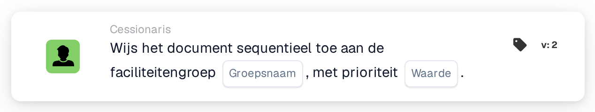

# Opeenvolgend toewijzen aan faciliteitsgroep

<figure><figcaption>
Versie 2
</figcaption></figure>

## Doel:

Deze workflowkaart voegt de groep die verantwoordelijk is voor de faciliteit van de inkooporder van het document toe aan de sequentiële toewijzing van het document. Net als **Assign Document to Facility Group** vindt de kaart de groep via de faciliteitscode van de gematchte inkooporders. In plaats van het document direct toe te wijzen, voegt ze de groep met een prioriteit toe aan de volgorde van goedkeurders, zodat meerdere sequentiële kaarten in een workflow een keten van toewijzingen kunnen opbouwen.

## Onderdelen van de kaart:

1. **Groepsnaam**
   * **Beschrijving:** Het deel van de naam dat de faciliteitengroepen gemeenschappelijk hebben.
   * **Detail:** Een tekst die wordt vergeleken met de namen van de gebruikersgroepen van de organisatie. Een groep komt overeen als haar naam deze tekst en de faciliteitscode van de inkooporder bevat. Bij de vergelijking wordt geen onderscheid gemaakt tussen hoofd- en kleine letters. Met de groepsnaam **Approver** en een inkooporder voor faciliteit **1000** zou bijvoorbeeld een groep met de naam **Approver 1000** overeenkomen.
2. **Waarde**
   * **Beschrijving:** De prioriteit van de groep binnen de sequentiële toewijzing.
   * **Detail:** Een geheel getal. Lagere getallen komen eerst, waarbij 0 de hoogste prioriteit is. Wordt er geen waarde of een negatieve waarde ingevoerd, dan wordt prioriteit 1 gebruikt.

## Functionaliteit:

* **Faciliteit bepalen:** De kaart leest de inkooporders waarmee het document is gematcht en verzamelt van elk daarvan de faciliteitscode (de locatie van de inkooporder).
* **Groep bepalen:** Voor elke faciliteitscode zoekt de kaart gebruikersgroepen waarvan de naam zowel de **Groepsnaam** van de kaart als de faciliteitscode bevat. Faciliteitscodes waarvoor geen groep wordt gevonden, worden in het workflowlogboek vermeld.
* **Actie-uitvoering:** Elke overeenkomende groep wordt met de prioriteit uit het veld **Waarde** aan de sequentiële toewijzing toegevoegd. De toewijzing zelf vindt plaats aan het einde van de workflowuitvoering: het item met het laagste prioriteitsnummer wordt als eerste toegewezen, en alle items, inclusief het eerste, worden als goedkeuringsverzoeken bij het document opgeslagen. De volgende stappen van de reeks worden daaruit in oplopende volgorde van prioriteit genomen. Heeft een andere kaart het document in dezelfde uitvoering al direct toegewezen, dan wordt deze eerste sequentiële toewijzing overgeslagen.
* **Ontbrekende gegevens:**
  * Is er op de kaart geen groepsnaam ingevoerd, dan wordt de kaart niet uitgevoerd en meldt ze de ontbrekende gegevens in het workflowlogboek.
  * Is het document niet met een inkooporder gematcht, dan meldt de kaart de ontbrekende gegevens in plaats van een groep toe te voegen.
  * Komt geen enkele groep overeen met een van de faciliteitscodes, dan wordt er geen groep toegevoegd en vermeldt het workflowlogboek dat er geen overeenkomende groep is gevonden.

## Opzet en configuratie:

* De gebruikersgroepen horen zo te worden benoemd dat elke naam het gemeenschappelijke naamdeel en de faciliteitscode bevat, bijvoorbeeld **Approver 1000**, **Approver 2000**.
* De kaart kan worden toegevoegd vanuit de categorie **Cessionaris**. Daarna wordt het gemeenschappelijke naamdeel van de groepen in het veld **Groepsnaam** ingevoerd en de prioriteit in het veld **Waarde**.
* Om een keten van goedkeurders op te bouwen, kunnen meerdere sequentiële kaarten in de workflow worden gecombineerd, elk met een eigen prioriteit, bijvoorbeeld de faciliteitengroep met prioriteit 1 en een centrale groep met prioriteit 2.

## Conclusie:

De workflowkaart "Assign Sequentially to Facility Group" plaatst het verantwoordelijke faciliteitsteam op een vastgelegde positie in een sequentiële goedkeuring. Samen met andere sequentiële kaarten maakt ze goedkeuringsketens mogelijk waarin het faciliteitsteam een van meerdere stappen is.
