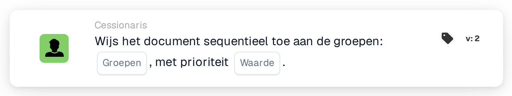

# Wijs opeenvolgend toe aan groepen

<figure><figcaption>
Versie 2
</figcaption></figure>

## **Doel**

Met de workflow-kaart "**Wijs het document opeenvolgend toe aan de groepen**" kunnen documenten sequentieel worden toegewezen aan een of meer geselecteerde groepen. De prioriteitswaarde bepaalt de toewijzingsvolgorde, waarbij lagere getallen een hogere prioriteit vertegenwoordigen.

## **Onderdelen van de kaart**

1. **Groep**
   * **Beschrijving**: Geeft de groepen op die de documenttoewijzing ontvangen.
   * **Details**: Een dropdownmenu waarin een of meerdere groepen voor documenttoewijzing kunnen worden geselecteerd.
2. **Prioriteit (waarde)**
   * **Beschrijving**: Een numeriek invoerveld waarin het prioriteitsniveau voor de groepen kan worden ingesteld.
   * **Details**: Lagere getallen duiden op een hogere prioriteit, zodat documenten in oplopende volgorde van prioriteit aan groepen worden toegewezen.

## **Functionaliteit**

* **Documenttoewijzing**:\
  De kaart wijst documenten sequentieel toe aan de geselecteerde groepen op basis van hun prioriteitswaarden.\
  Als meerdere groepen dezelfde prioriteit delen, worden documenten toegewezen in de volgorde waarin de groepen zijn geselecteerd.

## **Opzet en configuratie**

1. Voeg de kaart **Wijs het document opeenvolgend toe** toe aan uw workflow.
2. Configureer het veld **Groep**:
   * Selecteer een of meerdere groepen uit het dropdownmenu.
3. Configureer het veld **Prioriteit (waarde)**:
   * Voer een numerieke waarde in om de toewijzingsprioriteit in te stellen.
4. Sla op en activeer de workflow om de configuratie toe te passen.

## **Conclusie**

De workflow-kaart "Assign the Document Sequentially to Groups" zorgt voor een efficiënte documenttoewijzing aan een of meer groepen op basis van prioriteit. Deze functie ondersteunt flexibele en georganiseerde documentverwerking over meerdere teams of afdelingen heen.

<!-- workflow-card-practical-example-20261021 -->

## Praktisch voorbeeld

**Wanneer gebruiken:** Geef prioriteit aan documenttoewijzing aan beoordelingsteams.

**Configuratie:** Selecteer de geconfigureerde demogroepen en stel de gewenste prioriteit in, bijvoorbeeld `10`.

**Verwacht resultaat en tegenvoorbeeld:** Het document ontvangt de geselecteerde groepstoewijzingen met die prioriteit. Test een tweede prioriteit afzonderlijk wanneer de groepen verschillende fasen moeten bezetten.

Dit is een illustratieve configuratie en een verwacht resultaat. Gebruik velden, gebruikers en groepen die in uw testorganisatie zijn geconfigureerd; het is geen bewering dat dit voorbeeld is uitgevoerd.
