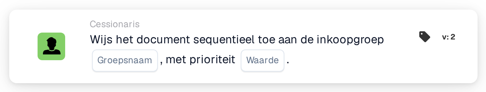

# Opeenvolgend toewijzen aan inkoopgroep

<figure><figcaption>
Versie 2
</figcaption></figure>

## **Doel**

Met de workflow-kaart "**Wijs het document opeenvolgend toe aan de inkoopgroep**" kunnen documenten sequentieel worden toegewezen aan een opgegeven inkoopgroep. De prioriteitswaarde bepaalt de toewijzingsvolgorde, waarbij lagere getallen een hogere prioriteit vertegenwoordigen.

## **Onderdelen van de kaart**

1. **Groep**
   * **Beschrijving**: Een tekstinvoerveld waarin de naam van de inkoopgroep kan worden ingevoerd.
   * **Details**: Geeft de inkoopgroep op waaraan het document wordt toegewezen.
2. **Prioriteit (waarde)**
   * **Beschrijving**: Een numeriek invoerveld waarin het prioriteitsniveau voor de groep kan worden ingesteld.
   * **Details**: Lagere getallen duiden op een hogere prioriteit, zodat documenten in oplopende volgorde van prioriteit aan groepen worden toegewezen.

## **Functionaliteit**

* **Documenttoewijzing**:\
  De kaart wijst documenten op sequentiële wijze toe aan de opgegeven inkoopgroep.\
  Prioriteitswaarden bepalen de toewijzingsvolgorde, waarbij lagere getallen het eerst worden verwerkt.

## **Opzet en configuratie**

1. Voeg de kaart **Wijs het document opeenvolgend toe** toe aan uw workflow.
2. Configureer het veld **Groep**:
   * Voer de naam van de inkoopgroep in het tekstveld in.
3. Configureer het veld **Prioriteit (waarde)**:
   * Voer een numerieke waarde in om de toewijzingsprioriteit in te stellen.
4. Sla op en activeer de workflow om de configuratie toe te passen.

## **Conclusie**

De workflow-kaart "Assign the Document Sequentially to the Procurement Group" zorgt voor een effectieve documenttoewijzing aan inkoopgroepen op basis van prioriteit. Dit verbetert de organisatorische efficiëntie en het taakbeheer.

<!-- workflow-card-practical-example-20261021 -->

## Praktisch voorbeeld

**Wanneer gebruiken:** Geef prioriteit aan een inkoopgroep binnen de documentbeoordeling.

**Configuratie:** Selecteer `Demo Procurement` en prioriteit `10`.

**Verwacht resultaat en tegenvoorbeeld:** Het document krijgt de toewijzing van de inkoopgroep met prioriteit `10`. Controleer of latere toewijzingen de beoogde hogere numerieke prioriteiten gebruiken.

Dit is een illustratieve configuratie en een verwacht resultaat. Gebruik velden, gebruikers en groepen die in uw testorganisatie zijn geconfigureerd; het is geen bewering dat dit voorbeeld is uitgevoerd.
