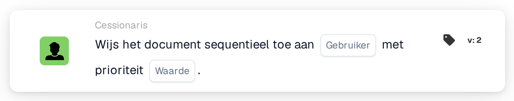

# Opeenvolgend toewijzen aan gebruiker

<figure><figcaption>
Versie 2
</figcaption></figure>

## **Doel**

De workflow-kaart "**Opeenvolgend toewijzen aan gebruiker**" automatiseert de toewijzing van documenten aan een geselecteerde gebruiker op sequentiële wijze. De prioriteitswaarde bepaalt de toewijzingsvolgorde, waarbij lagere getallen een hogere prioriteit vertegenwoordigen.

## **Onderdelen van de kaart**

1. **Gebruiker**
   * **Beschrijving**: De geselecteerde gebruiker krijgt het document toegewezen op basis van de workflow-volgorde.
   * **Details**: Een dropdownmenu dat alle beschikbare gebruikers voor toewijzing vermeldt.
2. **Prioriteit (waarde)**
   * **Beschrijving**: Een numeriek invoerveld waarin het prioriteitsniveau voor de gebruiker kan worden ingesteld.
   * **Details**: Lagere getallen duiden op een hogere prioriteit. Documenten worden in oplopende volgorde van prioriteit aan gebruikers toegewezen.

## **Functionaliteit**

* **Documenttoewijzing**:\
  De kaart wijst documenten sequentieel toe aan de geselecteerde gebruiker, rekening houdend met het prioriteitsniveau.\
  Als meerdere gebruikers dezelfde prioriteit hebben, worden de documenten toegewezen in de volgorde waarin de gebruikers in het dropdownmenu verschijnen.

## **Opzet en configuratie**

1. Voeg de kaart **Wijs het document opeenvolgend toe** toe aan uw workflow.
2. Configureer het veld **Gebruiker**:
   * Selecteer een gebruiker uit het dropdownmenu.
3. Configureer het veld **Prioriteit (waarde)**:
   * Voer een numerieke waarde in om de toewijzingsprioriteit in te stellen.
4. Sla op en activeer de workflow om de configuratie toe te passen.

## **Conclusie**

De workflow-kaart "Assign the Document Sequentially to User" zorgt voor een georganiseerde documentdistributie door documenten in een geprioriteerde volgorde toe te wijzen. Dit verbetert het taakbeheer en vermindert vertragingen in de verwerking.

<!-- workflow-card-practical-example-20261021 -->

## Praktisch voorbeeld

**Wanneer gebruiken:** Voeg een gebruiker toe aan een documentgoedkeuringsreeks met prioriteit.

**Configuratie:** Selecteer `Demo Reviewer A` en prioriteit `10`. Voeg een aparte opdracht toe met prioriteit `20` wanneer een latere reviewer nodig is.

**Verwacht resultaat en tegenvoorbeeld:** De toewijzingen hebben de geconfigureerde prioriteiten; de lagere numerieke waarde heeft een hogere prioriteit. Controleer de volgorde van de opdrachten, niet alleen de volgorde van de kaarten op het canvas.

Dit is een illustratieve configuratie en een verwacht resultaat. Gebruik velden, gebruikers en groepen die in uw testorganisatie zijn geconfigureerd; het is geen bewering dat dit voorbeeld is uitgevoerd.
