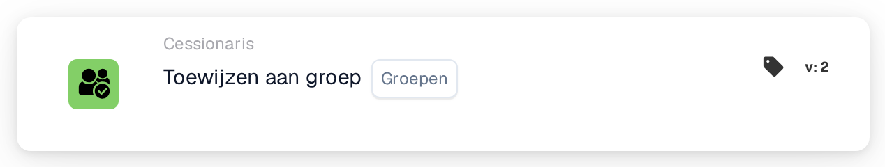
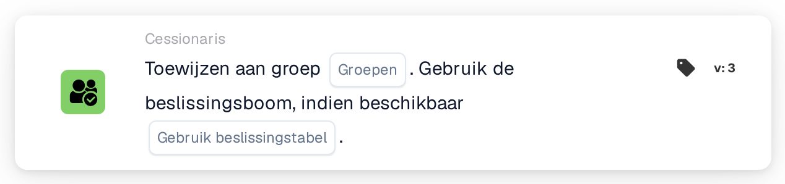

# Toewijzen aan groep

<figure><figcaption>
Versie 2
</figcaption></figure>

<figure><figcaption>
Versie 3
</figcaption></figure>

## Doel:

De workflow-kaart **"Assign to Group"** faciliteert de toewijzing van documenten aan een specifieke **groep** binnen het systeem. Dit zorgt ervoor dat het document door het juiste team wordt verwerkt, wat de workflow stroomlijnt. In latere versies uitgebreid, introduceert hij beslisboomfunctionaliteit voor dynamische groepstoewijzing.

## Onderdelen van de kaart:

1. **Groepen**
   * **Beschrijving:** Geeft de **groep** op waaraan het document wordt toegewezen.
   * **Details:** Geselecteerd uit een dropdownlijst van beschikbare **groepen**.

## **Aanvullende onderdelen in Version 3**

1. **Beslissingsboom (alleen versie 3)**
   * **Beschrijving:** Maakt het gebruik van een beslisboom mogelijk om de **groep** waaraan het document moet worden toegewezen dynamisch te bepalen.
   * **Opties:**
     * **True:** Schakelt verwerking via de beslisboom in.
     * **False:** Schakelt verwerking via de beslisboom uit.

## Functionaliteit:

* **Voorwaarde-evaluatie:** De kaart voert de actie alleen uit als zowel de **"Wanneer"**- als de **"En"**-secties als true worden geëvalueerd.
* **Documenttoewijzing:** Wijst het document toe aan de geselecteerde **groep**. In **Versie 3** bepaalt de **beslisboom** de doelgroep dynamisch indien ingeschakeld.

## Opzet en configuratie:

* **Groep selecteren:** Kies de **groep** uit de dropdownlijst om het document toe te wijzen.
* **Beslisboom gebruiken (alleen Version 3):** Schakel deze optie in als de **beslisboom** voor dynamische toewijzing moet worden gebruikt.

## Conclusie:

De workflow-kaart **"Assign to Group"** automatiseert documenttoewijzing aan vooraf gedefinieerde **groepen**, wat de teamcoördinatie verbetert. **Versie 3** introduceert de mogelijkheid om groepen dynamisch toe te wijzen op basis van beslisboomlogica.

<!-- workflow-card-practical-example-20261021 -->

## Praktisch voorbeeld

**Wanneer gebruiken:** Plaats een document in een gedeelde revisiewachtrij.

**Configuratie:** Selecteer geconfigureerde groep `Demo Finance`.

**Verwacht resultaat en tegenvoorbeeld:** Het document wordt toegewezen aan de geselecteerde groep. Dit is een documenttoewijzing en geen belofte dat er een extra taak of e-mail wordt aangemaakt.

Dit is een illustratieve configuratie en een verwacht resultaat. Gebruik velden, gebruikers en groepen die in uw testorganisatie zijn geconfigureerd; het is geen bewering dat dit voorbeeld is uitgevoerd.
