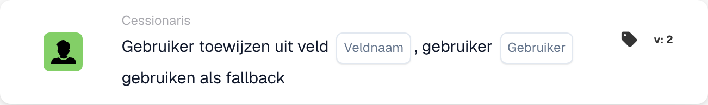

# Gebruiker uit veld toewijzen

<figure><figcaption>
Kaartvelden in de getoonde versie. De velden zijn nog niet ingevuld. Sommige labels van deze versie zijn in de interface nog niet of onjuist vertaald. De uitleg op deze pagina gebruikt de juiste termen; de afbeelding toont de werkelijke interface.
</figcaption></figure>

## **Doel:**

De workflow-kaart **"Gebruiker uit veld toewijzen met terugval"** wijst dynamisch een gebruiker toe op basis van de waarde die in een opgegeven documentveld wordt gevonden. Als het veld geen geldige gebruiker bevat, wordt een terugvalgebruiker geselecteerd uit een vooraf gedefinieerde lijst van beschikbare gebruikers om ervoor te zorgen dat de taak of actie op de juiste manier wordt toegewezen.

## **Onderdelen van de kaart:**

1. **Veldnaam**
   * **Beschrijving:** Geeft het **documentveld** op dat de toe te wijzen gebruikersinformatie bevat.
   * **Details:** Dit veld wordt geëvalueerd om te bepalen welke gebruiker moet worden toegewezen. Als het veld een geldige gebruiker bevat, krijgt die gebruiker de taak toegewezen. Als het veld leeg of ongeldig is, wordt de terugvalgebruiker toegewezen.
2. **Gebruiker (terugval)**
   * **Beschrijving:** Geeft de **terugvalgebruiker** op die wordt toegewezen als het documentveld geen geldige gebruiker bevat.
   * **Details:** Er wordt een dropdownlijst van alle beschikbare gebruikers geboden om uit te selecteren. Deze gebruiker wordt toegewezen als het documentveld leeg is of geen geldige gebruiker bevat.

## **Functionaliteit:**

* **Voorwaarde-evaluatie:**\
  De kaart voert de actie alleen uit als zowel de **"Wanneer"**- als de **"En"**-secties als true worden geëvalueerd.
* **Veldgebaseerde gebruikerstoewijzing:**\
  De kaart probeert eerst de taak of actie toe te wijzen aan de gebruiker die in het **Veldnaam** is geïdentificeerd.
* **Terugvalgebruikertoewijzing:**\
  Als het veld geen geldige gebruiker bevat (of leeg is), wijst de kaart de taak toe aan de terugvalgebruiker die in de **Gebruiker (terugval)**-dropdownlijst is geselecteerd.

## **Opzet en configuratie:**

* **Field Name selecteren:**\
  Kies het **documentveld** dat de gebruiker voor toewijzing opgeeft.
* **Terugvalgebruiker selecteren:**\
  Kies de **terugvalgebruiker** uit de dropdownlijst. Deze gebruiker krijgt de taak toegewezen als het documentveld geen geldige gebruiker bevat.

## **Conclusie:**

De workflow-kaart **"Gebruiker uit veld toewijzen met terugval"** zorgt ervoor dat een taak of actie altijd aan een geldige gebruiker wordt toegewezen. Als de gebruiker in het documentveld niet beschikbaar is, wordt automatisch de terugvalgebruiker toegewezen, wat flexibiliteit biedt en de voltooiing van de taak waarborgt.

<!-- workflow-card-practical-example-20261021 -->

## Praktisch voorbeeld

**Wanneer gebruiken:** Wijs de revisor toe, genoemd op basis van documentgegevens.

**Configuratie:** Selecteer veld `reviewer_name` en reservegebruiker `Demo Reviewer A`. Geef bij de eerste test een oplosbare demo-gebruikersnaam op.

**Verwacht resultaat en tegenvoorbeeld:** Een geldige veldwaarde selecteert die gebruiker. Een lege of onoplosbare waarde gebruikt de geconfigureerde fallback; verifieer beide gevallen.

Dit is een illustratieve configuratie en een verwacht resultaat. Gebruik velden, gebruikers en groepen die in uw testorganisatie zijn geconfigureerd; het is geen bewering dat dit voorbeeld is uitgevoerd.
