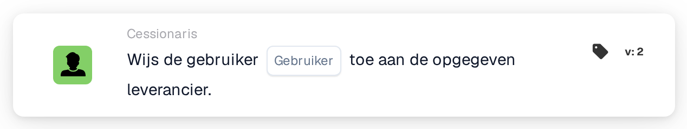

# Gebruiker toewijzen aan leverancier

<figure><figcaption>
Versie 2
</figcaption></figure>

## Doel:

Deze workflowkaart stelt de toegewezen gebruiker van een geregistreerde leverancier in. De toegewezen gebruiker is de interne contactpersoon die verantwoordelijk is voor de leverancier. De kaart werkt niet op een document: ze is bedoeld voor workflows die worden gestart door een wijziging van de status van een leverancier, bijvoorbeeld met de When-kaart **Supplier status changed**. De leverancier waarvan de status is gewijzigd, is de leverancier aan wie de gebruiker wordt toegewezen.

## Onderdelen van de kaart:

1. **Gebruiker**
   * **Beschrijving:** De gebruiker die de toegewezen gebruiker van de leverancier wordt.
   * **Detail:** Er kan één gebruiker van de organisatie worden geselecteerd. Heeft de leverancier al een toegewezen gebruiker, dan wordt die vervangen.

## Functionaliteit:

* **Actie-uitvoering:** De kaart neemt de leverancier uit de workflowuitvoering en slaat de geselecteerde gebruiker op als toegewezen gebruiker van de leverancier. Het resultaat wordt in het workflowlogboek vastgelegd.
* **Gebruik met e-mails:** Zodra een gebruiker is toegewezen, kunnen e-mails aan deze gebruiker worden geadresseerd met de optie **Gebruiker toegewezen aan leverancier**, bijvoorbeeld in de kaart **Send Email**.
* **Ontbrekende gegevens:** Is er op de kaart geen gebruiker geselecteerd, dan wordt de kaart niet uitgevoerd en meldt ze de ontbrekende gegevens in het workflowlogboek.
* **Fouten:** Wijst de leveranciersservice het verzoek af of antwoordt deze niet op tijd, dan eindigt de kaart met een fout.

## Opzet en configuratie:

* De kaart kan worden gebruikt in een workflow die wordt gestart door een wijziging van de status van een leverancier.
* De kaart kan worden toegevoegd vanuit de categorie **Cessionaris**. Daarna wordt in het veld **Gebruiker** de gebruiker geselecteerd die verantwoordelijk wordt voor de leverancier.

## Conclusie:

De workflowkaart "Assign User to Supplier" geeft elke leverancier automatisch een verantwoordelijke contactpersoon wanneer de status ervan verandert, bijvoorbeeld na de registratie. Latere stappen, zoals e-mails aan de toegewezen gebruiker, kunnen op deze toewijzing voortbouwen.
