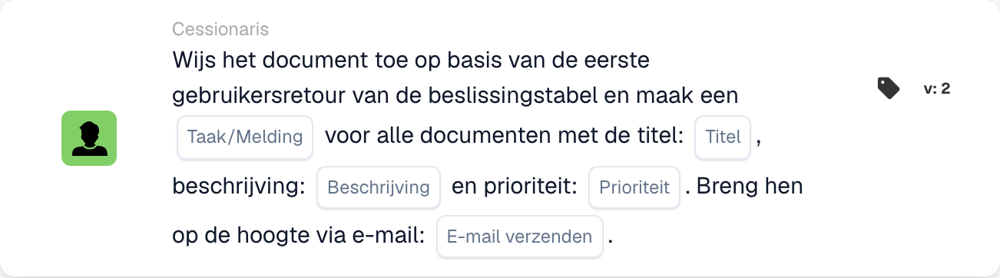
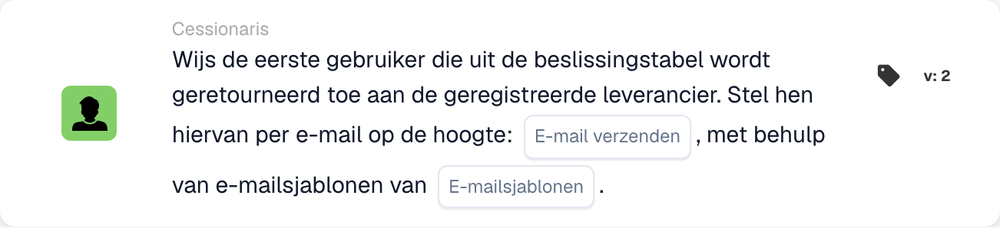

# Documenttoewijzing en gebruikerskaarten

## Documenttoewijzing en gebruikerskaarten - Volledige gids

**Omslagen:** 13 opdracht- en gebruikersgerelateerde kaarten

***

De kaarten op deze pagina komen in de groep **Dan** van de Workflow Builder – de acties die worden uitgevoerd zodra de When/And-voorwaarden overeenkomen:

<figure><figcaption><p>Niet-opgeslagen voorbeeld met Wanneer-, En- en Dan-kaarten. Vul alle velden in vóór uitvoering. Sommige labels van deze versie zijn in de interface nog niet of onjuist vertaald. De uitleg op deze pagina gebruikt de juiste termen; de afbeelding toont de werkelijke interface.</p></figcaption></figure>

***

### 📌 Versie-informatie

**Kaarten met meerdere versies:** DOC\_USER\_ASSIGN (v2 nieuwste, v3 verouderd), DOC\_GROUP\_ASSIGN (v2 nieuwste, v3 verouderd), OC\_ASSIGN\_DOC (v2)

**Belangrijk:** v3-versies hebben ondersteuning voor beslissingsbomen toegevoegd, maar zijn nu verouderd **Aanbeveling:** Gebruik v2 voor zowel DOC\_USER\_ASSIGN als DOC\_GROUP\_ASSIGN

📖 [Volledige versiegeschiedenis](../../release.md) | [Kaartversies en gedrag](../../cards-overview/card-versions-guide.md)

***

## Basisdocumenttoewijzing

### Kaart: DOC\_USER\_ASSIGN / Document toewijzen aan gebruiker

#### Doel

Wijst een document toe aan een specifieke persoon voor diens actie

#### Wanneer te gebruiken

* Het document heeft de beoordeling van een specifieke persoon nodig
* Overdracht aan een individueel teamlid
* Verantwoording bijhouden
* Wijs werk toe aan de genoemde persoon

#### Hoe het werkt

```
Document is "assigned to" = John Smith
Only John can see it as assigned to him
John is responsible for this document
```

#### Voorbeeld

```
Invoice arrives
    ↓
Assign Document to: John Smith (Finance Manager)
    ↓
Only John sees "Assigned to Me"
John must take action on it
```

#### Parameters

```
User: [Select which person]
```

#### Let op

Toewijzen betekent:

* Het document wordt voor die persoon weergegeven als 'toegewezen aan mij'
* Die persoon is verantwoordelijk
* Anderen kunnen het document nog steeds zien (maar niet zoals aan hen toegewezen)
* Eén opdracht per keer per document

***

### Kaart: DOC\_GROUP\_ASSIGN / Document toewijzen aan groep

#### Doel

Wijst een document toe aan een groep (alle leden zien het als aan hen toegewezen)

#### Wanneer te gebruiken

* Document voor team, niet individueel
* Meerdere mensen kunnen het aan
* Gedeelde verantwoordelijkheid
* Verdeling van de teamwerklast

#### Hoe het werkt

```
Document is "assigned to" = Finance Team (10 people)
All 10 team members see "Assigned to My Group"
Any team member can take action
```

#### Voorbeeld

```
New vendor invoice
    ↓
Assign Document to: Procurement Team
    ↓
All procurement team members see it
First available person handles it
```

#### Parameters

```
Group: [Select which group]
```

#### Verschil

```
Individual Assignment:
- One person responsible
- That person sees "Assigned to Me"
- Others don't see assignment

Group Assignment:
- Team responsible
- All members see "Assigned to My Group"
- Anyone can claim/process
```

***

### Kaart: ACTION\_ASSIGN\_DOC\_BASED\_ON\_DECISION\_TABLE

#### Doel

Wijst een document toe op basis van de logica van de beslissingstabel

#### Wanneer te gebruiken

* Verschillende leveranciers hebben verschillende behandelaars nodig
* Toewijzing op basis van bedrag
* Complexe routeringslogica
* Meerdere voorwaarden voor toewijzing

#### Hoe het werkt

```
Decision Table Logic:
  If Supplier = "ABC Corp" → Assign to: Procurement Team
  If Supplier = "XYZ Inc" → Assign to: Direct Manager
  If Amount > €10000 → Assign to: Finance Director

Document arrives
    ↓
Check: Which condition matches?
    ↓
Assign accordingly
```

#### Voorbeeld: toewijzing op basis van bedragen

```
Invoice: €2000 from ABC Corp

Decision Table checks:
  Is amount > €10000? NO
  Is amount > €5000? NO
  Is amount > €1000? YES

Result: Assign to: Finance Manager
```

#### Voorbeeld: Leveranciersgebaseerde toewijzing

```
Invoice from: Preferred Supplier

Decision Table:
  If preferred supplier → Finance Team
  If new supplier → Procurement Manager
  If blacklisted → Director Review

Result: Assign to: Finance Team
```

#### Parameters

```
Decision Table: [Select decision table]
(Decision table contains assignment logic)
```

***

### Kaart: ACTION\_ASSIGN\_DOC\_DECISION\_TABLE\_SEQUENTIAL

#### Doel

Wijst documenten opeenvolgend toe op basis van een beslissingstabel met prioriteiten

#### Wanneer te gebruiken

* Meerdere opeenvolgende goedkeuringen
* Verschillende mensen op verschillende niveaus
* Goedkeuringsketen op basis van bedrag
* Escalatie pad

#### Hoe het werkt

```
First Decision: Who approves first?
    ↓
Assign to: Person 1
    ↓
Person 1 approves
    ↓
Second Decision: Who approves next?
    ↓
Assign to: Person 2
    ↓
Person 2 approves (final)
    ↓
Document Complete
```

#### Prioriteitssysteem

```
Priority 1: First assignment
Priority 2: Second assignment
Priority 3: Third assignment
(etc.)

Each must complete before next begins
```

#### Voorbeeld: goedkeuring op meerdere niveaus

```
Invoice: €50,000

Decision Table:
  €1k-€5k → Assign to: Finance Manager (Priority 1)
  €5k-€20k → Then: Assign to: Finance Director (Priority 2)
  €20k+ → Then: Assign to: CFO (Priority 3)

Invoice Flow:
1. Finance Manager reviews → approves
2. Finance Director reviews → approves
3. CFO reviews → approves final

Each step depends on previous completion
```

#### Parameters

```
Decision Table: [Select]
Priority Order: [Determined by decision table]
```

***

### Kaart: ACTION\_ASSIGN\_DOC\_TO\_USER\_SEQUENTIAL

#### Doel

Wijst een document toe aan een gebruiker met opeenvolgende prioriteit

#### Wanneer te gebruiken

* Document heeft een specifieke persoon nodig
* Duidelijke sequentiële verwerking
* Enkele opdracht met bestelling

#### Hoe het werkt

```
Assign Document to: User A (Priority 1)
    ↓
User A processes
    ↓
Then: Assign to User B (Priority 2)
    ↓
User B processes
```

#### Voorbeeld

```
Invoice processing:
1. Assign to: Accounts Payable Clerk
2. Then: Assign to: Finance Manager
3. Then: Assign to: Director

Each person has their turn
```

***

### Kaart: ACTION\_ASSIGN\_DOC\_TO\_GROUP\_SEQUENTIAL

#### Doel

Wijst documenten opeenvolgend toe aan groepen

#### Wanneer te gebruiken

* Meerdere groepsgoedkeuringen
* Verschillende afdelingen in elke fase
* Teamgebaseerde sequentiële verwerking

#### Hoe het werkt

```
Step 1: Assign to Group A (Quality Team)
        Quality verifies
    ↓
Step 2: Assign to Group B (Finance Team)
        Finance reviews
    ↓
Step 3: Assign to Group C (Procurement)
        Procurement approves
```

#### Voorbeeld

```
New Supplier Onboarding:

Step 1: Quality Team
  - Evaluate supplier capability
  - Check certifications

Step 2: Finance Team
  - Check payment terms
  - Verify pricing

Step 3: Procurement Team
  - Approve supplier
  - Set up in system

Document passes through all three
```

***

### Kaart: ACTION\_ASSIGN\_DOC\_TO\_FACILITY\_GROUP

<!-- workflow-facility-example-direct-20261022 -->

Deze workflowactie wijst een document toe aan een groep op basis van de locaties van de gekoppelde inkooporders. In versie 2 is `group_name` een tekstfragment dat in groepsnamen wordt gezocht.

Voorbeeld: een synthetisch document is gekoppeld aan inkooporder `DEMO-PO-100`, met `location_id=BERLIN`. De ingestelde groepen heten `Receiving BERLIN` en `Receiving MUNICH`. Vul `Receiving` in bij `group_name`. De groepsnaam moet zowel dit tekstfragment als de locatie van de inkooporder bevatten; de vergelijking is niet hoofdlettergevoelig.

Verwacht resultaat: het document wordt rechtstreeks toegewezen aan `Receiving BERLIN`, als de documentstatus dit toestaat. Zonder gekoppelde inkooporder of passende groep is de toewijzing niet geslaagd; controleer de workflowlogboeken. Vermijd dubbelzinnige groepsnamen: bij meerdere overeenkomsten garandeert deze kaart geen vaste selectievolgorde.

Dit is een voorbeeldconfiguratie; er is geen workflow uitgevoerd.

***

### Kaart: ACTION\_ASSIGN\_DOC\_TO\_FACILITY\_GROUP\_SEQUENTIAL

<!-- workflow-facility-example-sequential-20261022 -->

Deze workflowactie voegt de passende locatiegroepen met een ingestelde prioriteit toe aan de wachtrij voor opeenvolgende toewijzingen. Zij beschrijft geen goederenverplaatsing tussen fabrieken of magazijnen.

Voorbeeld: gebruik dezelfde synthetische inkooporder, locatie en groepen als hierboven. Stel `group_name=Receiving` en prioriteit `value=10` in. Versie 2 leest de locatie uit de gekoppelde inkooporder en vindt `Receiving BERLIN`.

Verwacht resultaat: een toewijzingsverzoek voor die groep wordt met prioriteit `10` aan de wachtrij toegevoegd. Als meerdere groepen overeenkomen, krijgen ze dezelfde prioriteit; hun namen bepalen geen verwerkingsvolgorde. Controleer de wachtrij en de latere goedkeuring afzonderlijk. Zonder overeenkomst ontstaat geen geslaagde toewijzing.

Dit is een voorbeeldconfiguratie; er is geen workflow uitgevoerd.

***

### Kaart: ACTION\_ASSIGN\_DOC\_TO\_PROCUREMENT\_GROUP

#### Doel

Wijst document toe aan de inkoopafdeling

#### Wanneer te gebruiken

* Afhandeling van het inkoopteam
* Leveranciersgerelateerde werkzaamheden
* Inkooporder gerelateerd

#### Voorbeeld

```
Vendor evaluation document
    ↓
Assign to: Procurement Group
    ↓
Procurement team evaluates vendor
```

***

### Kaart: ACTION\_ASSIGN\_DOC\_TO\_PROCUREMENT\_GROUP\_SEQUENTIAL

#### Doel

Opeenvolgende opdracht binnen inkoop

#### Wanneer te gebruiken

* Aankoopproces in meerdere stappen
* Goedkeuringsketen bij inkoop

#### Voorbeeld

```
Purchase Requisition:

Step 1: Buyer (Creates PO)
Step 2: Approver (Reviews)
Step 3: Director (Final sign-off)

Each step in sequence
```

***

### Kaart: ACTION\_CHANGE\_DOC\_SUBORG / Documentsuborganisatie wijzigen

#### Doel

Wijst een document toe aan een andere suborganisatie

#### Wanneer te gebruiken

* Verkeerde organisatie geselecteerd
* Moet naar de juiste afdeling verhuizen
* Organisatorische herstructurering

#### Hoe het werkt

```
Current Sub-Org: Finance Department
    ↓
Change to: Accounting Department
    ↓
Document now belongs to Accounting
```

#### Voorbeeld

```
Document for: Berlin Office
    ↓
Realize should be: Munich Office
    ↓
Change Sub-Organization to: Munich Office
```

***

### Kaart: ACTION\_CHANGE\_DOC\_SUBORG\_BY\_FIELD\_TEXT

#### Doel

Wijzigt de suborganisatie op basis van de documentveldwaarde

#### Wanneer te gebruiken

* Suborganisatie opgeslagen in veld
* Zorg ervoor dat de documentlocatie overeenkomt met het veld
* Automatische organisatietoewijzing

#### Hoe het werkt

```
Document Field: "Delivery_Location" = "Berlin"
    ↓
Decision Table:
  If location = "Berlin" → Assign to: Berlin Sub-Org
  If location = "Munich" → Assign to: Munich Sub-Org

    ↓
Document assigned to: Berlin Sub-Org
```

#### Voorbeeld

```
Invoice field: "Cost Center: CC-Berlin-001"
    ↓
System recognizes: Berlin location
    ↓
Change document to: Berlin Sub-Organization
```

***

### Kaart: ACTION\_ASSIGN\_USER\_FROM\_FIELD\_WITH\_FALLBACK

#### Doel

Wijst een document uit het veld toe aan de gebruiker, met terugval als de gebruiker niet wordt gevonden

#### Wanneer te gebruiken

* Gebruikersnaam opgeslagen in documentveld
* Bestaat mogelijk niet in het systeem
* Back-up nodig als gebruiker niet beschikbaar is

#### Hoe het werkt

```
Document Field: "Approver: John Smith"
    ↓
Try to assign to: John Smith
    ↓
If John doesn't exist:
    ↓
Use Fallback: Sarah Johnson (Manager)
    ↓
Document assigned to: Sarah Johnson
```

#### Parameters

```
Source Field: [Field containing user name]
Fallback User: [If source user not found]
```

#### Voorbeeld

```
Invoice has field: "Contact Person: Mike Johnson"

Try to assign to: Mike Johnson
    ↓
If Mike not in system:
    ↓
Fallback to: Finance Manager (Robert)
```

***

### Kaart: ACTION\_ASSIGN\_USER\_TO\_SUPPLIER

#### Doel

Wijst een document toe aan de gebruiker die de leverancier beheert

#### Wanneer te gebruiken

* Gebruiker gekoppeld aan leverancier
* Accountmanager leveranciers
* Eigenaar van de leveranciersrelatie

#### Hoe het werkt

```
Document Supplier: ABC Corp
    ↓
System checks: Who manages ABC Corp?
    ↓
Assign to: John Smith (ABC Corp Account Manager)
```

***

## Toewijzingsbeslissingsbomen

### Beslissingstabel Voorbeeld 1: Op bedrag gebaseerd

```
Amount ≤ €1000
  → Assign to: Finance Team

Amount €1000-€5000
  → Assign to: Finance Manager

Amount €5000-€20000
  → Assign to: Finance Director

Amount > €20000
  → Assign to: CFO
```

### Beslissingstabel voorbeeld 2: Leveranciersgebaseerd

```
Supplier Type = "Preferred"
  → Assign to: Account Manager

Supplier Type = "New"
  → Assign to: Procurement Manager

Supplier Type = "Problem"
  → Assign to: Procurement Director
```

### Beslissingstabel voorbeeld 3: Op basis van documenttype

```
Document Type = "Invoice"
  → Assign to: Accounts Payable Team

Document Type = "Credit Memo"
  → Assign to: Finance Manager

Document Type = "PO"
  → Assign to: Procurement Team
```

***

## Voorbeelden van toewijzingsworkflows

### Voorbeeld 1: Eenvoudige routering

```
Document Arrives
    ↓
Check: Supplier = "ABC Corp"? YES
    ↓
Assign to: John Smith
(John handles ABC Corp)
    ↓
John reviews and approves
```

### Voorbeeld 2: Sequentiële goedkeuring

```
Document Arrives
    ↓
Assign to: Finance Manager (Step 1)
    ↓
Manager reviews
    ↓
Passes to: Finance Director (Step 2)
    ↓
Director reviews
    ↓
Passes to: CFO (Step 3)
    ↓
CFO approves final
```

### Voorbeeld 3: Op bedragen gebaseerde routering

```
Invoice: €50,000
    ↓
Decision Table: Amount > €20k?
    ↓
YES → Assign to: CFO
    ↓
CFO approves directly
```

### Voorbeeld 4: Op faciliteiten gebaseerd

```
Shipment for: Berlin Office
    ↓
Assign to: Berlin Warehouse Team
    ↓
Then assign to: Berlin Distribution Team
    ↓
Both teams process in sequence
```

***

## Beste praktijken voor toewijzing

✅ **Doe:**

* Houd beslissingstabellen eenvoudig
* Test routeringslogica met voorbeelden
* Zorg ervoor dat alle paden ergens naartoe leiden
* Zorg voor terugval voor ontbrekende gebruikers
* Beslissingen over documentroutering

❌ **Niet doen:**

* Circulaire opdrachten maken (A → B → A)
* Toewijzen aan niet-bestaande gebruikers (zonder terugval)
* Maak routering te complex
* Vergeet de routering te testen
* Toewijzen aan niet-beschikbare personen

***

## Probleemoplossing toewijzing

### "Document niet toegewezen"

**Oorzaak:** Aan voorwaarde is niet voldaan of gebruiker bestaat niet

**Oplossing:**

* Controleer of de voorwaarde waar is
* Controleer of de gebruiker in het systeem bestaat
* Controleer de fallback-instellingen
* Beoordeel de logica van de beslissingstabel

### "Verkeerde persoon toegewezen"

**Oorzaak:** Beslissingstabel of routeringslogica onjuist

**Oplossing:**

* Testbeslissingstabel
* Controleer de voorwaarden
* Controleer de gebruikerstoewijzing
* Controleer veldwaarden

### 'Opdracht lijkt iemand over te slaan'

**Oorzaak:** Volgorde onjuist

**Oplossing:**

* Controleer prioriteitsnummers
* Controleer of de volgorde correct is
* Test met monster
* Beoordeel de volgorde van de beslissingstabel

***

## Vergelijking van opdrachtkaarten

| Kaart                                                    | Wijst toe aan               | Routetype  | Gebruikscasus                   |
| ------------------------------------------------------- | ------------------------ | ----------- | -------------------------- |
| DOC\_USER\_ASSIGN                                       | Individueel               | Direct      | Eenvoudige opdracht          |
| DOC\_GROUP\_ASSIGN                                      | Groep                    | Direct      | Teamopdracht            |
| ACTION\_ASSIGN\_DOC\_BASED\_ON\_DECISION\_TABLE         | Beslissingsresultaat          | Voorwaardelijk | Complexe routering            |
| ACTION\_ASSIGN\_DOC\_DECISION\_TABLE\_SEQUENTIAL        | Meerdere (sequentieel)    | Voorwaardelijk | Goedkeuringsketen             |
| ACTION\_ASSIGN\_DOC\_TO\_USER\_SEQUENTIAL               | Gebruiker (sequentieel)        | Besteld     | Opeenvolgende gebruikersstappen      |
| ACTION\_ASSIGN\_DOC\_TO\_GROUP\_SEQUENTIAL              | Groepen (sequentieel)      | Besteld     | Opeenvolgende groepsstappen     |
| ACTION\_ASSIGN\_DOC\_TO\_FACILITY\_GROUP                | Facilitaire Groep           | Direct      | Faciliteitspecifiek          |
| ACTION\_ASSIGN\_DOC\_TO\_FACILITY\_GROUP\_SEQUENTIAL    | Faciliteiten (sequentieel)  | Besteld     | Multi-faciliteit             |
| ACTION\_ASSIGN\_DOC\_TO\_PROCUREMENT\_GROUP             | Inkoop              | Direct      | Inkoopworkflow       |
| ACTION\_ASSIGN\_DOC\_TO\_PROCUREMENT\_GROUP\_SEQUENTIAL | Inkoop (sequentieel) | Besteld     | Goedkeuringsketen voor inkoop |
| ACTION\_CHANGE\_DOC\_SUBORG                             | Suborganisatie         | Direct      | Afdelingswijziging          |
| ACTION\_CHANGE\_DOC\_SUBORG\_BY\_FIELD\_TEXT            | Suborganisatie per veld         | Voorwaardelijk | Veldgebonden opdracht     |
| ACTION\_ASSIGN\_USER\_FROM\_FIELD\_WITH\_FALLBACK       | Veld/terugval           | Voorwaardelijk | Dynamische gebruikerstoewijzing    |

***

## Gerelateerde kaarten

* **ACTION\_CREATE\_TASK\_FOR\_USER** - Taak aan dezelfde persoon toewijzen
* **ACTION\_SEND\_EMAIL** - Toegewezen persoon op de hoogte stellen
* **CONDITION\_USER\_IS\_ISNOT** - Controleer of de juiste persoon is toegewezen
* **CONDITION\_GROUP\_IS\_ISNOT** - Controleer of de juiste groep is toegewezen

<!-- workflow-card-example-action_assign_doc_to_first_user_and_tasks-20261021 -->

### Wijs het document toe aan de eerste teruggekeerde gebruiker en maak taken aan

<figure><figcaption><p>Kaartvelden in de getoonde versie. De velden zijn nog niet ingevuld. Sommige labels van deze versie zijn in de interface nog niet of onjuist vertaald. De uitleg op deze pagina gebruikt de juiste termen; de afbeelding toont de werkelijke interface.</p></figcaption></figure>

`ACTION_ASSIGN_DOC_TO_FIRST_USER_AND_TASKS` · versie 2

Gebruik een demo-beslissingstabelregel die geconfigureerde gebruikers `Demo Reviewer A` en `Demo Reviewer B` in die volgorde retourneert. Selecteer de taak/meldingsoptie, titel `Review invoice`, beschrijving, prioriteit en e-mailvoorkeur. De eerste geretourneerde gebruiker is het documenttoewijzingsdoel en de geconfigureerde taken/meldingen zijn gericht op de geretourneerde gebruikers. Controleer beide uitgangen; een lege aangifte mag niet als opdracht worden beschouwd.

<!-- workflow-card-example-action_assign_supplier_user_first_return_of_dt-20261021 -->

### Wijs de eerste geretourneerde gebruiker toe aan de leverancier

<figure><figcaption><p>Kaartvelden in de getoonde versie. De velden zijn nog niet ingevuld. Sommige labels van deze versie zijn in de interface nog niet of onjuist vertaald. De uitleg op deze pagina gebruikt de juiste termen; de afbeelding toont de werkelijke interface.</p></figcaption></figure>

`ACTION_ASSIGN_SUPPLIER_USER_FIRST_RETURN_OF_DT` · versie 2

Gebruik een geregistreerde demoleverancier en een beslissingstabelregel waarvan het eerste gebruikersresultaat `Demo Supplier Owner` is. Selecteer de beslissingstabel en, indien nodig, e-mailsjablonen. De leverancier-gebruikersvereniging maakt gebruik van de eerste teruggekeerde gebruiker; het is niet dezelfde handeling als het toewijzen van het document. Controleer het leveranciersresultaat afzonderlijk en test een lege regelretour.
