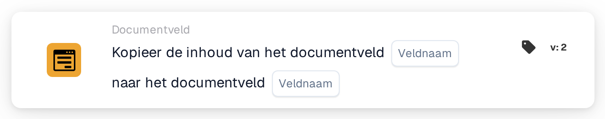

# Documentveld kopiëren naar documentveld

<figure><figcaption>
Versie 2
</figcaption></figure>

## Doel:

Deze workflowkaart kopieert de inhoud van een documentveld naar een ander documentveld van hetzelfde document. De kaart kan bijvoorbeeld worden gebruikt om een veld dat nodig is voor een export of een latere kaart te vullen met een waarde die al in een ander veld is geëxtraheerd.

## Onderdelen van de kaart:

1. **Veldnaam** (eerste)
   * **Beschrijving:** Het documentveld waarvan de inhoud wordt gekopieerd.
   * **Detail:** De naam van een documentveld. De naam wordt exact vergeleken, inclusief hoofd- en kleine letters. Het veld zelf wordt niet gewijzigd.
2. **Veldnaam** (tweede)
   * **Beschrijving:** Het documentveld waarnaar de inhoud wordt gekopieerd.
   * **Detail:** De naam van een documentveld. De huidige inhoud ervan wordt vervangen door de gekopieerde inhoud.

## Functionaliteit:

* **Waarde lezen:** De kaart zoekt het eerste veld tussen de velden van het document en leest de waarde ervan. De gevonden waarde wordt in het workflowlogboek vermeld.
* **Actie-uitvoering:** De waarde wordt in het tweede veld geschreven en het document wordt opgeslagen. De gekopieerde waarde wordt ongewijzigd overgenomen, zonder conversie. Bestaat het tweede veld nog niet op het document, dan wordt het toegevoegd. Na een geslaagde kopie werken latere kaarten in de workflow met de nieuwe waarde.
* **Ontbrekende gegevens:**
  * Is een van de twee veldnamen niet op de kaart ingesteld, dan wordt de kaart niet uitgevoerd en meldt ze de ontbrekende gegevens in het workflowlogboek.
  * Heeft het document geen veld met de eerste naam, dan wordt er niets gekopieerd en meldt de kaart dat het veld niet in het document is gevonden.
* **Fouten:** Kan het document niet worden opgeslagen, bijvoorbeeld omdat de huidige status geen wijzigingen toestaat, dan eindigt de kaart met een fout en behoudt het tweede veld zijn vorige inhoud.

## Opzet en configuratie:

* De kaart kan worden toegevoegd vanuit de categorie **Documentveld**. Daarna wordt het veld waaruit wordt gekopieerd ingesteld in het eerste vak **Veldnaam** en het veld waarnaar wordt gekopieerd in het tweede.
* Omdat de waarde zonder conversie wordt gekopieerd, horen de twee velden hetzelfde soort gegevens te bevatten, bijvoorbeeld tekst naar tekst of een datum naar een datum.

## Conclusie:

De workflowkaart "Copy Document Field into Document Field" draagt waarden zonder handmatig werk over tussen velden. Ze houdt samenhangende velden consistent en zorgt ervoor dat latere stappen van een workflow een waarde kunnen gebruiken onder de veldnaam die ze verwachten.
