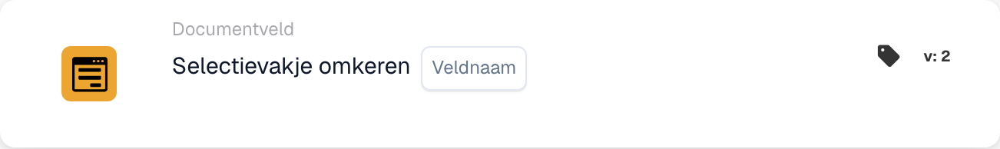

# Selectievakje omkeren

<figure><figcaption>
Kaartvelden in de getoonde versie. De velden zijn nog niet ingevuld.
</figcaption></figure>

## **Doel:**

Deze workflow-kaart is ontworpen om de huidige status van een selectievakjeveld om te keren. Als het selectievakje is aangevinkt (true), wordt het niet-aangevinkt (false), en omgekeerd. De omkering vindt plaats op basis van de voorwaarden die zijn ingesteld in de **"Wanneer"**- en **"En"**-secties. Deze kaart helpt workflows te automatiseren waarbij een voorwaarde vereist dat een selectievakje wordt omgewisseld op basis van specifieke criteria.

## **Onderdelen van de kaart:**

1. **Veldnaam**
   * **Beschrijving**: Geeft het om te keren selectievakjeveld op.
   * **Details**: Bij het geselecteerde selectievakjeveld wordt de status omgewisseld van true naar false of van false naar true, op basis van de huidige status.

## **Functionaliteit:**

* **Voorwaarde-evaluatie**: Het systeem evalueert de voorwaarden die zijn gedefinieerd in de **"Wanneer"**- en **"En"**-secties:
  * Als **beide voorwaarden true zijn**, wordt de actie in de **"Then"**-sectie uitgevoerd, wat in dit geval betekent dat het selectievakjeveld wordt omgewisseld.
  * Als **een van beide voorwaarden false is**, wordt de kaart niet uitgevoerd en wordt er geen wijziging aan het selectievakjeveld aangebracht.
* **Actie-uitvoering**: Als de voorwaarden in de **"Wanneer"**- en **"En"**-secties als true worden geëvalueerd, wordt de status van het selectievakjeveld omgekeerd:
  * Als het selectievakje is aangevinkt (true), wordt het niet-aangevinkt (false).
  * Als het selectievakje niet is aangevinkt (false), wordt het aangevinkt (true).

## **Opzet en configuratie:**

Om deze kaart te configureren, moeten gebruikers:

1. **Het selectievakjeveld selecteren** (Field Name) dat wordt omgekeerd. De beschikbare selectievakjevelden in het document worden weergegeven om uit te selecteren.
2. Het selectievakjeveld wordt alleen omgekeerd als de voorwaarden in zowel de **"Wanneer"**- als de **"En"**-secties true zijn.

## **Conclusie:**

De workflow-kaart **"Invert checkbox \[Field Name]"** biedt een eenvoudig maar krachtig automatiseringshulpmiddel om selectievakjewaarden om te wisselen op basis van specifieke voorwaarden. Door de noodzaak van handmatige aanpassingen aan selectievakjes te verminderen, verbetert deze kaart de efficiëntie in de documentverwerking en zorgt hij voor consistentie over workflows heen.

<!-- workflow-card-practical-example-20261021 -->

## Praktisch voorbeeld

**Wanneer gebruiken:** Schakel een Booleaanse waarde in als dat de beoogde bedrijfsbewerking is.

**Configuratie:** Selecteer selectievakje `demo_flag` met initiële waarde `false`.

**Verwacht resultaat en tegenvoorbeeld:** Eén uitvoering maakt het `true`; een tweede uitvoering maakt het weer `false`. Gebruik in plaats daarvan het selectievakje Set wanneer nieuwe pogingen altijd dezelfde waarde moeten behouden.

Dit is een illustratieve configuratie en een verwacht resultaat. Gebruik velden, gebruikers en groepen die in uw testorganisatie zijn geconfigureerd; het is geen bewering dat dit voorbeeld is uitgevoerd.
