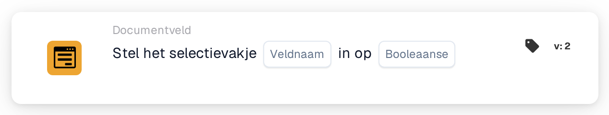

# Stel het selectievakje in op

<figure><figcaption>
Versie 2
</figcaption></figure>

## **Doel:**

Deze workflow-kaart is ontworpen om een selectievakjeveld op een opgegeven waarde (true of false) in te stellen op basis van de voorwaarden die zijn gedefinieerd in de **"Wanneer"**- en **"En"**-secties. Hij biedt een eenvoudige maar effectieve manier om selectievakje-updates te automatiseren wanneer aan bepaalde criteria wordt voldaan, wat zorgt voor een gestroomlijnde documentverwerking.

## **Onderdelen van de kaart:**

1. **Veldnaam:**
   * **Beschrijving**: Geeft het veld op waar het selectievakje wordt ingesteld.
   * **Details**: Het bij te werken selectievakjeveld wordt geïdentificeerd door de veldnaam.
2. **Booleaans**
   * **Beschrijving**: Definieert de waarde waarop het selectievakjeveld wordt ingesteld wanneer de voorwaarden in de **Waar**- en **En**-secties beide true zijn.
   * **Opties**:
     * **True**: Het selectievakje wordt op **true** ingesteld als aan de voorwaarden wordt voldaan.
     * **False**: Het selectievakje wordt op **false** ingesteld als aan de voorwaarden wordt voldaan.

## **Functionaliteit:**

* **Voorwaarde-evaluatie**: Het systeem evalueert de voorwaarden in zowel de **"Wanneer"**- als de **"En"**-secties.
* **Actie-uitvoering**: Als zowel de **"Wanneer"**- als de **"En"**-secties als true worden geëvalueerd, wordt het selectievakjeveld bijgewerkt naar de opgegeven waarde (true of false). Als een van beide voorwaarden false is, worden er geen acties ondernomen en blijft het selectievakje zoals het was.

## **Opzet en configuratie:**

Om deze kaart te configureren, moeten gebruikers:

1. **Het doel-selectievakjeveld opgeven** dat op true of false wordt ingesteld wanneer aan de voorwaarden wordt voldaan.
2. **De waarde (true of false) kiezen** waarop het selectievakje wordt ingesteld bij de voorwaarde-evaluatie.
3. De kaart voert de actie alleen uit als beide voorwaarden in de **"Wanneer"**- en **"En"**-secties als true worden geëvalueerd.

## **Conclusie:**

De workflow-kaart **"Set Checkbox"** is een eenvoudig en effectief automatiseringshulpmiddel om selectievakjevelden bij te werken op basis van specifieke voorwaarden. Door ervoor te zorgen dat aan zowel de **"Wanneer"**- als de **"En"**-secties wordt voldaan, kunnen gebruikers processen automatiseren en handmatige interventie verminderen, wat zorgt voor een soepelere en efficiëntere documentverwerking.

<!-- workflow-card-practical-example-20261021 -->

## Praktisch voorbeeld

**Wanneer gebruiken:** Markeer een succesvolle validatie met een expliciete vlag.

**Configuratie:** Selecteer het selectievakje veld `review_complete` en stel dit in op `true`.

**Verwacht resultaat en tegenvoorbeeld:** Het veld wordt aangevinkt. Voer de actie uit met `false` in een afzonderlijke test wanneer u de vlag moet wissen.

Dit is een illustratieve configuratie en een verwacht resultaat. Gebruik velden, gebruikers en groepen die in uw testorganisatie zijn geconfigureerd; het is geen bewering dat dit voorbeeld is uitgevoerd.
