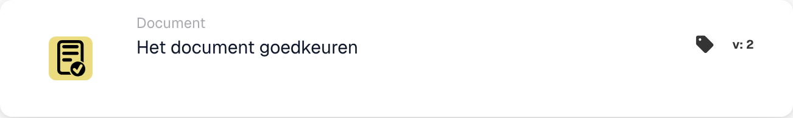

# Keur het document goed

<figure><figcaption>
Kaartvelden in de getoonde versie. De velden zijn nog niet ingevuld.
</figcaption></figure>

## **Doel:**

De workflow-kaart **"Keur het document goed"** wordt gebruikt om een document als goedgekeurd te markeren. Hiermee kan het document doorgaan naar de volgende fase in de workflow, waardoor geautomatiseerde verwerkings- of goedkeuringsworkflows kunnen worden uitgevoerd. Deze kaart helpt documentbeheerprocessen te stroomlijnen en zorgt ervoor dat alleen goedgekeurde documenten doorgaan voor verdere acties.

## **Onderdelen van de kaart:**

1. **Goedkeuringsstatus**
   * **Beschrijving**: Dit onderdeel markeert het document als goedgekeurd.
   * **Details**: Wanneer deze kaart wordt getriggerd, wordt de goedkeuringsstatus van het document bijgewerkt om goedkeuring aan te geven. Deze actie kan worden ingesteld op basis van de voorwaarden die zijn gedefinieerd in de **"Wanneer"**- en **"En"**-secties.

## **Functionaliteit:**

* **Voorwaarde-evaluatie**: Het systeem evalueert de voorwaarden die zijn ingesteld in de **"Wanneer"**- en **"En"**-secties.
  * Als **beide voorwaarden true zijn**, wordt het document als goedgekeurd gemarkeerd.
  * Als **een van beide voorwaarden false is**, wordt de kaart niet uitgevoerd en blijft de goedkeuringsstatus van het document ongewijzigd.
* **Actie-uitvoering**: Wanneer aan de voorwaarden wordt voldaan, wordt het document goedgekeurd. Deze wijziging wordt weergegeven in de documentstatus, waardoor het verder in de workflow kan doorgaan.

## **Conclusie:**

De workflow-kaart **"Keur het document goed"** is een belangrijk onderdeel voor het automatiseren van documentgoedkeuring in bedrijfsworkflows. Door ervoor te zorgen dat alleen documenten die aan specifieke criteria voldoen worden goedgekeurd, helpt hij consistentie te behouden, vermindert hij handmatig toezicht en zorgt hij voor een soepelere documentverwerking.

<!-- workflow-card-practical-example-20261021 -->

## Praktisch voorbeeld

**Wanneer gebruiken:** Keur een document goed nadat aan alle vereiste beoordelingsvoorwaarden is voldaan.

**Configuratie:** Plaats deze actie na de beoordelingsvoorwaarden in de succesvolle vertakking. Gebruik een demodocument dat wacht op goedkeuring.

**Verwacht resultaat en tegenvoorbeeld:** De actie keurt dat document goed. Een document dat niet aan een eerdere voorwaarde voldoet, bereikt deze actie nooit; goedkeuring alleen is geen bewijs van een voltooide ERP-export.

Dit is een illustratieve configuratie en een verwacht resultaat. Gebruik velden, gebruikers en groepen die in uw testorganisatie zijn geconfigureerd; het is geen bewering dat dit voorbeeld is uitgevoerd.
