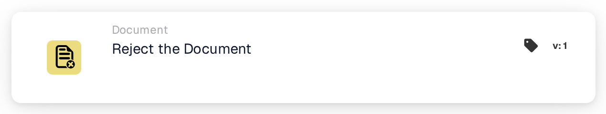
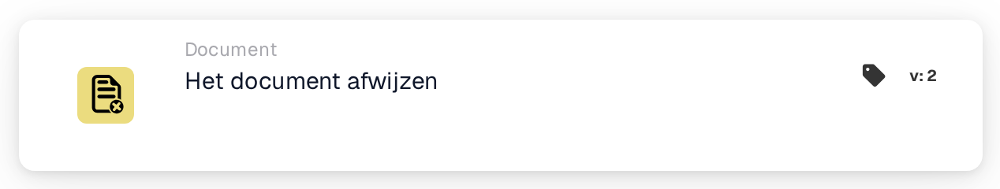

# Weiger het document

<figure><figcaption>
Versie 1
</figcaption></figure>

<figure><figcaption>
Versie 2
</figcaption></figure>

## **Doel:**

De workflow-kaart **"Weiger het document"** wordt gebruikt om een document binnen een workflow als afgekeurd te markeren. Deze actie stopt de voortgang van het document en voorkomt dat het naar de volgende fase in de workflow gaat. Hij zorgt ervoor dat documenten die niet aan de noodzakelijke voorwaarden of criteria voldoen, worden gemarkeerd en van verdere verwerking worden weerhouden.

## **Onderdelen van de kaart:**

1. **Afwijzingsstatus**
   * **Beschrijving**: Dit onderdeel markeert het document als afgekeurd, wat aangeeft dat het niet aan de vereiste voorwaarden voor goedkeuring voldeed.
   * **Details**: Wanneer deze kaart wordt getriggerd, werkt hij de status van het document bij naar "rejected". Deze beslissing wordt gemaakt op basis van de voorwaarden die zijn ingesteld in de **"Wanneer"**- en **"En"**-secties.

## **Functionaliteit:**

* **Voorwaarde-evaluatie**: Het systeem evalueert de voorwaarden die zijn ingesteld in de **"Wanneer"**- en **"En"**-secties.
  * Als **beide voorwaarden true zijn**, wordt het document afgekeurd.
  * Als **een van beide voorwaarden false is**, wordt de kaart niet uitgevoerd en blijft de status van het document ongewijzigd.
* **Actie-uitvoering**: Wanneer aan de voorwaarden wordt voldaan, wordt het document als afgekeurd gemarkeerd. Deze actie zorgt ervoor dat alleen documenten die aan specifieke criteria voldoen verder doorgaan, terwijl andere worden gemarkeerd en gestopt voor beoordeling of correctie.

## **Conclusie:**

De workflow-kaart **"Weiger het document"** is een essentieel hulpmiddel voor het controleren van de documentstroom in geautomatiseerde processen. Door afkeuring van niet-conforme documenten mogelijk te maken, zorgt hij ervoor dat alleen geldige en nauwkeurige documenten door de workflow gaan, wat de efficiëntie en nauwkeurigheid in het documentbeheer verbetert.

<!-- workflow-card-practical-example-20261021 -->

## Praktisch voorbeeld

**Wanneer gebruiken:** Een document afwijzen dat aan een gedefinieerde afwijzingsregel voldoet.

**Configuratie:** Leid een opzettelijk ongeldig demodocument naar deze actie, bijvoorbeeld na een expliciete afwijzingsbeslissing.

**Verwacht resultaat en tegenvoorbeeld:** Het document wordt afgewezen. Een geldig document moet een andere tak volgen en mag deze actie niet uitvoeren.

Dit is een illustratieve configuratie en een verwacht resultaat. Gebruik velden, gebruikers en groepen die in uw testorganisatie zijn geconfigureerd; het is geen bewering dat dit voorbeeld is uitgevoerd.
