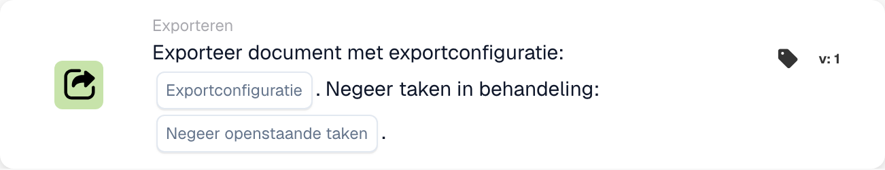

# Exporteren met exportconfiguratie

<figure><figcaption>
Kaartvelden in de getoonde versie. De velden zijn nog niet ingevuld.
</figcaption></figure>

## **Doel:**

De werkstroomkaart **"Exportdocument met exportconfiguratie"** is ontworpen om een document te exporteren met behulp van een opgegeven exportconfiguratie. Het biedt de flexibiliteit om openstaande taken die aan het document zijn gekoppeld te negeren, waardoor een soepel exportproces wordt gegarandeerd, ongeacht de huidige status.

## **Componenten van de kaart:**

1. **Configuratie exporteren**
   * **Beschrijving**: Specificeert de exportconfiguratie die moet worden gebruikt voor het verwerken van het document.
   * **Details**: deze configuratie bepaalt het formaat, de structuur en de bestemming van het geëxporteerde document.
2. **Negeer taken in behandeling**
   * **Beschrijving**: Bepaalt of lopende taken die aan het document zijn gekoppeld, tijdens het exportproces moeten worden genegeerd.
   * **Opties**:
     * **True**: exporteert het document, ongeacht openstaande taken.
     * **False**: Zorgt ervoor dat openstaande taken vóór de export worden voltooid.

## **Functionaliteit:**

* **Conditie-evaluatie**: het systeem evalueert de voorwaarden die zijn ingesteld in **"Wanneer"** en **"En secties"** van de workflow. Als beide voorwaarden waar zijn, wordt het exportproces gestart.
* **Documentexport**: Met behulp van de opgegeven **Exportconfiguratie** wordt het document verwerkt en geëxporteerd in het gedefinieerde formaat en de gedefinieerde bestemming.
* **Afhandeling van openstaande taken**: Als **Negeer lopende taken** is ingesteld op **True**, omzeilt het exportproces alle openstaande taken die aan het document zijn gekoppeld. Indien ingesteld op **False**, kunnen openstaande taken de export verhinderen. Los ze op en regel de beoogde workflow-trigger of probeer het opnieuw.

## **Installatie en configuratie:**

Om deze kaart te configureren, moeten gebruikers:

1. Selecteer de gewenste **Exportconfiguratie** om te definiëren hoe het document wordt geëxporteerd.
2. Kies of u **In behandeling zijnde taken negeert** door de waarde in te stellen op **True** of **False.**
3. Zorg ervoor dat de voorwaarden in **"Wanneer"** en **"En secties"** correct zijn ingesteld, aangezien de kaart zijn actie alleen uitvoert als deze voorwaarden waar zijn.

## **Conclusie:**

De workflowkaart **"Exportdocument met exportconfiguratie"** zorgt ervoor dat documenten efficiënt en volgens vooraf gedefinieerde configuraties worden geëxporteerd. Met de mogelijkheid om openstaande taken te negeren, biedt deze kaart flexibiliteit bij het verwerken van documenten in verschillende stadia, waardoor vertragingen worden verminderd en het exportproces wordt gestroomlijnd.

## Huidige versies en lopende taken

Kies op v3 ook **Status na export**: `finished` sluit het document na een succesvolle export; `exported` laat het open voor verdere verwerking. Eerdere versies behouden `finished`. Een ontbrekende selectie wordt standaard ingesteld op `finished`; een ongeldige selectie wordt afgewezen.

Als openstaande taken export verhinderen, meldt de kaart de weigering. Los de taken op en regel de beoogde trigger of nieuwe poging; automatisch wachten en hervatten worden niet gegarandeerd door deze kaart. De afzonderlijke exportkaart in de wachtrij verzamelt een configuratie voor de uiteindelijke export aan het einde van de run. Zie [Kaarten en resultaatstatus exporteren](../../cards-overview/export-cards-guide.md).

<!-- workflow-card-practical-example-20261021 -->

## Praktisch voorbeeld

**Wanneer gebruiken:** Kies een specifieke exportconfiguratie voor een gevalideerd document.

**Configuratie:** Selecteer de geconfigureerde demo-exporteur en stel In behandeling zijnde taken negeren in op `false`. Gebruik een document met een open taak, daarna een aparte toets zonder open taken.

**Verwacht resultaat en tegenvoorbeeld:** Er mag niet van worden uitgegaan dat de open-taakcasus automatisch wordt hervat. Nadat u de taak hebt opgelost, activeert u de beoogde export opnieuw en controleert u het exportresultaat en de ondersteunde status.

Dit is een illustratieve configuratie en een verwacht resultaat. Gebruik velden, gebruikers en groepen die in uw testorganisatie zijn geconfigureerd; het is geen bewering dat dit voorbeeld is uitgevoerd.
