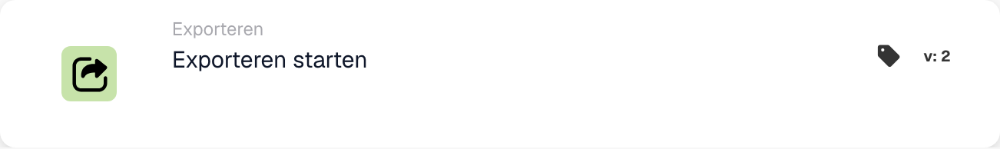

# Start exporteren

<figure><figcaption>
Kaartvelden in de getoonde versie. De velden zijn nog niet ingevuld.
</figcaption></figure>

## **Doel:**

De workflowkaart **"Export starten"** is ontworpen om het exportproces voor een document te starten. Deze kaart fungeert als trigger binnen de workflow om de exportbewerking naadloos te starten zodra aan de voorwaarden in de voorgaande secties is voldaan.

## **Componenten van de kaart:**

1. **Actie**
   1. **Beschrijving**: Start het exportproces voor het document.
   2. **Details**: De kaart gebruikt de geconfigureerde exportinstellingen in het systeem om het document te verwerken en exporteren.

## **Functionaliteit:**

* **Conditie-evaluatie**: het systeem evalueert de voorwaarden die zijn ingesteld in **"Wanneer"** en **"En secties"** van de workflow. Als aan alle voorwaarden is voldaan, begint het exportproces.
* **Documentexport**: het document wordt verwerkt en geëxporteerd met behulp van de standaard of eerder gedefinieerde exportconfiguratie.

## **Installatie en configuratie:**

Eerdere versies gebruiken de exportinstellingen die al in het systeem zijn gedefinieerd. Configureer in versie 4 de validatie en selecteer Status na export. Controleer ook of:

1. De voorwaarden **"Wanneer"** en **"En secties"** zijn correct geconfigureerd, aangezien de kaart alleen wordt uitgevoerd als deze voorwaarden waar zijn.
2. Er is een geldige exportconfiguratie gekoppeld aan het document in het systeem.

## **Conclusie:**

De workflowkaart **"Start Export"** biedt een gestroomlijnde en geautomatiseerde manier om het exportproces te activeren. Door te vertrouwen op vooraf geconfigureerde instellingen en voorwaardelijke evaluaties, zorgt het voor een efficiënte en nauwkeurige documentverwerking.

## Kaartversies en resultaatstatus

De bovenstaande verklaring over geen kaartspecifieke configuratie is van toepassing op de eerdere Start Export-kaart. Start exporteren met validatie v4 omvat validatie en **Status na export**. Kies `finished` om een ​​succesvol geëxporteerd document te sluiten, of `exported` om het open te houden voor verdere verwerking. Eerdere versies behouden `finished`. Zie [Kaarten en resultaatstatus exporteren](../../cards-overview/export-cards-guide.md) voor standaardinstellingen, fouten en tests.

<!-- workflow-card-practical-example-20261021 -->

## Praktisch voorbeeld

**Wanneer gebruiken:** Exporteer een document nadat de vereiste controles zijn uitgevoerd.

**Configuratie:** Selecteer de ondersteunde post-exportstatus, bijvoorbeeld `exported` wanneer het document beschikbaar moet blijven voor verdere verwerking. Zorg ervoor dat de geconfigureerde exporteur en de vereiste gegevens gereed zijn.

**Verwacht resultaat en tegenvoorbeeld:** Na succesvolle export wordt de geselecteerde resultaatstatus toegepast. Een exporteurfout is geen voltooide export; inspecteer het logboek en test de foutvertakking.

Dit is een illustratieve configuratie en een verwacht resultaat. Gebruik velden, gebruikers en groepen die in uw testorganisatie zijn geconfigureerd; het is geen bewering dat dit voorbeeld is uitgevoerd.
