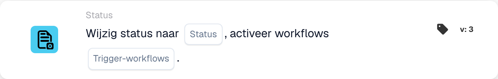

# Wijzig status naar

<figure><figcaption>
Kaartvelden in de getoonde versie. De velden zijn nog niet ingevuld.
</figcaption></figure>

## **Doel:**

De workflow-kaart **"Change Status"** wordt gebruikt om de status van een document te wijzigen naar een van de vooraf gedefinieerde toestanden — **Fout, afgewezen, gereed voor validatie, in afwachting van goedkeuring, in afwachting van tweede goedkeuring** — en optioneel bijbehorende workflows te triggeren op basis van de statuswijziging. Deze kaart automatiseert het proces van statusupdates en workflow-triggers, wat zorgt voor efficiënt documentbeheer en foutafhandeling.

## **Onderdelen van de kaart:**

1. **Status**
   * **Beschrijving**: Geeft de nieuwe status op die op het document wordt toegepast.
   * **Opties**:
     * **Error**: Markeert het document als zijnde waarbij een fout is opgetreden.
     * **Afgewezen**: Geeft aan dat het document is afgekeurd en niet verder doorgaat.
     * **Klaar voor validatie**: Stelt het document in om door de volgende gebruiker of het volgende systeemproces te worden beoordeeld en gevalideerd.
     * **In afwachting van goedkeuring**: Plaatst het document in een wachtstand voor goedkeuring.
     * **In afwachting van tweede goedkeuring**: Zet het document in de wacht voor een tweede goedkeuringsniveau indien van toepassing.
2. **Triggerwerkstromen**
   * **Beschrijving**: Bepaalt of er na de statuswijziging eventuele vervolgworkflows moeten worden getriggerd.
   * **Opties**:
     * **True**: Start eventuele relevante workflows op basis van de statuswijziging.
     * **False**: Voorkomt de uitvoering van workflows na de statuswijziging.

## **Functionaliteit:**

* **Voorwaarde-evaluatie**: Het systeem evalueert de voorwaarden die zijn ingesteld in de **"Wanneer"**- en **"En"**-secties. Als aan deze voorwaarden wordt voldaan, gaat de kaart verder met het wijzigen van de status van het document naar de geselecteerde waarde.
* **Statusupdate**: Zodra aan de voorwaarden is voldaan, wordt de status van het document bijgewerkt naar een van de vooraf gedefinieerde opties (Error, Rejected, Ready for Validation, Pending Approval, Pending Second Approval), afhankelijk van de selectie van de gebruiker.
* **Workflow-trigger-actie**: Als **Werkstromen activeren** op **True** is ingesteld, start het systeem automatisch eventuele bijbehorende workflows na de statusupdate. Als het op **False** is ingesteld, worden er geen aanvullende workflows getriggerd en eindigt het proces met de statuswijziging.

## **Opzet en configuratie:**

Om deze kaart te configureren, moeten gebruikers:

1. De gewenste **Status** opgeven waarop het document wordt ingesteld bij de voorwaarde-evaluatie (Error, Rejected, Ready for Validation, Pending Approval of Pending Second Approval).
2. Kiezen of **Werkstromen activeren** na de statuswijziging wordt uitgevoerd door **True** of **False** te selecteren.
3. De kaart voert de actie alleen uit als beide voorwaarden in de **"Wanneer"**- en **"En"**-secties als true worden geëvalueerd.

## **Conclusie:**

De workflow-kaart **"Change Status"** biedt een gestroomlijnde benadering voor het beheren van documentstatussen en het triggeren van gerelateerde workflows. Hij zorgt ervoor dat documenten automatisch naar de juiste status worden gerouteerd en dat de noodzakelijke acties worden ondernomen, afhankelijk van de statuswijziging. Door duidelijke voorwaarden voor de uitvoering in te stellen, vermindert hij handmatige inspanning en verbetert hij de workflow-efficiëntie.

<!-- workflow-card-practical-example-20261021 -->

## Praktisch voorbeeld

**Wanneer gebruiken:** Verplaats een gereviewd document naar een gedefinieerde verwerkingsstatus.

**Configuratie:** Selecteer uw geconfigureerde `Demo Review`-status en schakel het activeren van extra workflows uit voor dit voorbeeld.

**Verwacht resultaat en tegenvoorbeeld:** Het document krijgt de geselecteerde status. Met deze actie alleen wordt de afzonderlijk geconfigureerde export niet uitgevoerd.

Dit is een illustratieve configuratie en een verwacht resultaat. Gebruik velden, gebruikers en groepen die in uw testorganisatie zijn geconfigureerd; het is geen bewering dat dit voorbeeld is uitgevoerd.
