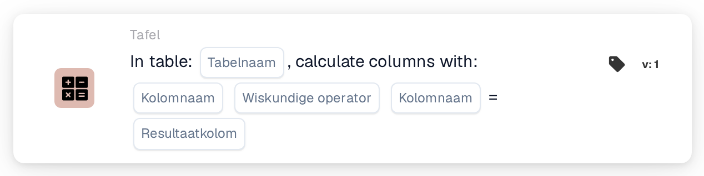
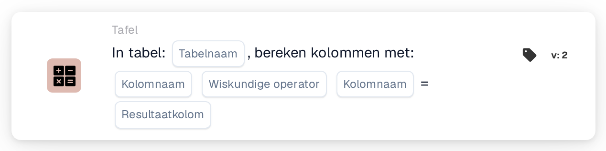

# Bereken kolommen met

<figure><figcaption>
Versie 1
</figcaption></figure>

<figure><figcaption>
Versie 2
</figcaption></figure>

## Doel:

Deze workflowkaart berekent rij voor rij een waarde uit twee kolommen van een tabel op het document en slaat het resultaat op in een resultaatkolom. De kaart kan bijvoorbeeld worden gebruikt om regeltotalen te berekenen uit hoeveelheid en eenheidsprijs.

## Beheerdersvideo:



[Video met Nederlandse ondertiteling](https://docbits-videos.fra1.cdn.digitaloceanspaces.com/settings-assistant/workflow-card-calc-columns-admin/v2/nl.html) · [Transcript lezen](https://docbits-videos.fra1.cdn.digitaloceanspaces.com/settings-assistant/workflow-card-calc-columns-admin/v2/nl.txt)

## Onderdelen van de kaart:

1. **Tabel**
   * **Beschrijving:** De tabel op het document waarin de berekening wordt uitgevoerd.
2. **Eerste kolom**
   * **Beschrijving:** De kolom met de eerste waarde van elke rij.
3. **Bewerking**
   * **Opties:**
     * **+** telt de tweede waarde op bij de eerste.
     * **-** trekt de tweede waarde af van de eerste.
     * **\*** vermenigvuldigt de twee waarden.
     * **/** deelt de eerste waarde door de tweede.
4. **Tweede kolom**
   * **Beschrijving:** De kolom met de tweede waarde van elke rij.
5. **Resultaatkolom**
   * **Beschrijving:** De kolom waarin het resultaat van elke rij wordt opgeslagen.
   * **Detail:** De naam wordt in hoofdletters opgeslagen, waarbij spaties worden vervangen door underscores (`total amount` wordt `TOTAL_AMOUNT`). Als de kolom nog niet bestaat, voegt de kaart die toe; als ze bestaat, worden de waarden ervan vervangen.

Versie 1 en 2 van de kaart hebben dezelfde instellingen en werken op dezelfde manier.

## Functionaliteit:

* **Berekening:** Voor elke rij van de tabel leest de kaart de twee kolommen (hoofdletters en kleine letters in de kolomnamen maken niet uit), past de bewerking toe en schrijft het resultaat in de resultaatkolom. Resultaten worden afgerond op vier decimalen. Daarna wordt het document met de nieuwe waarden opgeslagen.
  * Een lege of ontbrekende waarde geldt als `0`. Als beide waarden van een rij leeg zijn, blijft het resultaat van die rij leeg.
  * Een deling door nul laat het resultaat van die rij leeg.
  * Met **+** worden twee waarden die geen getallen zijn met een spatie samengevoegd in plaats van opgeteld. Bij de andere bewerkingen veroorzaakt een waarde die geen getal is een fout, en worden er geen resultaten opgeslagen.
* **Actie-uitvoering:** Als de berekening en het opslaan slagen, gaat de workflow verder met de volgende kaarten. Als de tabel niet op het document bestaat, een waarde niet kan worden berekend of het document niet kan worden opgeslagen, meldt de kaart een fout in het workflowlogboek.
* **Testkaart:** Wanneer de kaart met **Testkaart** wordt uitgevoerd, wordt de berekening alleen gesimuleerd en wordt het document niet gewijzigd.

## Opzet en configuratie:

* De kaart kan als Then-actie worden toegevoegd vanuit de categorie **Tabel**. Daarna worden de tabel, de twee kolommen, de bewerking en de resultaatkolom geselecteerd.
* **Voorbeeld:** Tabel `INVOICE_TABLE`, `QUANTITY` **\*** `UNIT_PRICE`, resultaatkolom `TOTAL_AMOUNT`. Een rij met hoeveelheid 2 en eenheidsprijs 10 krijgt 20, een rij met 3 en 4 krijgt 12.
* Omdat een lege waarde als `0` geldt, geeft een ontbrekende prijs een resultaat van `0`. Controleren of de invoerkolommen gevuld zijn, bijvoorbeeld met een voorwaarde vóór deze kaart, kan helpen om verkeerde totalen te voorkomen.
* Bij aftrekken en delen is de volgorde van de twee kolommen van belang.

## Conclusie:

De workflowkaart "Calculate Columns with" voegt automatisch berekende waarden toe aan tabelrijen. Regeltotalen en vergelijkbare waarden zijn beschikbaar voor de volgende kaarten en voor de export, zonder handmatige berekening.
