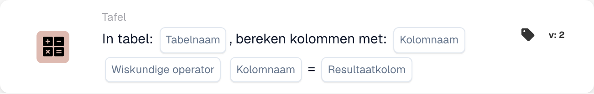

# Bereken kolommen met

<figure><figcaption>
Kaartvelden in de getoonde versie. De velden zijn nog niet ingevuld. Sommige labels van deze versie zijn in de interface nog niet of onjuist vertaald. De uitleg op deze pagina gebruikt de juiste termen; de afbeelding toont de werkelijke interface.
</figcaption></figure>

## **Doel:**

De workflow-kaart **"Bereken kolommen in tabel"** wordt gebruikt om berekeningen tussen kolommen in een geselecteerde tabel uit te voeren. Hiermee kunnen gebruikers kolommen selecteren, een wiskundige bewerking toepassen en het resultaat in een opgegeven resultaatkolom opslaan.

## **Onderdelen van de kaart:**

1. **Tabelnaam**
   * **Beschrijving:** Geeft de **tabel** op waarin de kolommen worden berekend.
   * **Details:** Er wordt een dropdownlijst van alle beschikbare **tabellen** geboden om uit te selecteren.
2. **Kolomnaam (1e kolom)**
   * **Beschrijving:** Geeft de **eerste kolom** op die bij de berekening betrokken is.
   * **Details:** Er wordt een lijst van alle beschikbare **kolommen** geboden om uit te selecteren.
3. **Bediening**
   * **Beschrijving:** Definieert de wiskundige bewerking die tussen de geselecteerde kolommen wordt toegepast.
   * **Opties:**
     * **Add (+):** Telt de waarde van de tweede kolom op bij de waarde van de eerste kolom.
     * **Aftrekken (-):** Trekt de waarde van de tweede kolom af van de waarde van de eerste kolom.
     * **Multiply (\*):** Vermenigvuldigt de waarde in de eerste kolom met de waarde in de tweede kolom.
     * **Verdeel (/):** Deelt de waarde in de eerste kolom door de waarde in de tweede kolom.
4. **Kolomnaam (2e kolom)**
   * **Beschrijving:** Geeft de **tweede kolom** op die bij de berekening betrokken is.
   * **Details:** Er wordt een lijst van beschikbare **kolommen** geboden om uit te selecteren.
5. **Resultaatkolom**
   * **Beschrijving:** Geeft de **kolom** op waarin het resultaat van de berekening wordt opgeslagen.
   * **Details:** Er wordt een lijst van beschikbare **kolommen** geboden waarin de berekende waarde wordt opgeslagen.

## **Functionaliteit:**

* **Voorwaarde-evaluatie:**\
  De kaart voert de actie alleen uit als zowel de **"Wanneer"**- als de **"En"**-secties als true worden geëvalueerd.
* **Kolomberekening:**\
  De kaart voert de geselecteerde wiskundige bewerking uit tussen de twee gekozen kolommen.
* **Resultaatopslag:**\
  Het resultaat van de berekening wordt opgeslagen in de geselecteerde **resultaatkolom**.

## **Opzet en configuratie:**

* **Tabel selecteren:**\
  Kies de **tabel** waarin de kolommen worden berekend.
* **Kolommen kiezen:**\
  Selecteer de **eerste kolom** en **tweede kolom** die in de berekening worden gebruikt.
* **Bewerking selecteren:**\
  Kies de wiskundige bewerking (**Add (+)**, **Aftrekken (-)**, **Multiply (\*)**, **Divide (/)**) die tussen de kolommen wordt toegepast.
* **Resultaatkolom selecteren:**\
  Kies de **resultaatkolom** waarin de berekening wordt opgeslagen.

## **Conclusie:**

De workflow-kaart **"Bereken kolommen in tabel"** stelt gebruikers in staat dynamische berekeningen tussen kolommen in een tabel uit te voeren en de resultaten in een aangewezen kolom op te slaan. De kaart biedt flexibiliteit om verschillende wiskundige bewerkingen toe te passen en zorgt ervoor dat het resultaat in de opgegeven kolom wordt opgeslagen.

<!-- workflow-card-practical-example-20261021 -->

## Praktisch voorbeeld

**Wanneer gebruiken:** Bereken regeltotalen op basis van hoeveelheid en eenheidsprijs.

**Configuratie:** Selecteer tabel `lines`, kolommen `quantity` en `unit_price`, vermenigvuldiging en resultaatkolom `line_total`.

**Verwacht resultaat en tegenvoorbeeld:** Een rij met `2` en `10` levert `20` op. Test een andere rij onafhankelijk en diagnosticeer ontbrekende of niet-numerieke invoer in plaats van deze als een geldig totaal te behandelen.

Dit is een illustratieve configuratie en een verwacht resultaat. Gebruik velden, gebruikers en groepen die in uw testorganisatie zijn geconfigureerd; het is geen bewering dat dit voorbeeld is uitgevoerd.
