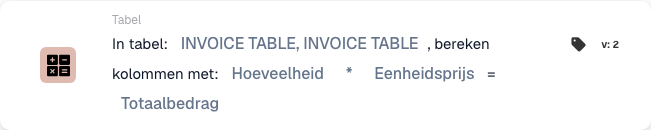

# Kolommen berekenen

## Wanneer en waar gebruiken

Gebruik deze kaart als elke rij in een tabel een berekende waarde nodig heeft. Een veelvoorkomend voorbeeld is het regeltotaal van een factuur: **hoeveelheid × eenheidsprijs**. De kaart berekent de gekozen bewerking per rij en schrijft het resultaat naar de resultaatkolom.

Voeg de actie in de standaardworkflow toe onder **Dan → Tabel**. Stel de gewenste voorwaarden in bij **Wanneer** en **En**, en controleer de invoer voordat een volgende workflowstap de berekende bedragen gebruikt.

## Beheerdersvideo

**36 seconden · Nederlands.** Jan legt het gebruik uit, kiest hoeveelheid × eenheidsprijs en toont de opgeslagen resultaten op dezelfde voorbeeldfactuur.



[Video met Nederlandse ondertiteling](https://docbits-videos.fra1.cdn.digitaloceanspaces.com/settings-assistant/workflow-card-calc-columns-admin/v2/nl.html) · [Transcript lezen](https://docbits-videos.fra1.cdn.digitaloceanspaces.com/settings-assistant/workflow-card-calc-columns-admin/v2/nl.txt)

## Kaart instellen

| Instelling | Keuze in het voorbeeld |
| --- | --- |
| Tabel | `INVOICE_TABLE` |
| Eerste kolom | `QUANTITY` — Hoeveelheid |
| Rekenbewerking | `*` — vermenigvuldigen |
| Tweede kolom | `UNIT_PRICE` — Eenheidsprijs |
| Resultaatkolom | `TOTAL_AMOUNT` — Totaalbedrag |

<figure><figcaption>
Hoeveelheid × Eenheidsprijs → Totaalbedrag in de werkelijke Nederlandse interface.
</figcaption></figure>

In de getoonde interface staat de tabelnaam tweemaal. De selectie in dit voorbeeld betreft één tabel: `INVOICE_TABLE`.

Naast vermenigvuldigen zijn **optellen (`+`)**, **aftrekken (`-`)** en **delen (`/`)** beschikbaar. Bij aftrekken en delen is de volgorde van de kolommen bepalend: de eerste kolom staat links van het bewerkingsteken. Controleer bij deling ook de noemer.

## Praktisch voorbeeld

Dezelfde voorbeeldfactuur bevat twee regels. De bronkolommen hebben deze waarden:

| Rij | Hoeveelheid | Eenheidsprijs | Totaalbedrag na de berekening |
| --- | ---: | ---: | ---: |
| 1 | 2 | 10,00 | 20,00 |
| 2 | 3 | 4,00 | 12,00 |

Na het uitvoeren van de kaart zijn **20,00** en **12,00** in de resultaatkolom opgeslagen. De hoeveelheid en eenheidsprijs blijven gelijk. Het gaat om afzonderlijke berekeningen per rij; de kaart maakt hiervan geen gezamenlijke factuursom.

## Controleren en tegenvoorbeelden

- Controleer of de juiste tabel, bronkolommen, bewerking en resultaatkolom zijn gekozen.
- Controleer of beide bronkolommen numerieke waarden bevatten. Tekst zoals `ABC` in plaats van een getal leidt tot een rekenfout.
- Een ontbrekende eenheidsprijs kan in dit voorbeeld een resultaat van **0** opleveren. Dat bewijst niet dat de invoer volledig is; controleer ontbrekende waarden afzonderlijk.
- Bestaande waarden in de resultaatkolom worden vervangen. Kies daarom bewust de kolom die de kaart mag bijwerken.
- Controleer meerdere rijen afzonderlijk en vergelijk de opgeslagen resultaten met de bronwaarden.
