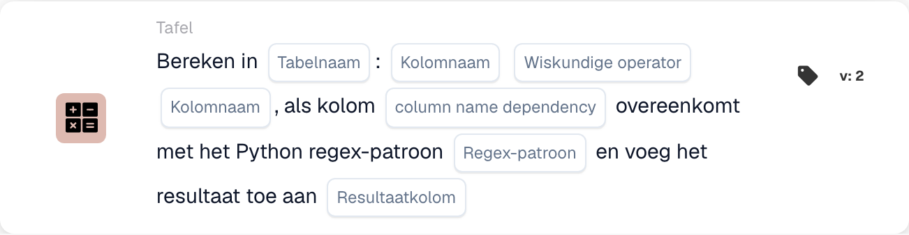

# Bereken binnen

<figure><figcaption>
Kaartvelden in de getoonde versie. De velden zijn nog niet ingevuld. Sommige labels van deze versie zijn in de interface nog niet of onjuist vertaald. De uitleg op deze pagina gebruikt de juiste termen; de afbeelding toont de werkelijke interface.
</figcaption></figure>

## **Doel:**

Met de workflow-kaart **"Bereken met Regex-afhankelijkheid"** kunnen gebruikers berekeningen tussen kolommen in een geselecteerde tabel uitvoeren, met een toegevoegde voorwaarde op basis van een reguliere-expressie-(regex)-patroon dat op een afhankelijkheidskolom wordt toegepast. Als het patroon overeenkomt, wordt de berekening uitgevoerd en wordt het resultaat in de opgegeven resultaatkolom opgeslagen.

## **Onderdelen van de kaart:**

1. **Tabelnaam**
   * **Beschrijving:** Geeft de **tabel** op waarin de kolommen worden berekend.
   * **Details:** Er wordt een dropdownlijst van alle beschikbare **tabellen** geboden om uit te selecteren.
2. **Kolomnaam (1e kolom)**
   * **Beschrijving:** Geeft de **eerste kolom** op die bij de berekening betrokken is.
   * **Details:** Er wordt een lijst van alle beschikbare **kolommen** geboden om uit te selecteren.
3. **Bediening**
   * **Beschrijving:** Definieert de wiskundige bewerking die tussen de geselecteerde kolommen wordt toegepast.
   * **Opties:**
     * **Add (+):** Telt de waarde van de tweede kolom op bij de waarde van de eerste kolom.
     * **Aftrekken (-):** Trekt de waarde van de tweede kolom af van de eerste kolom.
     * **Multiply (\*):** Vermenigvuldigt de waarde van de eerste kolom met de waarde in de tweede kolom.
     * **Verdeel (/):** Deelt de waarde van de eerste kolom door de tweede kolom.
4. **Kolomnaam (2e kolom)**
   * **Beschrijving:** Geeft de **tweede kolom** op die bij de berekening betrokken is.
   * **Details:** Er wordt een lijst van alle beschikbare **kolommen** geboden om uit te selecteren.
5. **Kolomnaam (afhankelijkheid)**
   * **Beschrijving:** Geeft de **afhankelijkheidskolom** op waarop het regex-patroon wordt toegepast.
   * **Details:** Er wordt een lijst van alle beschikbare **kolommen** geboden voor patroonmatching.
6. **Regex-patroon**
   * **Beschrijving:** Definieert het **regex-patroon** dat wordt gebruikt om met de afhankelijkheidskolom te matchen.
   * **Details:** Als de waarde in de afhankelijkheidskolom overeenkomt met het regex-patroon, wordt de berekening uitgevoerd.
7. **Resultaatkolom**
   * **Beschrijving:** Geeft de **resultaatkolom** op waarin het berekeningsresultaat wordt opgeslagen.
   * **Details:** Dit kan een nieuwe of bestaande kolom zijn waarin de berekende waarde wordt opgeslagen.

## **Functionaliteit:**

* **Voorwaarde-evaluatie:**
  * De kaart voert de actie alleen uit als zowel de **"Wanneer"**- als de **"En"**-secties als true worden geëvalueerd.
  * De kaart voert de actie alleen uit als de waarde in de afhankelijkheidskolom overeenkomt met het opgegeven **regex-patroon**.
* **Kolomberekening:**\
  Als het regex-patroon overeenkomt, voert de kaart de geselecteerde wiskundige bewerking uit tussen de twee gekozen kolommen.
* **Resultaatopslag:**\
  Het resultaat van de berekening wordt opgeslagen in de geselecteerde **resultaatkolom**.

## **Opzet en configuratie:**

* **Tabel selecteren:**\
  Kies de **tabel** waarin de kolommen worden berekend.
* **Kolommen kiezen:**\
  Selecteer de **eerste kolom** en **tweede kolom** die in de berekening worden gebruikt.
* **Bewerking selecteren:**\
  Kies de wiskundige bewerking (**Add (+)**, **Aftrekken (-)**, **Multiply (\*)**, **Divide (/)**) die tussen de kolommen wordt toegepast.
* **Afhankelijkheidskolom selecteren:**\
  Kies de **afhankelijkheidskolom** waarop het regex-patroon wordt toegepast.
* **Regex-patroon definiëren:**\
  Voer het **regex-patroon** in waarmee de afhankelijkheidskolom moet overeenkomen.
* **Resultaatkolom selecteren:**\
  Kies de **resultaatkolom** waarin de berekende waarde wordt opgeslagen.

## **Conclusie:**

De workflow-kaart **"Bereken met Regex-afhankelijkheid"** biedt een krachtige manier om berekeningen met voorwaardelijke logica uit te voeren op basis van een regex-patroon. Dit zorgt ervoor dat alleen rijen waarin de afhankelijkheidskolom overeenkomt met het opgegeven patroon de opgegeven berekening ondergaan, en dat het resultaat in de gekozen resultaatkolom wordt opgeslagen.

<!-- workflow-card-practical-example-20261021 -->

## Praktisch voorbeeld

**Wanneer gebruiken:** Bereken alleen geselecteerde tabelrijen.

**Configuratie:** Gebruik demotabel `lines` met numerieke kolommen `quantity` en `unit_price`. Selecteer overeenkomende rijen via de afhankelijkheidskolom en regex, vermenigvuldig de numerieke kolommen en schrijf naar `line_total`.

**Verwacht resultaat en tegenvoorbeeld:** Een geselecteerde rij met `2` en `10` ontvangt `20`. Een niet-overeenkomende rij moet afzonderlijk worden gecontroleerd om te bevestigen dat deze niet voor berekening is geselecteerd.

Dit is een illustratieve configuratie en een verwacht resultaat. Gebruik velden, gebruikers en groepen die in uw testorganisatie zijn geconfigureerd; het is geen bewering dat dit voorbeeld is uitgevoerd.
