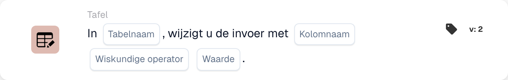

# Invoer wijzigen met

<figure><figcaption>
Kaartvelden in de getoonde versie. De velden zijn nog niet ingevuld. Sommige labels van deze versie zijn in de interface nog niet of onjuist vertaald. De uitleg op deze pagina gebruikt de juiste termen; de afbeelding toont de werkelijke interface.
</figcaption></figure>

## **Doel:**

De workflow-kaart **"Change Entries in Table"** wordt gebruikt om vermeldingen in een opgegeven databasetabel bij te werken. Hiermee kunt u een **tabel** en **kolom** selecteren en vervolgens wiskundige bewerkingen (optellen, aftrekken, vermenigvuldigen of delen) op de waarden in die kolom uitvoeren, met een opgegeven waarde.

## **Onderdelen van de kaart:**

1. **Tabelnaam**
   * **Beschrijving:** Geeft de **tabel** op waarin vermeldingen worden bijgewerkt.
   * **Details:** Er wordt een dropdownlijst van beschikbare **tabellen** geboden, waarmee u de doeltabel voor het bijwerken van vermeldingen kunt selecteren.
2. **Kolomnaam**
   * **Beschrijving:** Geeft de **kolom** binnen de geselecteerde tabel op die wordt bijgewerkt.
   * **Details:** Er wordt een lijst van alle beschikbare **kolommen** geboden om uit te selecteren.
3. **Bediening**
   * **Beschrijving:** Definieert de wiskundige bewerking die op de **kolom**waarden wordt uitgevoerd.
   * **Opties:**
     * **Add (+):** Telt een opgegeven **waarde** op bij de huidige waarde in de geselecteerde kolom.
     * **Aftrekken (-):** Trekt een opgegeven **waarde** af van de huidige waarde in de geselecteerde kolom.
     * **Multiply (\*):** Vermenigvuldigt de huidige waarde in de geselecteerde kolom met een opgegeven **waarde**.
     * **Verdeel (/):** Deelt de huidige waarde in de geselecteerde kolom door een opgegeven **waarde**.
4. **Waarde**
   * **Beschrijving:** Geeft de **waarde** op die in de geselecteerde bewerking wordt gebruikt.
   * **Details:** Dit is het getal dat wordt opgeteld, afgetrokken, vermenigvuldigd of gedeeld met de vermeldingen in de geselecteerde kolom.

## **Functionaliteit:**

* **Voorwaarde-evaluatie:**\
  De kaart voert de actie alleen uit als zowel de **"Wanneer"**- als de **"En"**-secties als true worden geëvalueerd.
* **Tabelvermelding bijwerken:**\
  De kaart voert de geselecteerde bewerking (**+**, **-**, **\*** of **/**) uit op de waarden in de gekozen **kolom** van de geselecteerde **tabel**, met de opgegeven **waarde**.

## **Opzet en configuratie:**

* **Tabel selecteren:**\
  Kies de **tabel** waarin de wijzigingen worden toegepast.
* **Kolom kiezen:**\
  Selecteer de **kolom** binnen de tabel die u wilt bijwerken.
* **Bewerking selecteren:**\
  Kies de wiskundige bewerking (**+**, **-**, **\***, **/**) die op de waarden van de geselecteerde kolom wordt toegepast.
* **Waarde invoeren:**\
  Geef de **waarde** op die in de geselecteerde bewerking wordt gebruikt.

## **Conclusie:**

De workflow-kaart **"Change Entries in Table"** maakt geautomatiseerde updates van databasevermeldingen mogelijk door een **tabel**, **kolom** en gewenste **wiskundige bewerking** te selecteren. Deze kaart is essentieel voor het uitvoeren van bulkgegevensaanpassingen of berekeningen binnen uw database.

<!-- workflow-card-practical-example-20261021 -->

## Praktisch voorbeeld

**Wanneer gebruiken:** Pas een numerieke aanpassing toe op een bestaande tabelkolom.

**Configuratie:** Selecteer demotabel `lines`, numerieke kolom `quantity`, optelling en waarde `1`.

**Verwacht resultaat en tegenvoorbeeld:** Een bestaande hoeveelheid van `2` wordt `3`. Het herhalen van deze actie levert `4` op, dus gebruik deze alleen als herhaalde optelling is bedoeld.

Dit is een illustratieve configuratie en een verwacht resultaat. Gebruik velden, gebruikers en groepen die in uw testorganisatie zijn geconfigureerd; het is geen bewering dat dit voorbeeld is uitgevoerd.
