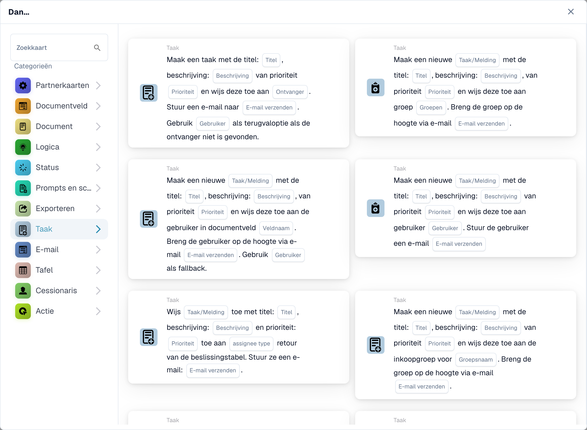

# Taak

De kaarten van deze categorie in de **Kaart toevoegen**-kiezer van de Workflow Builder:

<figure><figcaption>
Beschikbare kaarten in de geselecteerde categorie. Vul de velden vóór gebruik in. Sommige labels van deze versie zijn in de interface nog niet of onjuist vertaald. De uitleg op deze pagina gebruikt de juiste termen; de afbeelding toont de werkelijke interface.
</figcaption></figure>
