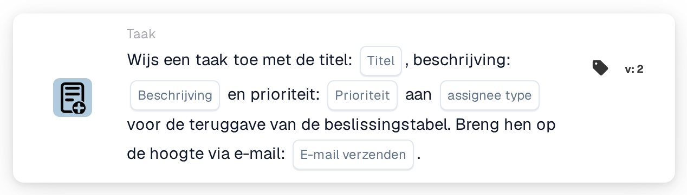
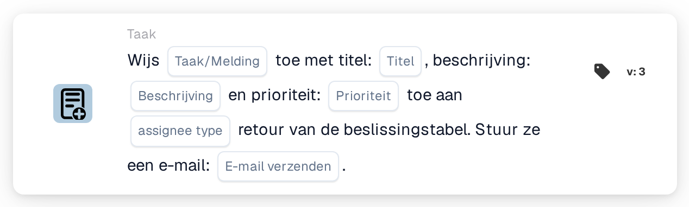

# Wijs een taak met titel toe

<figure><figcaption>
Versie 2
</figcaption></figure>

<figure><figcaption>
Versie 3
</figcaption></figure>

## **Doel:**

De workflow-kaart "Assign Task / Notification from Decision Table" is ontworpen om taken of meldingen dynamisch toe te wijzen op basis van de resultaten van een decision table. Deze kaart zorgt ervoor dat taken of meldingen aan de juiste gebruiker of groep worden toegewezen volgens de logica die in de decision table is gedefinieerd, met een optionele e-mailmelding die naar de ontvanger wordt verzonden.

## **Onderdelen van de kaart:**

1. **Titel**
   * **Beschrijving**: Geeft de titel op van de taak of melding die wordt aangemaakt.
   * **Details**: De titel moet context bieden en het doel van de taak of melding beschrijven.
2. **Beschrijving**
   * **Beschrijving**: Definieert de inhoud of het doel van de taak of melding.
   * **Details**: Biedt aanvullende informatie over de taak of melding en legt de context of de vereiste actie uit.
3. **Prioriteit**
   * **Beschrijving**: Definieert het urgentieniveau van de taak of melding.
   * **Opties**:
     * **High**: Taken of meldingen die onmiddellijke aandacht vereisen.
     * **Middelmatig**: Belangrijke taken die snel moeten worden afgehandeld.
     * **Low**: Taken die op een later tijdstip kunnen worden afgehandeld.
4. **Type toegewezen persoon**
   * **Beschrijving**: Geeft de gebruiker of groep op die op basis van de uitvoer van de decision table aan de taak of melding wordt toegewezen.
   * **Details**: De decision table evalueert dynamisch de voorwaarden en retourneert de juiste gebruiker of groep voor toewijzing.
5. **E-mailmelding**
   * **Beschrijving**: Configureert of er een e-mailmelding naar de toegewezen gebruiker of groep wordt verzonden.
   * **Opties**:
     * **True**: Verzendt een e-mailmelding naar de ontvanger.
     * **False**: Er wordt geen e-mailmelding verzonden.

#### **Aanvullende onderdelen in Version 3**

1. **Meldingstype**
   * **Beschrijving**: Geeft op of de kaart een taak of een melding aanmaakt.
   * **Opties**:
     * **Taak**: Maakt een taak aan die wordt toegewezen aan de gebruiker of groep uit de decision table.
     * **Notification**: Verzendt een melding naar de gebruiker of groep uit de decision table.

## **Functionaliteit:**

* **Voorwaarde-evaluatie:**\
  De kaart voert de actie alleen uit als zowel de **"Wanneer"**- als de **"En"**-secties als true worden geëvalueerd.
* **Taak-/meldingstoewijzing**\
  De kaart wijst de taak of melding toe aan de gebruiker of groep die door de decision table wordt geïdentificeerd. De decision table evalueert dynamisch vooraf gedefinieerde voorwaarden en retourneert de bijbehorende ontvanger.
* **E-mailmelding**\
  Indien zo geconfigureerd, wordt er een e-mailmelding naar de toegewezen gebruiker of groep verzonden.
* **Versie 3-functionaliteit**\
  In Version 3 maakt de kaart het aanmaken van ofwel een Task ofwel een Notification mogelijk, wat meer flexibiliteit biedt voor taakbeheer en communicatie.

## **Opzet en configuratie:**

1. **Taak- of meldingsdetails definiëren**:\
   Voer de titel, beschrijving en prioriteit voor de taak of melding in.
2. **Besluittabel gemaakt**:\
   Stel de decision table in om dynamisch te bepalen welke gebruiker of groep de taak of melding krijgt toegewezen.
3. **E-mailmelding inschakelen**:\
   Geef op of er een e-mailmelding naar de toegewezen gebruiker of groep moet worden verzonden.
4. **Notification Type opgeven (Version 3)**:\
   Kies of de kaart een taak aanmaakt of een melding verzendt.

## **Conclusie:**

De workflow-kaart **"Taak/melding toewijzen vanuit beslissingstabel"** automatiseert de toewijzing van taken of meldingen op basis van dynamische voorwaarden die in een decision table zijn gedefinieerd. Version 3 verbetert de functionaliteit door gebruikers te laten kiezen tussen het aanmaken van een taak of een melding, en zorgt ervoor dat altijd de juiste ontvanger wordt toegewezen. De e-mailmeldingsfunctie houdt gebruikers op de hoogte, wat de communicatie en het taakbeheer stroomlijnt.

<!-- workflow-card-practical-example-20261021 -->

## Praktisch voorbeeld

**Wanneer gebruiken:** Maak een taak voor de verantwoordelijke, geretourneerd door een beslissingstabel.

**Configuratie:** Gebruik een overeenkomende demoregel die `Demo Reviewer A`, titel `Review invoice` en de gewenste prioriteit retourneert.

**Verwacht resultaat en tegenvoorbeeld:** De resulterende taak wordt toegewezen op basis van de geretourneerde toegewezen persoon. Test een ongeëvenaarde regel afzonderlijk en inspecteer het kaartlogboek.

Dit is een illustratieve configuratie en een verwacht resultaat. Gebruik velden, gebruikers en groepen die in uw testorganisatie zijn geconfigureerd; het is geen bewering dat dit voorbeeld is uitgevoerd.
