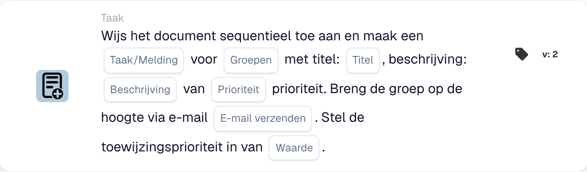

# Document toewijzen en taak/melding voor groep maken

<figure><figcaption>
Kaartvelden in de getoonde versie. De velden zijn nog niet ingevuld.
</figcaption></figure>

## **Doel**

De workflow-kaart "**Document toewijzen en taak/melding voor groep maken**" wijst een document toe aan een opgegeven groep, maakt een taak of melding aan met aanpasbare details en verzendt optioneel een e-mailmelding naar de groep. Deze kaart ondersteunt ook het toewijzen van een numerieke prioriteitswaarde om de uitvoeringsvolgorde te bepalen.

## **Onderdelen van de kaart**

1. **Groepsnaam**
   * **Beschrijving:** Geeft de groep op die de taak of melding ontvangt.
   * **Details:** Een dropdown om de naam te kiezen van de groep waaraan het document en de taak/melding worden toegewezen.
2. **Taak/Melding**
   * **Beschrijving:** Geeft het type actie op dat voor de groep wordt aangemaakt.
   * **Details:** Een dropdown om ofwel "Task" ofwel "Notification" te selecteren op basis van de gewenste actie.
3. **Titel**
   * **Beschrijving:** Biedt de titel van de taak of melding.
   * **Details:** Een veld om een beknopte, beschrijvende titel voor de taak of melding toe te voegen.
4. **Beschrijving**
   * **Beschrijving:** Beschrijft de taak of melding verder.
   * **Details:** Een veld om aanvullende details over het doel van de taak of de inhoud van de melding te bieden.
5. **Prioriteit**
   * **Beschrijving:** Definieert het urgentieniveau van de taak of melding.
   * **Opties:**
     * **High:** Vereist onmiddellijke aandacht.
     * **Middel:** Belangrijk maar niet urgent.
     * **Low:** Kan later worden afgehandeld.
6. **E-mail verzenden**
   * **Beschrijving:** Configureert of er een e-mailmelding naar de groep wordt verzonden.
   * **Opties:**
     * **True:** Verzendt een e-mailmelding.
     * **False:** Verzendt geen e-mail.
7. **Waarde**
   * **Beschrijving:** Stelt de numerieke prioriteit voor de documenttoewijzing in.
   * **Details:** Een veld om een numerieke waarde in te voeren, waarbij een lager getal een hogere prioriteit aangeeft.

## **Functionaliteit**

* **Voorwaarde-evaluatie:**\
  De kaart voert de acties alleen uit als aan de geconfigureerde workflow-voorwaarden wordt voldaan.
* **Documenttoewijzing en aanmaak van taak/melding:**\
  Het document wordt toegewezen aan de groep die in het veld "Group Name" is opgegeven. Er wordt een taak of melding aangemaakt met de geconfigureerde titel, beschrijving en prioriteitsniveau.
* **E-mailmelding:**\
  Als "Send Mail" op True is ingesteld, wordt er een e-mailmelding naar de groep verzonden om hen op de hoogte te stellen van de taak of melding.

## **Opzet en configuratie**

1. **Group Name definiëren:**
   * Voer de naam van de groep in het veld Group Name in.
2. **Taak/Melding selecteren:**
   * Kies "Taak" of "Melding" in de Taak/Melding-dropdown.
3. **Taak-/meldingsdetails instellen:**
   * Voer de Title en Description voor de taak of melding in.
   * Selecteer de prioriteit in de vervolgkeuzelijst (Hoog, Gemiddeld of Laag).
4. **E-mailmelding inschakelen:**
   * Configureer de optie Send Mail op True of False, afhankelijk van of er een e-mailmelding moet worden verzonden.
5. **Numerieke prioriteit toewijzen:**
   * Voer een numerieke waarde in het veld Value in om de prioriteit van de toewijzing te bepalen, waarbij lagere waarden voorrang krijgen.
6. Sla de kaartconfiguratie op en activeer de workflow.

## **Conclusie**

De workflow-kaart "Assign Document and Create Task/Notification for Group" zorgt ervoor dat documenten aan de juiste groep worden toegewezen, terwijl taken of meldingen worden aangemaakt met aanpasbare prioriteits- en e-mailmeldingsopties. Dit stroomlijnt het documentbeheer en verbetert de workflow-efficiëntie.

<!-- workflow-card-practical-example-20261021 -->

## Praktisch voorbeeld

**Wanneer gebruiken:** Maak een teamtaak naast de geprioriteerde documenttoewijzing.

**Configuratie:** Selecteer `Demo Finance`, titel `Review invoice` en de taak- en toewijzingsprioriteiten.

**Verwacht resultaat en tegenvoorbeeld:** Controleer de groepsdocumenttoewijzing en de taak/melding afzonderlijk. Een taak alleen is geen bewijs van een voltooide documentgoedkeuring.

Dit is een illustratieve configuratie en een verwacht resultaat. Gebruik velden, gebruikers en groepen die in uw testorganisatie zijn geconfigureerd; het is geen bewering dat dit voorbeeld is uitgevoerd.
