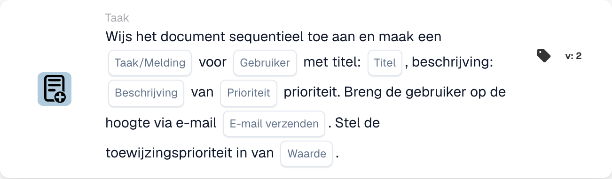

# Document toewijzen en taak/melding voor gebruiker maken

<figure><figcaption>
Kaartvelden in de getoonde versie. De velden zijn nog niet ingevuld.
</figcaption></figure>

## **Doel**

De workflow-kaart "**Document toewijzen en taak/melding voor gebruiker maken**" wijst een document toe aan een opgegeven gebruiker, maakt een taak of melding aan met configureerbare details en verzendt optioneel een e-mailmelding naar de gebruiker. Deze kaart maakt het ook mogelijk een numerieke prioriteitswaarde in te stellen om de uitvoeringsvolgorde te bepalen.

## **Onderdelen van de kaart**

1. **Gebruiker**
   * **Beschrijving:** Geeft de gebruiker op die de taak of melding ontvangt.
   * **Details:** Een vervolgkeuzemenu om de gebruiker te selecteren aan wie het document en de taak/melding wordt toegewezen.
2. **Taak/Melding**
   * **Beschrijving:** Geeft het type actie op dat voor de gebruiker wordt aangemaakt.
   * **Details:** Een dropdown om ofwel "Task" ofwel "Notification" te kiezen op basis van de beoogde actie.
3. **Titel**
   * **Beschrijving:** De titel van de taak of melding.
   * **Details:** Een veld om een beknopte, beschrijvende titel voor de taak of melding te bieden.
4. **Beschrijving**
   * **Beschrijving:** Aanvullende details over de taak of melding.
   * **Details:** Een veld om het doel van de taak te beschrijven of context voor de melding te bieden.
5. **Prioriteit**
   * **Beschrijving:** Definieert het urgentieniveau van de taak of melding.
   * **Opties:**
     * **High:** Vereist onmiddellijke aandacht.
     * **Middel:** Belangrijk maar niet urgent.
     * **Low:** Kan later worden afgehandeld.
6. **E-mail verzenden**
   * **Beschrijving:** Configureert of er een e-mailmelding naar de gebruiker wordt verzonden.
   * **Opties:**
     * **True:** Verzendt een e-mailmelding naar de gebruiker.
     * **False:** Er wordt geen e-mailmelding verzonden.
7. **Waarde**
   * **Beschrijving:** Stelt de numerieke prioriteit voor de documenttoewijzing in.
   * **Details:** Een veld om een numerieke waarde in te voeren, waarbij lagere getallen een hogere prioriteit aangeven.

## **Functionaliteit**

* **Voorwaarde-evaluatie:**\
  De kaart voert de acties alleen uit als aan de geconfigureerde workflow-voorwaarden wordt voldaan.
* **Documenttoewijzing en aanmaak van taak/melding:**\
  Het document wordt toegewezen aan de gebruiker die in het veld "User" is opgegeven. Er wordt een taak of melding aangemaakt met de opgegeven titel, beschrijving en prioriteitsniveau.
* **E-mailmelding:**\
  Als "Send Mail" op True is ingesteld, wordt er een e-mail naar de gebruiker verzonden om hem op de hoogte te stellen van de taak of melding.

## **Opzet en configuratie**

1. **Gebruiker selecteren:**
   * Kies de gebruiker uit het User-dropdownmenu.
2. **Taak-/meldingsdetails configureren:**
   * Selecteer "Taak" of "Melding" in de Taak/Melding-dropdown.
   * Voer de Title en Description voor de taak of melding in.
   * Stel de Prioriteit in door High, Medium of Low in de dropdown te selecteren.
3. **E-mailmelding inschakelen:**
   * Configureer de optie Send Mail op True of False, afhankelijk van of er een e-mailmelding moet worden verzonden.
4. **Numerieke prioriteit instellen:**
   * Voer een numerieke waarde in het veld Value in om de prioriteit van de toewijzing te bepalen, waarbij lagere waarden het eerst worden verwerkt.
5. Sla de kaartconfiguratie op en activeer de workflow.

## **Conclusie**

De workflow-kaart "Assign Document and Create Task/Notification for User" zorgt ervoor dat documenten aan de juiste gebruiker worden toegewezen, terwijl taken of meldingen worden aangemaakt met gedefinieerde prioriteiten en optionele e-mailmeldingen. Deze kaart helpt de taakdelegatie te stroomlijnen en de workflow-efficiëntie te verbeteren.

<!-- workflow-card-practical-example-20261021 -->

## Praktisch voorbeeld

**Wanneer gebruiken:** Creëer een gebruikersbeoordelingstaak naast de geprioriteerde documenttoewijzing.

**Configuratie:** Selecteer `Demo Reviewer A`, taaktitel `Review invoice`, taakprioriteit en toewijzingsprioriteit.

**Verwacht resultaat en tegenvoorbeeld:** Controleer of zowel de documenttoewijzing als de taak/melding bestaan voor de geselecteerde gebruiker, met de beoogde prioriteiten.

Dit is een illustratieve configuratie en een verwacht resultaat. Gebruik velden, gebruikers en groepen die in uw testorganisatie zijn geconfigureerd; het is geen bewering dat dit voorbeeld is uitgevoerd.
