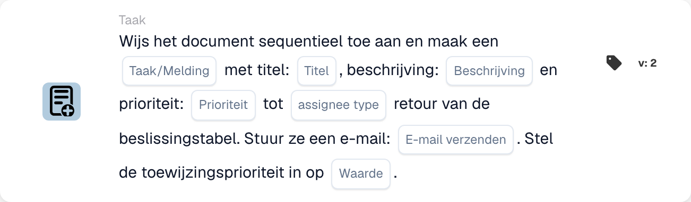

# Document toewijzen en taak/melding maken

<figure><figcaption>
Kaartvelden in de getoonde versie. De velden zijn nog niet ingevuld. Sommige labels van deze versie zijn in de interface nog niet of onjuist vertaald. De uitleg op deze pagina gebruikt de juiste termen; de afbeelding toont de werkelijke interface.
</figcaption></figure>

## **Doel**

De workflow-kaart "**Document toewijzen en taak/melding maken op basis van de beslissingstabel**" wijst een document toe en maakt een taak of melding aan met configureerbare details. De toegewezene wordt bepaald door de retourwaarde van een decision table, en de kaart maakt het mogelijk prioriteiten in te stellen en e-mailmeldingen te verzenden.

## **Onderdelen van de kaart**

1. **Type toegewezen persoon**
   * **Beschrijving:** Geeft op of de retourwaarde van de decision table het document en de taak/melding aan een gebruiker of groep toewijst.
   * **Details:** Een veld om het toegewezene-type te configureren als ofwel "User" ofwel "Group" op basis van de uitvoer van de decision table.
2. **Taak/Melding**
   * **Beschrijving:** Geeft het type actie op dat voor de toegewezene wordt aangemaakt.
   * **Details:** Een dropdown om ofwel "Task" ofwel "Notification" te selecteren op basis van de workflow-behoeften.
3. **Titel**
   * **Beschrijving:** De titel van de taak of melding.
   * **Details:** Een veld om een beknopte titel te bieden die de taak of melding identificeert.
4. **Beschrijving**
   * **Beschrijving:** Aanvullende details over de taak of melding.
   * **Details:** Een veld om het doel en de context van de taak of melding te beschrijven.
5. **Prioriteit**
   * **Beschrijving:** Definieert het urgentieniveau van de taak of melding.
   * **Opties:**
     * **High:** Vereist onmiddellijke aandacht.
     * **Middel:** Belangrijk maar niet urgent.
     * **Low:** Kan later worden afgehandeld.
6. **Type toegewezen persoon**
   * **Beschrijving:** Dit veld bepaalt het type toegewezene (User of Group) aan wie het document en de taak/melding worden toegewezen.
   * **Details:** Een vervolgkeuzemenu voor het selecteren van de taak/melding aan een gebruiker van een groep wordt toegewezen op basis van de uitvoer van de beslissingstabel.
7. **E-mail verzenden**
   * **Beschrijving:** Configureert of er een e-mailmelding naar de toegewezene wordt verzonden.
   * **Opties:**
     * **True:** Verzendt een e-mailmelding.
     * **False:** Er wordt geen e-mailmelding verzonden.
8. **Waarde**
   * **Beschrijving:** Stelt de numerieke prioriteit voor de documenttoewijzing in.
   * **Details:** Een veld om een numerieke waarde in te voeren, waarbij lagere getallen een hogere prioriteit aangeven.

## **Functionaliteit**

* **Voorwaarde-evaluatie:**\
  De kaart voert de acties alleen uit als aan de workflow-voorwaarden wordt voldaan.
* **Besluittabel-evaluatie:**\
  De decision table bepaalt of het document en de taak/melding aan een gebruiker of groep worden toegewezen.
* **Documenttoewijzing en aanmaak van taak/melding:**\
  Het document wordt toegewezen aan het resultaat van de decision table. Er wordt een taak of melding aangemaakt met de opgegeven titel, beschrijving en prioriteitsniveau.
* **E-mailmelding:**\
  Als "Send Mail" op True is ingesteld, wordt er een e-mailmelding naar de toegewezene verzonden.

## **Opzet en configuratie**

1. **Assignee Type definiëren:**
   * Configureer het veld Assignee Type als ofwel "User" ofwel "Group" op basis van de uitvoer van de decision table.
2. **Taak/Melding selecteren:**
   * Kies "Taak" of "Melding" in de Taak/Melding-dropdown.
3. **Taak-/meldingsdetails instellen:**
   * Voer de Title en Description voor de taak of melding in.
   * Selecteer de prioriteit (hoog, gemiddeld of laag) in de vervolgkeuzelijst.
4. **E-mailmelding inschakelen:**
   * Stel de optie Send Mail in op True of False, afhankelijk van of er een e-mailmelding moet worden verzonden.
5. **Numerieke prioriteit instellen:**
   * Voer een numerieke waarde in het veld Value in om de toewijzingsprioriteit te bepalen, waarbij lagere getallen het eerst worden verwerkt.
6. Sla de kaartconfiguratie op en activeer de workflow.

## **Conclusie**

De workflow-kaart "Assign Document and Create Task/Notification Based on Decision Table" zorgt ervoor dat taken of meldingen dynamisch aan de juiste gebruiker of groep worden toegewezen op basis van de resultaten van de decision table. Deze kaart faciliteert efficiënte taakdelegatie, aanpasbare prioriteiten en optionele e-mailmeldingen om de responsiviteit van de workflow te verbeteren.

<!-- workflow-card-practical-example-20261021 -->

## Praktisch voorbeeld

**Wanneer gebruiken:** Gebruik een beslissingstabelresultaat om een document toe te wijzen en achtereenvolgens een revisietaak te maken.

**Configuratie:** Selecteer de demobeslissingstabel, taaktitel `Review invoice`, beschrijving en prioriteit. Configureer het retourformaat voor de toegewezen persoon en de e-mailoptie die vereist is voor de geselecteerde versie.

**Verwacht resultaat en tegenvoorbeeld:** De overeenkomende geretourneerde toegewezen persoon ontvangt de gedocumenteerde documenttoewijzing en taak/melding. Controleer beide resultaten; een lege tabelretour is geen succesvolle toewijzing.

Dit is een illustratieve configuratie en een verwacht resultaat. Gebruik velden, gebruikers en groepen die in uw testorganisatie zijn geconfigureerd; het is geen bewering dat dit voorbeeld is uitgevoerd.
