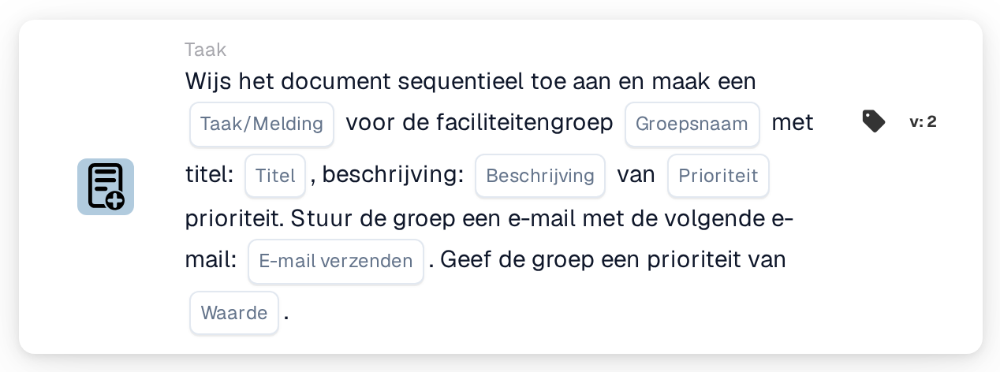

# Wijs toe aan de faciliteitsgroep en maak een taak/melding aan

<figure><figcaption>
Versie 2
</figcaption></figure>

## Doel:

Deze workflowkaart voegt de groep die verantwoordelijk is voor de faciliteit van de inkooporder van het document toe aan de sequentiële toewijzing van het document en koppelt een taak of melding aan deze stap. De faciliteit wordt overgenomen uit de inkooporders waarmee het document is gematcht, en de groep wordt gevonden aan de hand van haar naam, die zowel de op de kaart ingevoerde groepsnaam als de faciliteitscode bevat. De taak of melding hoort bij de stap van de groep in de reeks.

## Onderdelen van de kaart:

1. **Taak/Melding**
   * **Beschrijving:** Bepaalt of er voor de groep een taak of een melding wordt aangemaakt.
   * **Opties:**
     * **Taak:** Er wordt een taak aangemaakt.
     * **Kennisgeving:** Er wordt een melding aangemaakt.
2. **Groepsnaam**
   * **Beschrijving:** Het deel van de naam dat de faciliteitengroepen gemeenschappelijk hebben.
   * **Detail:** Een tekst die wordt vergeleken met de namen van de gebruikersgroepen van de organisatie. Een groep komt overeen als haar naam deze tekst en de faciliteitscode van de inkooporder bevat. Bij de vergelijking wordt geen onderscheid gemaakt tussen hoofd- en kleine letters. Met de groepsnaam **Approver** en een inkooporder voor faciliteit **1000** zou bijvoorbeeld een groep met de naam **Approver 1000** overeenkomen.
3. **Titel**
   * **Beschrijving:** De titel van de taak of melding.
   * **Detail:** Een korte tekst waaraan de taak of melding te herkennen is.
4. **Beschrijving**
   * **Beschrijving:** Verdere details over de taak of melding.
   * **Detail:** Een tekst die beschrijft wat er gedaan kan worden of waarom de groep wordt geïnformeerd.
5. **Prioriteit**
   * **Beschrijving:** De urgentie van de taak of melding.
   * **Opties:**
     * **hoog gewicht:** De taak of melding wordt met hoge prioriteit aangemaakt.
     * **gemiddeld gewicht:** De taak of melding wordt met gemiddelde prioriteit aangemaakt.
     * **laag gewicht:** De taak of melding wordt met lage prioriteit aangemaakt.
6. **E-mail verzenden**
   * **Beschrijving:** Bepaalt of de groep ook per e-mail over de taak wordt geïnformeerd.
   * **Opties:**
     * **True:** Er wordt een e-mailmelding naar de groep verzonden.
     * **False:** Er wordt geen e-mailmelding verzonden.
7. **Waarde**
   * **Beschrijving:** De prioriteit van de groep binnen de sequentiële toewijzing.
   * **Detail:** Een geheel getal. Lagere getallen komen eerst, waarbij 0 de hoogste prioriteit is. Wordt er geen waarde of een negatieve waarde ingevoerd, dan wordt prioriteit 1 gebruikt.

## Functionaliteit:

* **Faciliteit bepalen:** De kaart leest de inkooporders waarmee het document is gematcht en verzamelt van elk daarvan de faciliteitscode (de locatie van de inkooporder).
* **Groep bepalen:** Voor elke faciliteitscode zoekt de kaart gebruikersgroepen waarvan de naam zowel de **Groepsnaam** van de kaart als de faciliteitscode bevat. Faciliteitscodes waarvoor geen groep wordt gevonden, worden in het workflowlogboek vermeld.
* **Actie-uitvoering:** Elke overeenkomende groep wordt met de prioriteit uit het veld **Waarde** aan de sequentiële toewijzing toegevoegd, samen met de taak of melding. De toewijzing zelf vindt plaats aan het einde van de workflowuitvoering: het item met het laagste prioriteitsnummer wordt als eerste toegewezen en de bijbehorende taak of melding wordt aangemaakt. Alle items, inclusief het eerste, worden als goedkeuringsverzoeken bij het document opgeslagen, en de volgende stappen van de reeks worden daaruit in oplopende volgorde van prioriteit genomen. Heeft een andere kaart het document in dezelfde uitvoering al direct toegewezen, dan wordt deze eerste sequentiële toewijzing overgeslagen en wordt de bijbehorende taak of melding in deze uitvoering niet aangemaakt.
* **Standaardwaarden:** Is er geen taakprioriteit ingesteld, dan wordt **gemiddeld gewicht** gebruikt. Is **E-mail verzenden** niet ingesteld, dan wordt er geen e-mail verzonden. Is **Taak/Melding** niet ingesteld, dan wordt er een taak aangemaakt en vermeldt het workflowlogboek de ontbrekende instelling.
* **Ontbrekende gegevens:**
  * Is de groepsnaam, de titel of de beschrijving leeg, dan wordt de kaart niet uitgevoerd en meldt ze de ontbrekende gegevens in het workflowlogboek.
  * Is het document niet met een inkooporder gematcht, dan meldt de kaart de ontbrekende gegevens in plaats van een groep toe te voegen.
  * Komt geen enkele groep overeen met een van de faciliteitscodes, dan wordt er geen groep toegevoegd en vermeldt het workflowlogboek dat er geen overeenkomende groep is gevonden.

## Opzet en configuratie:

* De gebruikersgroepen horen zo te worden benoemd dat elke naam het gemeenschappelijke naamdeel en de faciliteitscode bevat, bijvoorbeeld **Approver 1000**, **Approver 2000**.
* De kaart kan worden toegevoegd vanuit de categorie **Taak**. Daarna kunnen het type (**Taak** of **Kennisgeving**), het gemeenschappelijke naamdeel van de groepen, de titel, de beschrijving, de taakprioriteit, de e-mailinstelling en de positie in de reeks (**Waarde**) worden geconfigureerd.
* Om een keten van goedkeurders op te bouwen, kunnen meerdere sequentiële kaarten in de workflow worden gecombineerd, elk met een eigen **Waarde**.

## Conclusie:

De workflowkaart "Assign to Facility Group and Create a Task/Notification" plaatst het verantwoordelijke faciliteitsteam op een vastgelegde positie in een sequentiële goedkeuring en geeft het een duidelijke taak voor zijn stap. Eén kaart dekt alle faciliteiten af, zolang de gebruikersgroepen een consistent naamgevingsschema met de faciliteitscode in hun naam volgen.
