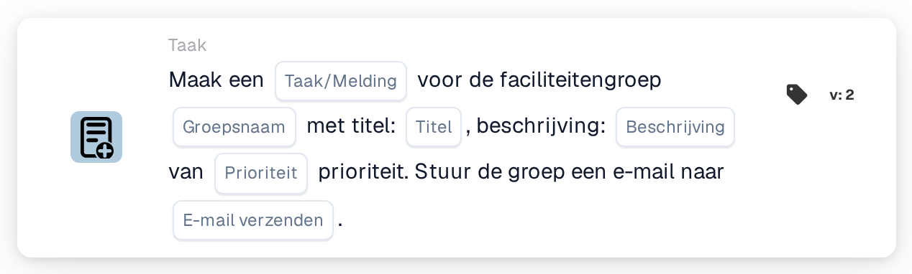

# Maak een nieuwe taak en wijs deze toe aan de faciliteitsgroep

<figure><figcaption>
Versie 2
</figcaption></figure>

## Doel:

Deze workflowkaart maakt een taak of melding aan voor de groep die verantwoordelijk is voor de faciliteit van de inkooporder van het document. De faciliteit wordt niet op de kaart geselecteerd, maar overgenomen uit de inkooporders waarmee het document is gematcht. De kaart zoekt vervolgens een gebruikersgroep waarvan de naam zowel de op de kaart ingevoerde groepsnaam als de faciliteitscode bevat, en maakt de taak voor die groep aan. Het document zelf wordt niet opnieuw toegewezen.

Voor een kaart die het document daarnaast als onderdeel van een sequentiële toewijzing aan de faciliteitengroep toewijst, kan **Assign to Facility Group and Create a Task/Notification** worden gebruikt.

## Onderdelen van de kaart:

1. **Taak/Melding**
   * **Beschrijving:** Bepaalt of er voor de groep een taak of een melding wordt aangemaakt.
   * **Opties:**
     * **Taak:** Er wordt een taak aangemaakt.
     * **Kennisgeving:** Er wordt een melding aangemaakt.
2. **Groepsnaam**
   * **Beschrijving:** Het deel van de naam dat de faciliteitengroepen gemeenschappelijk hebben.
   * **Detail:** Een tekst die wordt vergeleken met de namen van de gebruikersgroepen van de organisatie. Een groep komt overeen als haar naam deze tekst en de faciliteitscode van de inkooporder bevat. Bij de vergelijking wordt geen onderscheid gemaakt tussen hoofd- en kleine letters. Met de groepsnaam **Warehouse** en een inkooporder voor faciliteit **1000** zou bijvoorbeeld een groep met de naam **Warehouse 1000** overeenkomen.
3. **Titel**
   * **Beschrijving:** De titel van de taak of melding.
   * **Detail:** Een korte tekst waaraan de taak of melding te herkennen is.
4. **Beschrijving**
   * **Beschrijving:** Verdere details over de taak of melding.
   * **Detail:** Een tekst die beschrijft wat er gedaan kan worden of waarom de groep wordt geïnformeerd.
5. **Prioriteit**
   * **Beschrijving:** De urgentie van de taak of melding.
   * **Opties:**
     * **hoog gewicht:** De taak of melding wordt met hoge prioriteit aangemaakt.
     * **gemiddeld gewicht:** De taak of melding wordt met gemiddelde prioriteit aangemaakt.
     * **laag gewicht:** De taak of melding wordt met lage prioriteit aangemaakt.
6. **E-mail verzenden**
   * **Beschrijving:** Bepaalt of de groep ook per e-mail over de taak wordt geïnformeerd.
   * **Opties:**
     * **True:** Er wordt een e-mailmelding naar de groep verzonden.
     * **False:** Er wordt geen e-mailmelding verzonden.

## Functionaliteit:

* **Faciliteit bepalen:** De kaart leest de inkooporders waarmee het document is gematcht en verzamelt van elk daarvan de faciliteitscode (de locatie van de inkooporder).
* **Groep bepalen:** Voor elke faciliteitscode zoekt de kaart gebruikersgroepen waarvan de naam zowel de **Groepsnaam** van de kaart als de faciliteitscode bevat. Faciliteitscodes waarvoor geen groep wordt gevonden, worden in het workflowlogboek vermeld.
* **Taken aanmaken:** Voor de overeenkomende groep wordt een taak of melding met de titel, beschrijving en prioriteit van de kaart aangemaakt en aan het document gekoppeld. Komen meerdere groepen overeen, dan wordt de taak voor slechts één ervan aangemaakt; welke dat is, wordt niet door de kaart bepaald.
* **Standaardwaarden:** Is er geen prioriteit ingesteld, dan wordt **gemiddeld gewicht** gebruikt. Is **E-mail verzenden** niet ingesteld, dan wordt er geen e-mail verzonden. Is **Taak/Melding** niet ingesteld, dan wordt er een taak aangemaakt en vermeldt het workflowlogboek de ontbrekende instelling.
* **Ontbrekende gegevens:**
  * Is de groepsnaam, de titel of de beschrijving leeg, dan wordt de kaart niet uitgevoerd en meldt ze de ontbrekende gegevens in het workflowlogboek.
  * Is het document niet met een inkooporder gematcht, dan meldt de kaart de ontbrekende gegevens in plaats van een taak aan te maken.
  * Komt geen enkele groep overeen met een van de faciliteitscodes, dan wordt er geen taak aangemaakt en vermeldt het workflowlogboek dat er geen overeenkomende groep is gevonden.

## Opzet en configuratie:

* De gebruikersgroepen horen zo te worden benoemd dat elke naam het gemeenschappelijke naamdeel en de faciliteitscode bevat, bijvoorbeeld **Warehouse 1000**, **Warehouse 2000**.
* De kaart kan worden toegevoegd vanuit de categorie **Taak**. Daarna kunnen het type (**Taak** of **Kennisgeving**), het gemeenschappelijke naamdeel van de groepen, de titel, de beschrijving, de prioriteit en de e-mailinstelling worden geconfigureerd.

## Conclusie:

De workflowkaart "Create a New Task and assign it to Facility Group" betrekt het team van de juiste faciliteit bij het proces zonder te veranderen aan wie het document is toegewezen. Eén kaart dekt alle faciliteiten af, zolang de gebruikersgroepen een consistent naamgevingsschema met de faciliteitscode in hun naam volgen.
