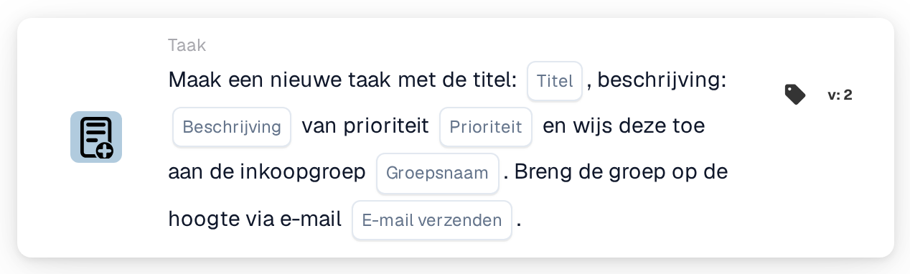
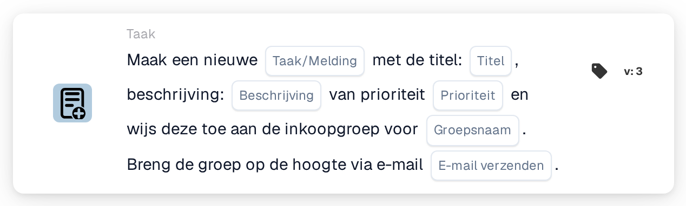

# Maak een nieuwe taak en wijs deze toe aan de inkoopgroep

<figure><figcaption>
Versie 2
</figcaption></figure>

<figure><figcaption>
Versie 3
</figcaption></figure>

## **Doel:**

De workflow-kaart **"Taak voor inkoopgroep maken"** maakt een nieuwe taak aan die dynamisch wordt toegewezen aan de inkoopgroep die in de configuratie is opgegeven. Deze taak kan met verschillende prioriteitsniveaus worden toegewezen, en er kan een optionele e-mailmelding worden verzonden om de groep over de taak te informeren. Deze kaart zorgt ervoor dat het juiste team wordt gewaarschuwd op basis van workflow-voorwaarden.

## **Onderdelen van de kaart:**

1. **Titel**
   * **Beschrijving:** Geeft de titel van de taak op.
   * **Details:** Dit veld identificeert de taak die wordt aangemaakt en biedt een beknopte titel voor eenvoudige identificatie.
2. **Beschrijving**
   * **Beschrijving:** Biedt verdere details over de taak.
   * **Details:** Dit veld wordt gebruikt om het doel van de taak en eventuele noodzakelijke context of instructies te beschrijven.
3. **Prioriteit**
   * **Beschrijving:** Definieert de urgentie van de taak.
   * **Opties:**
     * **High:** Taak vereist onmiddellijke aandacht.
     * **Middel:** Taak is belangrijk maar niet urgent.
     * **Low:** Taak kan op een later tijdstip worden afgehandeld.
4. **Groepsnaam**
   * **Beschrijving:** Geeft de inkoopgroep op aan wie de taak wordt toegewezen.
   * **Details:** Dit veld wijst de inkoopgroep aan die verantwoordelijk is voor de taak. Het zorgt ervoor dat de taak naar het juiste team wordt geleid.
5. **E-mailmelding**
   * **Beschrijving:** Configureert of er een e-mailmelding naar de toegewezen inkoopgroep moet worden verzonden.
   * **Opties:**
     * **True:** Verzendt een e-mailmelding naar de inkoopgroep.
     * **False:** Er wordt geen e-mailmelding verzonden.

## **Functionaliteit:**

* **Voorwaarde-evaluatie:**\
  De kaart voert de actie alleen uit als zowel de **"Wanneer"**- als de **"En"**-secties als true worden geëvalueerd.
* **Taakaanmaak:**\
  De kaart maakt een nieuwe taak aan en wijst deze toe aan de inkoopgroep die in het veld "Group Name" is gedefinieerd. Deze taak bevat de opgegeven titel, beschrijving en prioriteitsniveau.
* **E-mailmelding:**\
  Als de e-mailmeldingsoptie op true is ingesteld, wordt er een e-mail naar de inkoopgroep verzonden om hen over de taak te informeren.

## **Opzet en configuratie:**

* **Taakdetails definiëren:**\
  Voer de titel, beschrijving en het prioriteitsniveau van de taak in.
* **Inkoopgroep selecteren:**\
  Kies de inkoopgroep die verantwoordelijk is voor de taak.
* **E-mailmelding inschakelen:**\
  Geef op of er bij het aanmaken van de taak een e-mailmelding naar de groep moet worden verzonden.

## **Conclusie:**

De workflow-kaart "Create Task for Procurement Group" zorgt ervoor dat taken automatisch aan de juiste inkoopgroep worden toegewezen met gedefinieerde prioriteiten. Deze kaart kan de groep ook via e-mail op de hoogte stellen om ervoor te zorgen dat taken snel worden afgehandeld, wat de workflow-efficiëntie en het taakbeheer verbetert.

<!-- workflow-card-practical-example-20261021 -->

## Praktisch voorbeeld

**Wanneer gebruiken:** Vraag het inkoopteam om een factuuruitzondering te beoordelen.

**Configuratie:** Selecteer `Demo Procurement`, titel `Review order variance`, beschrijving en prioriteit.

**Verwacht resultaat en tegenvoorbeeld:** Er wordt een taak aangemaakt voor de geselecteerde inkoopgroep. Controleer de taakopdrachtgever en -beschrijving; creatie alleen bevestigt niet dat de variantie is opgelost.

Dit is een illustratieve configuratie en een verwacht resultaat. Gebruik velden, gebruikers en groepen die in uw testorganisatie zijn geconfigureerd; het is geen bewering dat dit voorbeeld is uitgevoerd.
