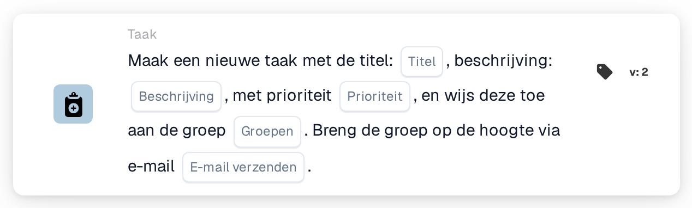
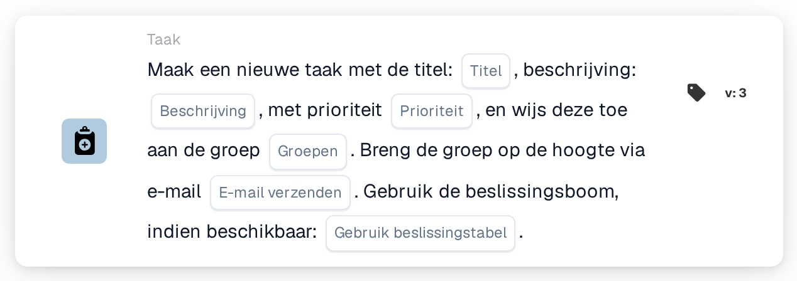
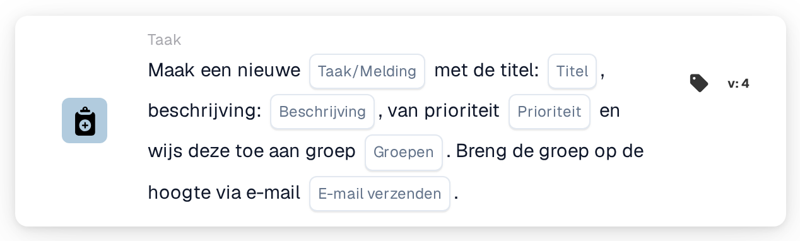

# Maak een nieuwe taak en wijs deze toe aan de groep

<figure><figcaption>
Versie 2
</figcaption></figure>

<figure><figcaption>
Versie 3
</figcaption></figure>

<figure><figcaption>
Versie 4
</figcaption></figure>

## **Doel:**

De workflow-kaart **"Groepstaak of melding maken"** faciliteert het aanmaken van taken of meldingen voor opgegeven groepen, wat zorgt voor efficiënte communicatie en taakbeheer. In latere versies uitgebreid met beslisboomfunctionaliteit, bepaalt hij dynamisch de toegewezen groep of methode, wat de bewerkingen stroomlijnt.

## **Onderdelen van de kaart:**

1. **Titel**
   * **Beschrijving**: Geeft de titel van de taak of melding op.
   * **Details**: Fungeert als de identifier voor de aangemaakte taak of melding.
2. **Beschrijving**
   * **Beschrijving**: Beschrijft de context of details van de taak of melding.
   * **Details**: Biedt duidelijkheid over het doel ervan.
3. **Prioriteit**
   * **Beschrijving**: Stelt het belangrijkheidsniveau van de taak in.
   * **Opties**:
     * **High**: Vereist onmiddellijke actie.
     * **Middelmatig**: Belangrijk maar minder urgent.
     * **Low**: Kan later worden afgehandeld.
4. **Toegewezen groep**
   * **Beschrijving**: Geeft de groep op die verantwoordelijk is voor de taak of melding.
   * **Details**: Geselecteerd uit een dropdownlijst van beschikbare groepen.
5. **E-mailmelding**
   * **Beschrijving**: Maakt het mogelijk een e-mail te verzenden om de toegewezen groep op de hoogte te stellen.
   * **Opties**:
     * **True**: Verzendt een e-mailmelding.
     * **False**: Er wordt geen e-mailmelding verzonden.

## **Aanvullende onderdelen in Version 3 en Version 4**

1. **Beslissingsboom (alleen versie 3)**
   * **Beschrijving**: Maakt het gebruik van een beslisboom voor dynamische taakaanmaak mogelijk.
   * **Opties**:
     * **True**: Activeert verwerking via de beslisboom.
     * **False**: Schakelt verwerking via de beslisboom uit.
2. **Taak-/meldingsoptie** **(alleen versie 4)**
   * **Beschrijving**: Maakt het aanmaken van ofwel een taak ofwel een melding mogelijk.
   * **Opties**:
     * **Taak**: Maakt een taak voor de geselecteerde groep aan.
     * **Notification**: Verzendt een melding in plaats van een taak aan te maken.

## **Functionaliteit:**

* **Voorwaarde-evaluatie**:\
  Voert de kaartactie alleen uit wanneer de **"Wanneer"**- en **"En"**-secties true zijn.
* **Aanmaak van taak of melding**:
  * Er wordt een taak voor de geselecteerde groep aangemaakt met de opgegeven titel, beschrijving en prioriteit.
  * In Version 4 kan de kaart een melding aanmaken in plaats van een taak.
* **Dynamische toewijzing (alleen Version 3)**:\
  Indien ingeschakeld, bepaalt de beslisboom de doelgroep dynamisch.
* **E-mailmelding**:\
  Verzendt een e-mailmelding naar de groep als de e-mailoptie op true is ingesteld.

## **Opzet en configuratie:**

1. **Taak- of meldingsdetails definiëren**: Voer de titel, beschrijving en prioriteit in.
2. **Aan een groep toewijzen**: Selecteer een groep uit de dropdownlijst voor de taak- of meldingstoewijzing.
3. **E-mailmelding inschakelen**: Geef aan of de groep via e-mail op de hoogte moet worden gesteld.
4. **Beslisboom gebruiken (alleen Version 3)**: Schakel de beslisboom in om de groep dynamisch toe te wijzen.
5. **Uitvoertype selecteren (alleen Version 4)**: Kies of de kaart een taak of een melding aanmaakt.

## **Conclusie:**

De workflow-kaart **"Groepstaak of melding maken"** vereenvoudigt het taak- en meldingsbeheer door groepen rechtstreeks aan te spreken. De functie voor dynamische toewijzing, mogelijk gemaakt door de beslisboom, verbetert de flexibiliteit, terwijl e-mailmeldingen zorgen voor tijdige communicatie. Versions 3 en 4 voegen geavanceerde functionaliteit toe, waardoor het een veelzijdig hulpmiddel is voor efficiënte workflow-uitvoering.

<!-- workflow-card-practical-example-20261021 -->

## Praktisch voorbeeld

**Wanneer gebruiken:** Geef een gedeeld team een concrete beoordelingstaak.

**Configuratie:** Selecteer groep `Demo Finance`, titel `Review invoice`, een nuttige beschrijving en prioriteit. Schakel e-mail uit voor de eerste test.

**Verwacht resultaat en tegenvoorbeeld:** De groep ontvangt de taak. Bevestig de titel en verantwoordelijke in de takenlijst; e-mailbezorging is een aparte controle als deze is ingeschakeld.

Dit is een illustratieve configuratie en een verwacht resultaat. Gebruik velden, gebruikers en groepen die in uw testorganisatie zijn geconfigureerd; het is geen bewering dat dit voorbeeld is uitgevoerd.
