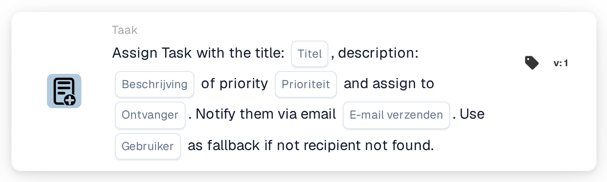
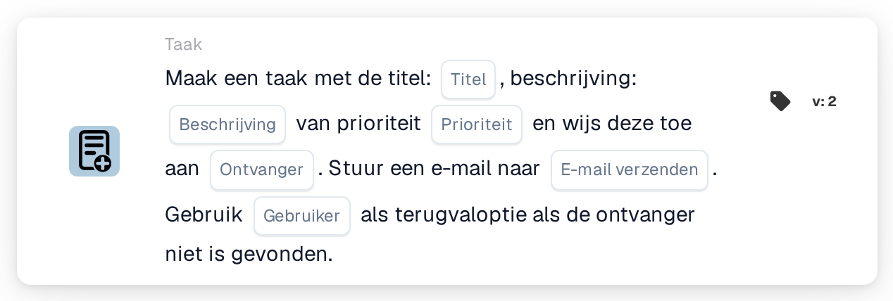

# Maak een nieuwe taak en wijs deze toe aan de ontvanger

<figure><figcaption>
Versie 1
</figcaption></figure>

<figure><figcaption>
Versie 2
</figcaption></figure>

## **Doel:**

De workflow-kaart **"Taak maken met terugval"** zorgt voor efficiënte taakdelegatie door taken toe te wijzen aan specifieke rollen — disponent of purchaser — terwijl een terugvalmechanisme wordt geïntegreerd om mislukte taaktoewijzingen te voorkomen. Deze kaart verbetert de betrouwbaarheid en aanpasbaarheid van de workflow in dynamische scenario's.

## **Onderdelen van de kaart:**

1. **Titel**
   * **Beschrijving**: Geeft de titel van de taak die wordt aangemaakt op.
   * **Details**: Biedt een beknopte identifier voor de taak.
2. **Beschrijving**
   * **Beschrijving**: Beschrijft het doel of de context van de taak.
   * **Details**: Verduidelijkt de details van de taak.
3. **Prioriteit**
   * **Beschrijving**: Stelt het urgentieniveau voor de taak in.
   * **Opties**:
     * **High**: Vereist onmiddellijke aandacht.
     * **Middelmatig**: Belangrijk maar niet urgent.
     * **Low**: Kan later worden afgehandeld.
4. **Toegewezen rol**
   * **Beschrijving**: Geeft de primaire rol op aan wie de taak wordt toegewezen.
   * **Opties**:
     * **Disponent**: Wijst de taak toe aan de disponent.
     * **Koper**: Wijst de taak toe aan de purchaser.
5. **E-mailmelding**
   * **Beschrijving**: Maakt het mogelijk de toegewezen gebruiker via e-mail op de hoogte te stellen.
   * **Opties**:
     * **True**: Verzendt een e-mailmelding naar de gebruiker.
     * **False**: Er wordt geen e-mailmelding verzonden.
6. **Fallback-gebruiker**
   * **Beschrijving**: Biedt een terugvaloptie voor taaktoewijzing als de ontvangerrol niet wordt gevonden.
   * **Details**: Maakt het mogelijk een gebruiker uit een dropdownlijst te selecteren om de taakdelegatie te waarborgen.

## **Functionaliteit:**

* **Voorwaarde-evaluatie**:\
  De kaart wordt alleen uitgevoerd als aan de voorwaarden in de **"Wanneer"**- en **"En"**-secties wordt voldaan.
* **Taaktoewijzing**:
  * De taak wordt toegewezen aan de geselecteerde rol (disponent of purchaser).
  * Als de opgegeven rol niet wordt gevonden, wordt de taak toegewezen aan een gebruiker uit de terugval-dropdownlijst.
* **E-mailmelding**:\
  Verzendt een e-mail naar de toegewezen gebruiker als e-mailmelding is ingeschakeld.

## **Opzet en configuratie:**

1. **Taakdetails opgeven**: Voer de titel, beschrijving en prioriteit van de taak in.
2. **Primaire rol selecteren**: Kies de rol aan wie de taak wordt toegewezen (disponent of purchaser).
3. **Terugvalgebruiker configureren**: Selecteer een terugvalgebruiker uit de dropdownlijst om de taaktoewijzing te waarborgen als de primaire rol niet wordt gevonden.
4. **E-mailmelding inschakelen**: Geef aan of de toegewezen gebruiker een e-mailmelding moet ontvangen.

## **Conclusie:**

De workflow-kaart **"Taak maken met terugval"** zorgt voor een naadloze taakdelegatie door een terugvalmechanisme te integreren. Door taken op basis van rollen toe te wijzen en een alternatieve gebruikersoptie te bieden, verbetert hij de betrouwbaarheid en flexibiliteit in taakbeheerprocessen.

<!-- workflow-card-complete-example-20261021 oc_task -->

### Voorbeeld van een ontvangertaak

**Configuratie:** Voer titel `Review delivery date` in, een beschrijving die het synthetische document identificeert, een prioriteit, rol Inkoper en geconfigureerde fallback-gebruiker `DEMO_REVIEWER`. Schakel e-mailmelding uit voor deze illustratieve configuratie.

**Verwacht resultaat en tegenvoorbeeld:** Wanneer een koper kan worden opgelost, wordt de nieuwe taak aan die gebruiker toegewezen. Als de rol niet kan worden opgelost, wordt de geconfigureerde fallback gebruikt. Verifieer het daadwerkelijke taakeigendom; een ontbrekende primaire ontvanger is geen bewijs dat de reservegebruiker bestaat of dat er een taak is gemaakt.

Dit is een illustratieve testconfiguratie en verwachte uitkomst; het werd niet uitgevoerd. Gebruik gegevens en ontvangers die in uw testorganisatie zijn geconfigureerd.
