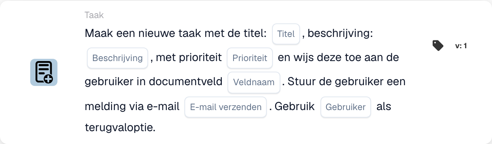

# Maak een nieuwe taak en wijs deze toe aan het veld Gebruiker in document

<figure><figcaption>
Kaartvelden in de getoonde versie. De velden zijn nog niet ingevuld.
</figcaption></figure>

## **Doel:**

De workflow-kaart **"Veldgebaseerde taak of melding maken"** wordt gebruikt om taken of meldingen aan te maken die dynamisch worden toegewezen aan gebruikers die binnen specifieke documentvelden zijn geïdentificeerd. Deze kaart biedt een optioneel terugvalmechanisme om een soepele workflow-uitvoering te waarborgen, zelfs wanneer het documentveld geen geldige gebruiker opgeeft.

## **Onderdelen van de kaart:**

1. **Titel**
   * **Beschrijving**: Geeft de titel van de taak of melding op.
   * **Details**: Wordt gebruikt om de taak of melding die wordt aangemaakt een naam te geven en te identificeren.
2. **Beschrijving**
   * **Beschrijving**: Biedt aanvullende details over de taak of melding.
   * **Details**: Zorgt ervoor dat de ontvanger het doel en de context van de taak of melding begrijpt.
3. **Prioriteit**
   * **Beschrijving**: Definieert de urgentie van de taak of melding.
   * **Opties**:
     * **High**: Vereist onmiddellijke aandacht.
     * **Middelmatig**: Belangrijk maar minder urgent.
     * **Low**: Kan op een later tijdstip worden afgehandeld.
4. **Veldnaam**
   * **Beschrijving**: Geeft het documentveld op dat wordt gebruikt om de taak of melding toe te wijzen.
   * **Details**: Het geselecteerde veld bepaalt dynamisch de gebruiker aan wie de taak of melding wordt toegewezen. Als het veld leeg of ongeldig is, wordt de taak of melding toegewezen aan de terugvalgebruiker die uit de dropdownlijst is geselecteerd.
5. **E-mailmelding**
   * **Beschrijving**: Configureert of de toegewezen gebruiker via e-mail op de hoogte wordt gesteld.
   * **Opties**:
     * **True**: Verzendt een e-mailmelding naar de toegewezen gebruiker.
     * **False**: Er wordt geen e-mailmelding verzonden.
6. **Fallback-gebruiker**
   * **Beschrijving**: Maakt de selectie van een gebruiker uit een dropdownlijst mogelijk om de taak of melding toe te wijzen wanneer er geen geldige gebruiker in het documentveld wordt gevonden.
   * **Details**: Zorgt ervoor dat de taak of melding wordt toegewezen, zelfs als het documentveld leeg of ongeldig is.

## **Aanvullende onderdelen in Version 3:**

1. **Meldingstype**
   * **Beschrijving**: Geeft op of de kaart een taak of een melding aanmaakt.
   * **Opties**:
     * **Taak**: Maakt een taak aan die wordt toegewezen aan de opgegeven gebruiker.
     * **Notification**: Verzendt een melding in plaats van een taak aan te maken.

## **Functionaliteit:**

* **Voorwaarde-evaluatie**:\
  De kaart voert de actie alleen uit als zowel de **"Wanneer"**- als de **"En"**-secties als true worden geëvalueerd.
* **Aanmaak van taak of melding**:
  * Wijst de taak of melding toe aan de gebruiker die in het documentveld is geïdentificeerd.
  * In Version 3 is het mogelijk ofwel een taak ofwel een melding aan te maken.
* **Terugvalmechanisme**:\
  Als het documentveld geen geldige gebruiker identificeert, wijst de kaart de taak of melding toe aan de terugvalgebruiker die uit de dropdownlijst is geselecteerd.
* **E-mailmelding**:\
  Verzendt een e-mailmelding naar de toegewezen gebruiker indien zo geconfigureerd.

## **Opzet en configuratie:**

1. **Taak- of meldingsdetails definiëren**: Voer de titel, beschrijving en prioriteit in.
2. **Het documentveld selecteren**: Kies het veld dat de gebruiker voor de taak- of meldingstoewijzing opgeeft.
3. **E-mailmelding inschakelen**: Geef op of er een e-mailmelding naar de toegewezen gebruiker moet worden verzonden.
4. **Terugvalgebruiker selecteren**: Kies een terugvalgebruiker uit de dropdownlijst voor toewijzing als het documentveld geen geldige gebruiker identificeert.
5. **Notification Type opgeven (Version 3)**: Geef aan of de kaart een taak of melding aanmaakt.

## **Conclusie:**

De workflow-kaart **"Veldgebaseerde taak of melding maken"** stroomlijnt het taak- en meldingsbeheer door verantwoordelijkheden dynamisch toe te wijzen op basis van documentvelden. Het terugvalgebruikermechanisme en de uitgebreide opties in Version 3 bieden flexibiliteit en zorgen ervoor dat taken of meldingen altijd worden toegewezen, zelfs wanneer documentgegevens onvolledig zijn.

<!-- workflow-card-practical-example-20261021 -->

## Praktisch voorbeeld

**Wanneer gebruiken:** Maak een revisietaak voor de gebruiker genoemd in de documentgegevens.

**Configuratie:** Selecteer `reviewer_name`, reservegebruiker `Demo Reviewer A`, titel `Review invoice` en prioriteit.

**Verwacht resultaat en tegenvoorbeeld:** Een oplosbare gebruiker in het veld ontvangt de taak. Een leeg of onoplosbaar veld gebruikt de geconfigureerde fallback; test beide paden.

Dit is een illustratieve configuratie en een verwacht resultaat. Gebruik velden, gebruikers en groepen die in uw testorganisatie zijn geconfigureerd; het is geen bewering dat dit voorbeeld is uitgevoerd.
