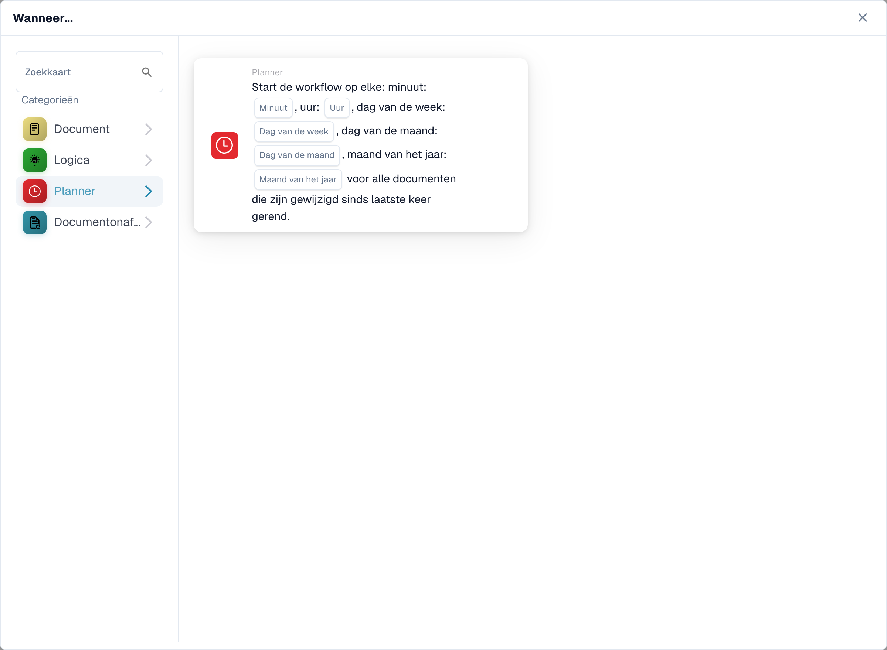
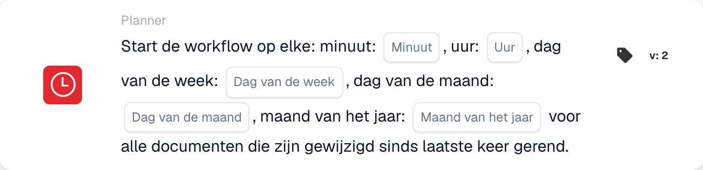

# Als

De kaarten in deze categorie, weergegeven in de bibliotheek **Kaart toevoegen** van de Workflow Builder:

<figure><figcaption>
Beschikbare kaarten in de geselecteerde categorie. Vul de velden vóór gebruik in.
</figcaption></figure>

#### Inzicht in het ‘wanneer’ in workflowconfiguraties

**Doel van "Wanneer"**

* De sectie 'Wanneer' in een werkstroomconfiguratie definieert de triggervoorwaarden die een bepaalde werkstroomactie initiëren. Deze voorwaarden zijn gebaseerd op gespecificeerde criteria met betrekking tot documentattributen of gebruikersactiviteiten binnen het ERP-systeem.

**Hoe het werkt**

* In uw interface lijkt "Wanneer" een startpunt te zijn waar gebruikers verschillende triggerkaarten kunnen selecteren. Elke kaart specificeert de voorwaarden waaronder daaropvolgende acties (gedefinieerd in de sectie "En") zullen worden uitgevoerd.

**Conditiekaarten documenttype**

* De kaarten met het documentpictogram weergegeven in de schermafbeelding zijn variaties op de voorwaarden voor 'Documenttype', die worden gebruikt om workflows te activeren op basis van het type document dat wordt verwerkt. Hier volgt een overzicht van elk type conditiekaart dat wordt weergegeven:
  * **Documenttype (Operator) één van (Type)**: Deze kaart activeert een actie wanneer het type document overeenkomt met een van de opgegeven typen in een lijst. De operator kan opties opnemen zoals 'is' of 'is niet', waardoor inclusieve of exclusieve voorwaarden mogelijk zijn.
  * **Documenttype (operator) (type)**: deze eenvoudigere variant wordt geactiveerd op basis van één voorwaarde voor het documenttype. Normaal gesproken wordt gecontroleerd of het documenttype "is" of "niet" een specifiek type is, zonder de optie om uit meerdere typen te kiezen.
  *

**Selderij Beat**

* De kaart met het klokpictogram in de schermafbeelding is een "Celery Beat"-voorwaarde, die wordt gebruikt om workflows te activeren op basis van datum en tijd.

#### Een 'When'-triggerkaart instellen

1. **Selectie van voorwaardetype**: gebruikers beginnen met het selecteren van een voorwaardetype dat relevant is voor de workflow die ze willen automatiseren. In dit geval staan ​​documenttypen centraal.
2. **De operator definiëren**: gebruikers moeten beslissen welke logische operator, zoals "is" of "is niet", die de basis vormt voor het vergelijken van feitelijke documenttypen met de gedefinieerde voorwaarden.
3. **Documenttypen specificeren**: Afhankelijk van de kaart kunnen gebruikers een of meerdere documenttypen selecteren die de workflow activeren wanneer documenten van die typen worden verwerkt.
4. **De trigger voltooien**: zodra de voorwaarde is ingesteld, wordt deze de basis voor het activeren van specifieke acties die in de workflow zijn gedefinieerd. Als een document aan de gestelde voorwaarde voldoet, worden automatisch de gedefinieerde acties gestart.

#### Praktische toepassing

In de praktijk zijn deze triggerkaarten cruciaal voor het automatiseren van processen zoals goedkeuringen, meldingen of andere procedures die afhankelijk zijn van het type document dat wordt afgehandeld. Als een documenttype bijvoorbeeld een 'Factuur' is en het voldoet aan de voorwaarden die zijn ingesteld op de kaart 'Wanneer', kan de workflow het document automatisch doorsturen voor betalingsverwerking.

Deze opzet zorgt ervoor dat workflows niet alleen efficiënt zijn, maar ook worden afgestemd op de specifieke operationele behoeften van de organisatie, waardoor handmatig toezicht wordt verminderd en de documentverwerkingsprocessen worden versneld.

Samenvattend gaat het gedeelte 'Wanneer' van uw workflowconfiguratie over het voorbereiden van geautomatiseerde acties op basis van specifieke, vooraf gedefinieerde voorwaarden. Het is een krachtig hulpmiddel om ervoor te zorgen dat uw ERP-systeem dynamisch reageert op de behoeften van het bedrijf, waardoor zowel de productiviteit als de nauwkeurigheid van het documentbeheer worden verbeterd.

[Variabele wijziging en webhook-gebeurtenistriggerreferentie](../cards-overview/logic-cards-guide.md).

<!-- workflow-card-example-celery_beat-20261021 -->

### Geplande verwerking

<figure><figcaption>
Kaartvelden in de getoonde versie. De velden zijn nog niet ingevuld.
</figcaption></figure>

`CELERY_BEAT` · versie 2

Gebruik een geplande trigger voor documenten die sinds de vorige run zijn gewijzigd. Voor een dagelijks demoschema selecteert u minuut `0`, uur `9` en de aangeboden dagelijkse/maandwaarden. Controleer de geconfigureerde tijdzone van de planner en de volgende geplande uitvoering. Deze trigger is geen bewijs dat ongewijzigde documenten opnieuw worden verwerkt.
