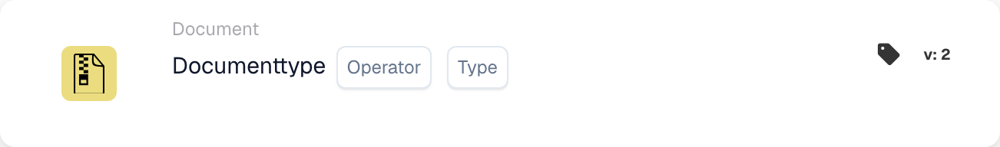
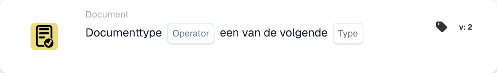

# Kaartbeschrijving

## **Wanneer-kaarten: Document type**

Met deze twee kaarten kan een workflow worden gestart. Hier kunt u bepalen met welk documenttype de workflow begint of dat de workflow geselecteerde documenttypen niet mag beïnvloeden.

\\

<figure><figcaption>
Kaartvelden in de getoonde versie. De velden zijn nog niet ingevuld.
</figcaption></figure>

<figure><figcaption>
Kaartvelden in de getoonde versie. De velden zijn nog niet ingevuld.
</figcaption></figure>

Deze kaart kan ook worden gebruikt om meerdere documenttypen op te geven waarop de workflow van toepassing moet zijn.
