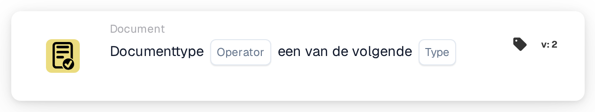

# Documenttype is een van

<figure><figcaption>
Versie 2
</figcaption></figure>

## **Doel:**

Deze DocBits-kaart zorgt voor de juiste classificatie van een document door te controleren of het overeenkomt met een van de gespecificeerde documenttypen. Dit is handig voor situaties waarin een document tot meer dan één categorie kan behoren, waardoor bredere validatie en geautomatiseerde verwerking mogelijk zijn.

## **Functionaliteit:**

* **Validatie van meerdere documenttypen:** Met deze kaart kunnen gebruikers controleren of een document overeenkomt met een reeks gespecificeerde documenttypen, waardoor flexibele categorisering mogelijk is voor complexere documentworkflows.
* **Exploitant:** Gebruikers kunnen voorwaarden definiëren om het document te valideren tegen meerdere typen. Beschikbare operators zijn onder andere:
  * **Is:** Bevestigt dat het document overeenkomt met een van de gespecificeerde documenttypen.
  * **Is Niet:** Zorgt ervoor dat het document niet overeenkomt met een van de geselecteerde documenttypen.
* **Documenttypen:** Gebruikers kunnen kiezen uit meerdere ondersteunde documenttypen, waaronder:
  * **Factuur:** Financiële gegevens die worden ingediend voor betaling.
  * **Debitnota:** Documenten die een aanpassing aangeven die het verschuldigde bedrag verhoogt.
  * **Creditnota:** Documenten die een verlaging van het verschuldigde bedrag aangeven.
  * **Inkooporder:** Documenten die de bestelling van een koper beschrijven.
  * **Orderbevestiging:** Documenten die bevestigen dat een bestelling is geaccepteerd.
  * **Vooruitgangskennisgeving van verzending:** Documenten die aankondigen dat er een zending op komst is.

## **Gebruik:**

Deze kaart is ideaal voor documentbeheerders en beheerders die ervoor moeten zorgen dat documenten worden gecategoriseerd in een van de verschillende typen. Het is vooral handig voor documentworkflows waarin een document onder meerdere categorieën kan vallen, waardoor automatisering en classificatienauwkeurigheid worden verbeterd.

## **Voorbeeldscenario:**

* Een gebruiker uploadt een document dat ofwel een "Factuur" of "Debitnota" kan zijn. Door de "Is" operator te gebruiken, bevestigt de kaart dat het document overeenkomt met een van de geselecteerde typen, waardoor het systeem de juiste regels en categorisatie kan toepassen.

Door gebruik te maken van de kaart "Validatie van meerdere documenttypen" kunnen organisaties de flexibiliteit van workflows verbeteren, categorisatie automatiseren en ervoor zorgen dat documenten correct worden afgehandeld, zelfs wanneer meerdere typen van toepassing zijn.
