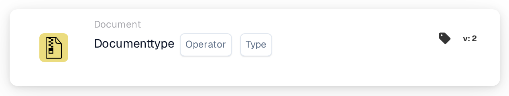

# Documenttypebewerking

<figure><figcaption>
Versie 1
</figcaption></figure>

<figure><figcaption>
Versie 2
</figcaption></figure>

## **Doel:**

Deze workflowkaart is speciaal ontworpen om vooraf gedefinieerde bewerkingen uit te voeren op documenten die zijn gecategoriseerd op type. Het stroomlijnt de verwerking van verschillende documentvormen binnen een ERP-systeem, waarbij wordt gegarandeerd dat elk type wordt verwerkt volgens zijn unieke vereisten en organisatorische beleid.

## **Functionaliteit:**

* **Documenttypevalidatie**: Deze kaart controleert of een document overeenkomt met een bepaald type, zodat gebruikers de categorisatie kunnen bevestigen.
* **Exploitant**: Gebruikers kunnen voorwaarden instellen om het type document te bepalen. Beschikbare operators zijn onder andere:
  * **Is**: Bevestigt dat het document overeenkomt met het gespecificeerde documenttype.
  * **Is Niet**: Zorgt ervoor dat het document niet overeenkomt met het gespecificeerde documenttype.
* **Documenttypen**: Ondersteunde documenttypen zijn onder andere:
  * **Factuur**
  * **Creditnota**
  * **Debitnota**
  * **Inkooporder**
  * **Orderbevestiging**
  * **Vooruitbetaling kennisgeving**

## **Gebruik**:

Deze kaart is handig voor documentbeheerders en beheerders die moeten controleren of documenten correct zijn geclassificeerd voor een gestroomlijnde verwerking. Het valideren van documenttypen verbetert de automatisering van workflows, maakt documentspecifieke acties mogelijk en houdt records georganiseerd.

## **Voorbeeldscenario**:

* Een gebruiker uploadt een document dat is gelabeld als een "Debitnota." Met behulp van de "Is" operator bevestigt de kaart dat het documenttype inderdaad "Debitnota" is, waardoor het systeem relevante verwerkingsregels kan toepassen en het passend kan categoriseren.

Door de kaart "Documenttype" in te zetten, kunnen organisaties de classificatie van documenten automatiseren, consistentie in de verwerking van documenten waarborgen en de efficiëntie van documentbeheerworkflows verbeteren.
