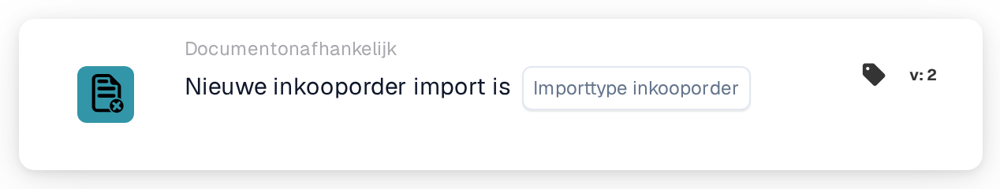

# Inkooporderimport

<figure><figcaption>
Versie 2
</figcaption></figure>

## Doel:

Deze workflowkaart start een workflow (trigger) wanneer een inkooporder in DocBits wordt geïmporteerd. De kaart kan reageren op nieuw aangemaakte inkooporders, op updates van bestaande inkooporders of op beide. De workflow loopt zonder document en kan dus worden gebruikt om mensen te informeren of andere systemen aan te roepen zodra er inkoopordergegevens binnenkomen.

## Onderdelen van de kaart:

1. **Importtype inkooporder**
   * **Beschrijving:** Bepaalt welk soort import de workflow start.
   * **Opties:**
     * **een nieuwe bestelling.** De inkooporder bestond nog niet en is door de import aangemaakt.
     * **een update van een bestaande inkooporder.** Een bestaande inkooporder is door de import bijgewerkt.

     Beide opties kunnen worden geselecteerd.

## Functionaliteit:

* **Wanneer de workflow start:** Wanneer een inkooporder uit het ERP-systeem door de inkooporderimport wordt verwerkt, legt het systeem vast of het om een nieuwe inkooporder of om een update ging. Daarna start het alle geactiveerde documentonafhankelijke workflows van de organisatie (behalve webhook- en geplande workflows) en geeft het deze informatie, samen met de inkooporder-ID en het inkoopordernummer, aan de workflows door. Dit gebeurt alleen als de workflowmodule voor de organisatie actief is en er actieve workflows zijn. Een inkooporder die wordt overgeslagen omdat de binnenkomende versie niet nieuwer is dan de opgeslagen versie, start geen workflows.
* **Voorwaarde-evaluatie:** De kaart controleert of het aan de workflow doorgegeven importtype een van de op de kaart geselecteerde typen is.
* **Actie-uitvoering:**
  * **True-voorwaarde:**\
    Komt het importtype overeen met een geselecteerde optie, dan gaat de workflow verder met de volgende kaarten.
  * **False-voorwaarde:**\
    Komt het importtype niet overeen, of is de workflow door een andere documentonafhankelijke gebeurtenis gestart (bijvoorbeeld een gewijzigde leveranciersstatus), dan is niet aan de kaart voldaan en worden de stappen erna niet uitgevoerd.
* **Ontbrekende gegevens:** Is er op de kaart geen importtype geselecteerd, dan evalueert de kaart de voorwaarde niet. Ze meldt de ontbrekende invoer (of een fout) in het workflowlogboek en de stappen erna worden niet uitgevoerd.

## Opzet en configuratie:

* De kaart kan worden toegevoegd vanuit de groep **WHEN**, categorie **Documentonafhankelijk**. Daarna worden een of beide importtypen geselecteerd, de verdere voorwaarden en acties toegevoegd, en wordt de workflow opgeslagen en geactiveerd.

## Conclusie:

Met de kaart "Purchase order import" kunnen workflows reageren zodra inkoopordergegevens worden aangemaakt of bijgewerkt, zonder op een document te wachten. Zo blijven vervolgprocessen in de pas met de inkooporders die uit het ERP-systeem komen.
