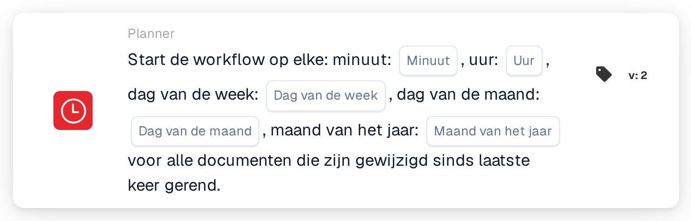

# Geplande workflowstart

<figure><figcaption>
Versie 2
</figcaption></figure>

## Doel:

Deze workflowkaart start een workflow (trigger) volgens een tijdschema, vergelijkbaar met een cronjob. Op elk gepland tijdstip wordt de workflow uitgevoerd voor alle documenten die sinds de vorige uitvoering zijn gewijzigd. Dit is nuttig voor regelmatige verwerking, zoals nachtelijke controles, periodieke herinneringen of opvolgacties die niet direct bij elke documentwijziging hoeven te worden uitgevoerd.

## Onderdelen van de kaart:

1. **Minuut**
   * **Beschrijving:** De minuut of minuten van het uur waarop de workflow start.
   * **Detail:** Waarde in cron-notatie, bijvoorbeeld `0`, `30`, `0,30` of `*/15`. Leeg betekent elke minuut (`*`).
2. **Uur**
   * **Beschrijving:** Het uur of de uren van de dag waarop de workflow start.
   * **Detail:** Waarde in cron-notatie, bijvoorbeeld `6` of `8-18`. Leeg betekent elk uur (`*`).
3. **Dag van de week**
   * **Beschrijving:** De weekdag of weekdagen waarop de workflow start.
   * **Detail:** Waarde in cron-notatie, bijvoorbeeld `1-5`. Leeg betekent elke dag van de week (`*`).
4. **Dag van de maand**
   * **Beschrijving:** De dag of dagen van de maand waarop de workflow start.
   * **Detail:** Waarde in cron-notatie, bijvoorbeeld `1` of `1,15`. Leeg betekent elke dag (`*`).
5. **Maand van het jaar**
   * **Beschrijving:** De maand of maanden waarin de workflow start.
   * **Detail:** Waarde in cron-notatie, bijvoorbeeld `1` of `1-6`. Leeg betekent elke maand (`*`).

## Functionaliteit:

* **Tijdzone:** Alle tijden zijn in UTC, de tijdzone van de DocBits-servers. Zo is 6:00 UTC 8:00 uur in de Midden-Europese zomertijd.
* **Wanneer de workflow start:** Wanneer de workflow wordt opgeslagen en geactiveerd, wordt uit de vijf velden een schema-item aangemaakt. Wordt de workflow gedeactiveerd of verwijderd, dan wordt het schema-item verwijderd. Op elk gepland tijdstip doet het systeem het volgende:
  * het zoekt documenten van de organisatie die sinds de laatste uitvoering van de workflow zijn gewijzigd, opgeslagen of van status zijn veranderd,
  * het start de workflow op de achtergrond afzonderlijk voor elk van deze documenten, en
  * het onthoudt het tijdstip van deze uitvoering als beginpunt voor de volgende.

  Documenten die de limiet voor workflowuitvoeringen hebben bereikt, worden overgeslagen. Wordt de workflow gedeactiveerd terwijl de documenten worden verwerkt, dan worden de resterende documenten niet meer uitgevoerd.
* **Voorwaarde-evaluatie:** De kaart controleert of de workflow door het schema is gestart.
* **Actie-uitvoering:**
  * **True-voorwaarde:**\
    Wanneer de workflow door het schema is gestart, is aan de kaart voldaan en gaat de workflow verder met de volgende kaarten.
  * **False-voorwaarde:**\
    Wanneer de workflow op een andere manier is gestart, bijvoorbeeld door een documenttrigger, een webhook of een gewijzigde variabele, is niet aan de kaart voldaan en worden de stappen erna niet uitgevoerd.
* **Slechts één schema per workflow:** Bevat een workflow in de Advanced Workflow Builder meerdere schemakaarten, dan wordt alleen de eerste voor het schema gebruikt.
* **Opslaan:** Kan het schema-item bij het opslaan niet worden bijgewerkt, dan wordt de workflow toch opgeslagen en verschijnt er een waarschuwing. Door de workflow opnieuw op te slaan, wordt het bijwerken opnieuw geprobeerd.

## Opzet en configuratie:

* De kaart kan worden toegevoegd vanuit de groep **WHEN**, categorie **Planner**. Daarna worden de tijdvelden ingevuld; velden die leeg blijven, betekenen "elke". Zo starten minuut `0`, uur `6`, dag van de week `1-5` en de overige velden leeg de workflow op werkdagen om 6:00 UTC. Vervolgens worden de verdere voorwaarden en acties toegevoegd en wordt de workflow opgeslagen en geactiveerd.

## Conclusie:

De kaart "Scheduled workflow start" voert workflows op vaste tijdstippen uit in plaats van bij elke gebeurtenis. Omdat elke uitvoering alleen de documenten oppakt die sinds de vorige uitvoering zijn gewijzigd, blijft de regelmatige verwerking gericht op nieuw werk.
