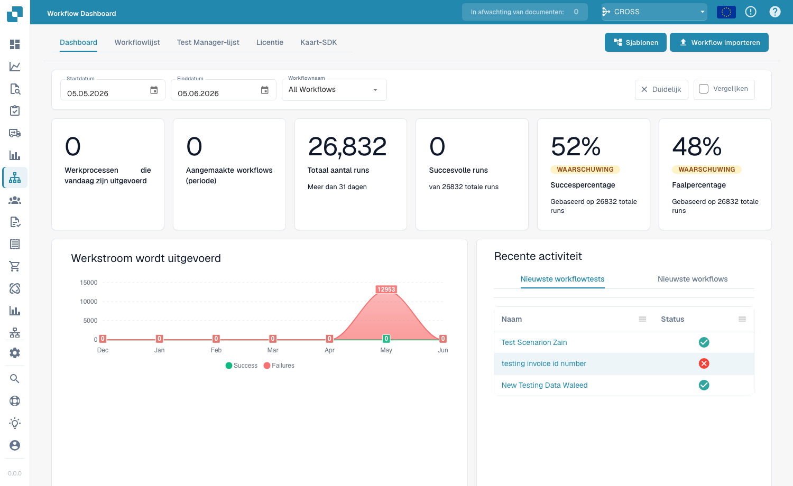
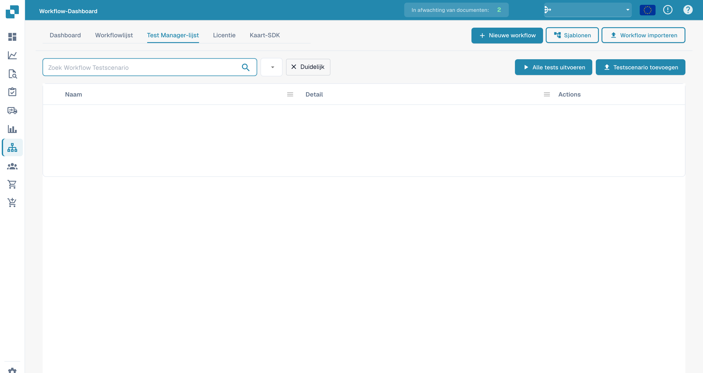

# Dashboard

Het **Workflow-dashboard** is het startpunt van het workflowgedeelte. Het laat zien hoe uw workflows presteren (uitvoeringstotalen, slaag- en faalpercentages, een grafiek van uitvoeringen in de tijd en recente activiteit) en geeft toegang tot de workflowlijst, de testmanager en de Card SDK.

<figure><figcaption>
Het Workflow Dashboard: uitvoeringstotalen, slaag-/faalpercentages en recente activiteit voor elke workflow.
</figcaption></figure>

## Tabbladen

- **Dashboard** — uitvoeringsstatistieken en recente activiteit (hierboven weergegeven).
- **Workflowlijst** — elke workflow met zijn type, uitvoeringsvolgorde en trigger. Maak een nieuwe aan met **Nieuwe workflow**.
- **Test Manager-lijst** — testscenario's die uw workflows valideren; voer ze uit met **Alle tests uitvoeren**.
- **Licentie** — informatie over workflowlicenties.
- **Card SDK** — bouw en upload aangepaste workflowkaarten (zie [Card SDK](card-sdk.md)).

De werkbalk biedt ook **Sjablonen**, waarmee de bibliotheek [Workflow Templates](standard-workflow-builder.md#workflow-templates) wordt geopend, en **Workflow importeren**, waarmee u een workflow uit een JSON-bestand importeert.

Met de **Testbeheer** kunt u per workflow testscenario's opslaan en gezamenlijk uitvoeren, zodat u kunt bevestigen dat uw workflows na wijzigingen nog steeds correct werken:

<figure><figcaption>
Lijst met workflowtestscenario&#x27;s.
</figcaption></figure>

## Volgende stappen

- Bouw een lineaire automatisering met de **Standaardworkflow**-builder.
- Bouw een vertakkende flow met de **Geavanceerde workflow**-builder.
