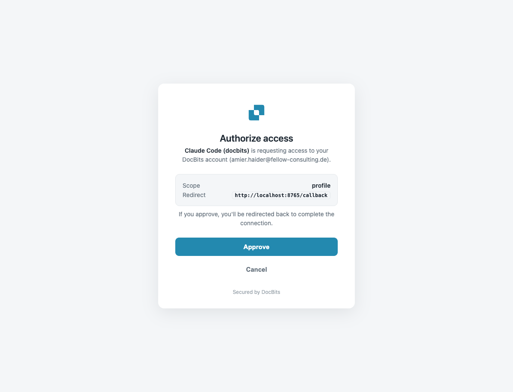

# Installatie en configuratie

Een AI-assistent verbinden met DocBits MCP kost één commando, gevolgd door een eenmalige aanmelding. De aanbevolen manier om u aan te melden is **OAuth** — dezelfde DocBits-aanmelding die u al gebruikt, in uw browser. Voor automatisering kunt u in plaats daarvan verbinden met een API-sleutel.

## 1. Kies uw endpoint

De MCP-server draait op de DocBits API-host. Gebruik de host voor **uw regio (EU of US)**:

| Omgeving | EU-endpoint | US-endpoint |
|-------------|-------------|-------------|
| Productie | `https://eu.api.docbits.com/v3/mcp` | `https://us.api.docbits.com/v3/mcp` |
| Sandbox | `https://eu.sandbox.api.docbits.com/v3/mcp` | `https://us.sandbox.api.docbits.com/v3/mcp` |


`api.docbits.com` is het enige endpoint dat klanten gebruiken. Kies altijd de **regio waarin uw organisatie zich bevindt** (EU of US) — de MCP wijst de aanmelding automatisch naar de bijbehorende authenticatieserver, u configureert dit niet apart. De onderstaande voorbeelden gebruiken de EU-productiehost; vervang die door de uwe.


## 2. Aanmelden met OAuth (aanbevolen)

OAuth is het gemakkelijke pad — geen geheimen om te kopiëren. Nadat u de server hebt toegevoegd, **opent de eerste verbinding de DocBits-aanmelding in uw browser**, keurt u een toestemmingsscherm goed en is de client verbonden.

**Wat u voor elke client ziet:**

1. De client opent de DocBits-aanmeldpagina in uw browser.
2. U meldt zich aan met uw DocBits-account (als u al bent aangemeld bij de DocBits-webapp, wordt de sessie hergebruikt — geen nieuwe aanmelding).
3. U keurt het toestemmingsscherm goed ("Authorize access").
4. De browser geeft de client een token en de verbinding is actief.

OAuth geeft een kortlevend toegangstoken (8 uur) plus een vernieuwingstoken (30 dagen) uit, zodat de client automatisch vernieuwt en verbonden blijft — **u meldt zich maar één keer aan.**


**U moet bij DocBits zijn aangemeld — uw bestaande sessie wordt hergebruikt.** De MCP-aanmelding vraagt u niet opnieuw in te loggen als uw browser al een DocBits-sessie heeft. Als u al bent aangemeld bij de DocBits-webapp, gaat u **rechtstreeks naar het toestemmingsscherm**. Als u niet bent aangemeld, verschijnt eerst de DocBits-aanmeldpagina; nadat u zich eenmaal hebt aangemeld, wordt de sessie automatisch naar de MCP overgenomen.


<figure><figcaption><p>Nog niet aangemeld — de DocBits-aanmeldpagina in huisstijl (u ziet deze alleen als uw browser geen DocBits-sessie heeft)</p></figcaption></figure>

<figure><figcaption><p>Al aangemeld — de sessie wordt hergebruikt en u gaat rechtstreeks naar het toestemmingsscherm. Keur goed om te verbinden; wat de client aanvraagt (scope en redirect) wordt getoond.</p></figcaption></figure>



```bash
# 1) add the server
claude mcp add --transport http docbits https://eu.api.docbits.com/v3/mcp

# 2) sign in (opens browser → DocBits login + consent → connected)
claude mcp login docbits
```

`claude mcp login docbits` is de OAuth-stap. Controleer na succes door Claude te vragen: *"controleer de status van de DocBits API"*.



```bash
gemini mcp add --transport http docbits https://eu.api.docbits.com/v3/mcp
```

Gemini CLI ontdekt de OAuth-server automatisch. Bij **het eerste gebruik** van de server opent het de DocBits-aanmelding in uw browser (dynamische clientregistratie en tokenbeheer worden voor u afgehandeld). Keur de toestemming goed en u bent verbonden. Indien nodig kunt u de aanmelding opnieuw starten via het menu `/mcp` in Gemini.



```bash
codex mcp add docbits \
  --url https://eu.api.docbits.com/v3/mcp \
  --oauth-resource https://eu.api.docbits.com/v3/mcp
```

De vlag `--oauth-resource` geeft Codex de opdracht de OAuth-aanmelding voor deze server uit te voeren. Bij het eerste gebruik opent Codex de DocBits-aanmelding in uw browser; keur de toestemming goed en u bent verbonden.



## 3. Verbinden met een API-sleutel (automatisering)

Voor headless agents, CI of elke omgeving zonder browser slaat u OAuth over en geeft u de API-sleutel van uw organisatie mee als header `X-API-KEY`.



```bash
claude mcp add --transport http docbits https://eu.api.docbits.com/v3/mcp \
  --header "X-API-KEY: <your-api-key>"
```



Voeg toe aan `~/.gemini/settings.json`:

```json
{
  "mcpServers": {
    "docbits": {
      "httpUrl": "https://eu.api.docbits.com/v3/mcp",
      "headers": { "X-API-KEY": "<your-api-key>" }
    }
  }
}
```



Voeg toe aan `~/.codex/config.toml`:

```toml
[mcp_servers.docbits]
url = "https://eu.api.docbits.com/v3/mcp"
http_headers = { "X-API-KEY" = "<your-api-key>" }
```

Of houd de sleutel buiten het bestand en lees hem uit de omgeving:

```toml
[mcp_servers.docbits]
url = "https://eu.api.docbits.com/v3/mcp"
env_http_headers = { "X-API-KEY" = "DOCBITS_API_KEY" }
```



## Hoe de OAuth-aanmelding werkt (onder de motorkap)

DocBits implementeert de standaard **MCP OAuth 2.1**-flow, zodat elke compatibele client zonder handmatige configuratie verbinding maakt:

1. De client roept het MCP-endpoint aan en krijgt een `401` met een `WWW-Authenticate`-header die naar de metadata van de beschermde resource wijst.
2. Hij leest `/.well-known/oauth-protected-resource`, dat de DocBits-authenticatieserver noemt.
3. Hij leest de metadata van de authenticatieserver en **registreert zichzelf** dynamisch (RFC 7591) — geen client secret nodig.
4. Uw browser opent de DocBits-aanmelding en -toestemming. Als u al bent aangemeld bij de webapp, wordt de sessie hergebruikt.
5. De client wisselt de autorisatiecode (PKCE) in voor een toegangstoken en vernieuwingstoken en roept de MCP aan.


Afmelden bij de DocBits-**webapp verbreekt de MCP-verbinding niet** — de MCP bewaart zijn eigen tokens en blijft werken totdat het vernieuwingstoken verloopt (30 dagen) of u de server uit uw client verwijdert.


## Probleemoplossing

| Symptoom | Oorzaak / oplossing |
|---------|-------------|
| De aanmeldpagina opent nooit | Controleer of de endpointhost/regio juist en bereikbaar is; sommige headless omgevingen kunnen geen browser openen — gebruik dan een API-sleutel. |
| `401` na het verbinden | Token verlopen en geen vernieuwingstoken (de API-sleutelmodus vernieuwt nooit) — maak opnieuw verbinding / meld u opnieuw aan. |
| Tools ontbreken | Uw gebruiker/API-sleutel heeft mogelijk geen rechten voor die functies; controleer uw DocBits-rol. |
| Verkeerde gegevens / regio | Zorg dat u het endpoint van **uw** regio hebt gebruikt (EU of US). |
