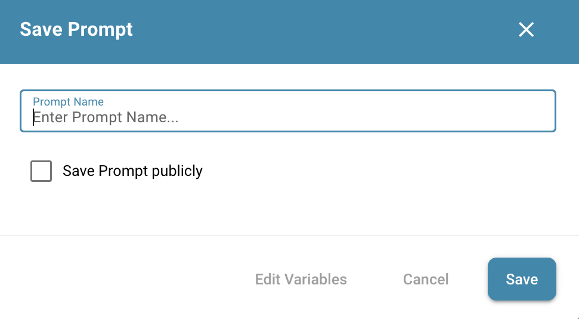

# DocBits Operator

## Overzicht

De **DocBits Operator** is een AI-gestuurde automatiseringsassistent die is ontworpen om repetitieve taken in uw workflows te vereenvoudigen. Gebruikers maken _prompts_: stapsgewijze instructies, aangevuld met variabelen, die de AI sturen om automatisch te navigeren, gegevens in te voeren en door interfaces te klikken. Dit vermindert handmatige inspanning en versnelt routinematige handelingen.

## De DocBits Operator inschakelen

Volg deze stappen om de DocBits Operator in te schakelen:

1. **Navigeer naar Instellingen**:
   * Ga vanaf het Dashboard naar **Instellingen**.
   *   Selecteer **Documentverwerking** en kies vervolgens **Module**.

       <figure><figcaption></figcaption></figure>
2. **Schakel de functie in**:
   * Scroll omlaag naar de optie **DocBits Operator**.
   *   Zet de schuifschakelaar aan om de **DocBits Operator** in te schakelen.

       
<figure><figcaption></figcaption></figure>

## Toegang tot de interface

* Zodra de functie is ingeschakeld, opent u de **DocBits Operator** via het hoofdnavigatiemenu.

### **1. Promptinvoer**

Onderaan het scherm staat een invoerveld met het label _“Enter your prompt here…”_. Hier schrijven gebruikers de instructies die de operator moet volgen.

Naast het invoerveld staan verschillende bedieningsknoppen:

* **Prompt Variabelen** – Opent een pop-up waarin u sleutel-waardeparen invoert die in de prompt worden gebruikt. Variabelen worden tussen accolades geschreven, zoals `{invoice_number}` of `{url}`. Deze waarden gelden alleen voor de huidige prompt in het invoerveld.
* **Prompt Opslaan** – Slaat de huidige prompt op. Kies of u deze opslaat als:
  * **Organisatieprompt** – Bewerkbaar binnen uw organisatie; bevat zowel de prompt als de gedefinieerde variabelewaarden.
  * **Globale prompt** – Gedeeld door alle tenants; bevat alleen de prompt en de plaatshouders van de variabelen (er worden geen waarden opgeslagen).
* **Chat wissen** – Wist het huidige gesprek met de operator, maar laat de prompt in het invoerveld ongewijzigd. Handig bij hergebruik of verfijning van een prompt.

Gedetailleerde richtlijnen voor het schrijven van effectieve prompts, inclusief syntaxis, variabelen en voorbeelden, vindt u in de [**Prompt-schrijfgids**](prompt-writing-guide.md).

### **2. Navigatie via de zijbalk**

Gebruik het pictogram linksboven om de zijbalk te openen of te sluiten. De zijbalk toont opgeslagen prompts, ingedeeld in twee categorieën:

* **Organisatieprompts**: bewerkbaar en herbruikbaar binnen uw organisatie.
* **Globale prompts**: gedeeld door alle tenants. Deze kunnen geen variabelen opslaan en kunnen niet worden bewerkt of verwijderd.
  * Een globale prompt blijft bewerkbaar en verwijderbaar voor de **organisatie die hem heeft gemaakt**, waar hij onder Organisatieprompts verschijnt.
* **Zoekfunctie:** met de zoekbalk bovenaan de zijbalk vinden gebruikers snel opgeslagen prompts op naam of trefwoord.
* **Pictogramoverzicht:** Elke opgeslagen prompt heeft een reeks actiepictogrammen
  * **Pijl** – Start de prompt
  * **Pen** – Bewerk de prompt (alleen beschikbaar voor prompts van uw eigen organisatie)
  * **Prullenbak** – Verwijder de prompt (alleen beschikbaar voor prompts van uw eigen organisatie)

### 3. Prompt opslaan

Een klik op de knop **Prompt Opslaan** opent een pop-up waarin u de huidige prompt voor later gebruik opslaat.

<figure><figcaption></figcaption></figure>

#### **Velden van de pop-up Prompt opslaan**

* **Promptnaam:** Voer een naam in om de prompt te identificeren.
* **Prompt openbaar opslaan (selectievakje):** Wanneer dit is aangevinkt, wordt de prompt opgeslagen als **Globale prompt**. Globale prompts worden gedeeld door alle tenants en kunnen geen **waarden** van variabelen opslaan (alleen de **namen** van variabelen).
* **Variabelen bewerken:** Opent de [**pop-up Prompt Variabelen**](prompt-writing-guide.md#prompt-variabelen-pop-up) om de variabelendefinities te controleren of aan te passen voordat u opslaat.

**Acties**

* **Annuleren:** Sluit de pop-up zonder op te slaan.
* **Opslaan:** Slaat de prompt op met de opgegeven naam en zichtbaarheidsinstelling.

### 4. Bedieningselementen voor promptuitvoering

Wanneer een prompt wordt uitgevoerd, hebben gebruikers verschillende opties om de uitvoering te beheren of erin in te grijpen:

* **Prompt pauzeren:** Onderbreekt de huidige uitvoering tijdelijk. Handig als u de huidige status wilt bekijken of het systeem wilt voorbereiden op de volgende stappen.&#x20;
* **Prompt hervatten:** Zet de uitvoering voort vanaf het punt waar deze was gepauzeerd.  (1).png>)
* **Prompt annuleren:** Stopt de uitvoering volledig en reset de sessie. Dit is handig als de prompt moet worden afgebroken of opnieuw gestart vanwege onjuist gedrag of gewijzigde invoer.&#x20;
* **Besturing overnemen:** Hiermee kan de gebruiker handmatig ingrijpen door rechtstreeks met het systeem te werken. Dit is nuttig als de operator vastloopt of een stap verkeerd interpreteert. Wanneer u de besturing overneemt, wordt de prompt **automatisch gepauzeerd** en schakelt het systeem over naar de handmatige modus totdat u kiest om te hervatten of te annuleren.

### 5. Detailweergave van de operator

Zodra een prompt is gestart, komt er een extra knop beschikbaar waarmee gebruikers kunnen overschakelen naar een **gedetailleerde uitvoeringsweergave**. 

* **Detailweergave openen:** Met deze knop gaat u naar een aparte weergave die stap voor stap in realtime toont wat de operator doet.

In de detailweergave kunnen gebruikers:

* Elke uitgevoerde actie volgen (bijv. klikken, invoer, wachttijden).
* Zien welke stap momenteel actief is.
* Vaststellen waar problemen optreden als de prompt op problemen stuit.
* Dezelfde acties **Pauzeren**, **Hervatten**, **Annuleren** en **Besturing overnemen** gebruiken.

<figure><figcaption></figcaption></figure>

